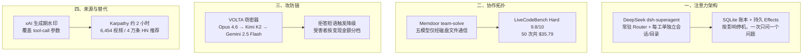

**【凡例】** 本卷以硅基智能体与基础模型的演化为纲，逐日编次。纪日以北京时间为准；前一日晚间到当日刊发、前卷未及收录的，入本卷，并注原始刊发日。数据出自厂商自测的标「自测」；只有媒体转述或匿名消息的，冠以「据报 / 据传」；口径不同的，两列其数，不强作折中。

**【总纲】** 10 月 31 日，几件事都在回答同一个问题：智能体到底该占多少人的注意力。DeepSeek 开源了一个常驻 Router 的原型，把「少打扰人」写进状态机。Memdoor 用五个 Qwen3.8-27B，只靠磁盘文件协作，在 LiveCodeBench Hard 上压过 Fable 5 单次调用。VOLTA 窃密器把受害者估值外包给三家模型，遇到拒答就换下一家。xAI 给 Grok API 默认加水印，连工具调用参数也盖。Karpathy 用 Opus 5.5，大约两小时做出一个 6,454 个视频的 HackerTube。协作、攻击、来源和人的替代，都被拆成了可以计价的接口。

---

## 一、DeepSeek 开源 dsh-superagent 原型：一个常驻 Router，每个工单自己的会话和目录

**【纪事】** DeepSeek Harness 团队在 10 月 31 日发了 Super-agent 的设计文章，同时开源研究原型 `deepseek-ai/dsh-superagent-prototype`。

仓库在 10 月 31 日 09:32 UTC 创建，MIT 许可，TypeScript。到当天 19 时，大约 5,005 星、476 fork。README 写得很清楚：这是研究原型，不是 DeepSeek 官方产品；为了公开发布做过改写，和内部版本、文章里讲的实现不完全一样，有些设计还没落地。

它面向一个 GitHub 仓库，以 DeepSeek Harness 的 bundle 形式交付。默认听 GitHub，也可以接飞书。被允许的人提需求，它开一个工单项，在自己的会话和目录里干活，再回原对话作答，比如交一个 pull request。Web 面板只列需要人处理的事。

核心是一本账。`Engine` 是 Triggers、Threads、Decisions、Tickets、Assignments 的唯一写者，每条命令在一个事务里完成。流程是 Trigger → Eval（带截止时间）→ Decision（accept / stop / ignore / unavailable）→ Ticket（Mandate、Subscriptions、第一个 Assignment）→ Assignment → Report。Executor 给每个 Ticket 单独开一个会话和目录。

状态放在一个 SQLite 里。Runtime 先拿目录锁再打开，防止两个进程同时迁移或写入。`Effects` 是持久副作用队列，每个 kind/key 一行，事务提交后才执行，失败按指数退避重试；`Later` 可以延后，但不计一次失败。Outbox 是消息回执的唯一写者，`send` 在同一个事务里存回执、入队回复。

并发上，`WorkerSlots` 预留容量。人的消息可以多占一个槽，超出 `maxWorkers` 也行；唤醒优先于新启动。准入分四类：`addressed`、`followup`、`admission`、`bot`。主动接活只在自动模式、且匹配到已启用规则时才允许，否则只记一条「would accept」。

项目自述的原则只有一句：尽量少占人的注意力，尽量多给价值。翻成具体规则是：只在被请求、或团队书面规则允许时行动；只在有人必须行动、或结果能用时说话；一次只问一个结构化问题；按影响决定停在哪；草稿标未完成，失败就说失败，不绕过限制来避免提问。

**【史官按】** 这份原型的重点不是多智能体，是把人的注意力当成一等资源来调度。什么时候叫人、什么时候只记一笔、什么时候必须问一个问题，都写进了状态机。Router 和 Worker 只是表面。撑着自主性的是 Ticket 和 Effects 那本事务账：每一步都能查，才不会用消息数量冒充工作量。

**【信源】**
- [deepseek-ai/dsh-superagent-prototype — GitHub（2026-10-31）](https://github.com/deepseek-ai/dsh-superagent-prototype)
- [007 Architecture — dsh-superagent 文档](https://github.com/deepseek-ai/dsh-superagent-prototype/blob/main/docs/007-architecture.md)
- [000 Philosophy — dsh-superagent 文档](https://github.com/deepseek-ai/dsh-superagent-prototype/blob/main/docs/000-philosophy.md)

---

## 二、五个 Qwen3.8-27B 只靠磁盘文件协作，在 LiveCodeBench Hard 前十题拿到 9.8/10

**【纪事】** Memdoor 在 10 月 31 日的 Hacker News 上发了 `team-solve` 工作流，复现 Lee（2026）的 GVS5H 方法。

角色是这样分的：Qwen3.8-27B 起规划、双构思、求解、管理五个模型角色，另设一个修复工。每个角色都从全新上下文开始，彼此只通过磁盘文件通信，提示词里明确要求「不要依赖聊天记录」。整个工作流由 8 个 YAML 描述，不含代码，也不指定模型。

流程不复杂。`plan` 读 `task.md` 写计划；`ideate-a` 和 `ideate-b` 并行，一个提「最直接可证明的算法」，另一个提「另一族的算法」；`solve` 读两份提案，写 `solution.py`；`test` 只跑测试，从不判失败；`review` 读测试输出，写修复指令；`repair` 改 `solution.py`；`verify` 用非零退出码定胜负。

LiveCodeBench Hard 前十题，跑 5 轮，隐藏测试全测。这个工作流均值 9.8/10，作者原来的 harness 在同一模型、同一提示词下是 9.6，Fable 5 单次调用是 8.0。五轮分别是 10、10、10、10、9。

50 次运行一共 35.79 美元。单次中位 40 分钟，约 0.39 美元。模型经 OpenRouter 调用，没有在本地跑。

唯一失分的那题，manager 编了一个错误反例，团队据此把原本正确的程序改坏了。另有两处正确程序被覆盖，后来恢复。这两个都是作者循环里原有的缺口，没有修。

作者把限定条件也写了：只测 10 题，不是作者的 100 题；9.8 和 9.6 在这个样本上没统计差异；赛题出自 2025 年春，不能排除训练污染；Fable 5 那一列取自作者文件，没有在这个 harness 里重跑；评测只看公开样例，评分用隐藏测试。

**【史官按】** 把协作通道从聊天改成磁盘，等于把「共识」降级成可以 diff 的工件。9.8 和 9.6 在十道题上没有统计意义，0.39 美元一次、40 分钟一轮有意义。它说明多智能体的瓶颈已经从单模型能力挪到协调开销：谁写文件、谁读文件、什么时候覆盖，这些才是新的算法。

**【信源】**
- [team-solve — Memdoor（2026-10-31）](https://github.com/guregodevo/memdoor/tree/main/examples/workflows/team-solve)
- [GVS5H — slee-persis（Lee, 2026）](https://github.com/slee-persis/GVS5H)

---

## 三、VOLTA 窃密器让三家模型给受害者估价，Claude 拒答就换 Kimi 和 Gemini

**【纪事】** Cisco Talos 在 10 月 31 日披露了一个会自删除的 Windows 窃密器，名字叫 VOLTA-AUTODOXER。它多出来的一层不在偷，在偷完之后的分析。

采集面很宽：浏览器密码、Cookie、支付卡、加密货币钱包助记词、Discord / Telegram / Steam / Roblox 会话、Microsoft OAuth 令牌、SSH 和云厂商密钥、机器上保存过的所有 Wi-Fi 明文密码，还有截图。它内置破解器，直接对钱包 vault 跑破解，结果写进 `WALLET VAULTS CRACKED`。

然后它给受害者建一份证据包：地理位置、家庭住址、雇主和雇主域名、推断出的出生年、卡号后四位、Slack 工作区、文档作者元数据、iPhone 备份迹象、Roblox 账户的实时估值。它还会用受害者自己的会话去 Gmail 搜 Amazon、DoorDash、Uber Eats、Grubhub、Walmart、PayPal 的收据，坐实住址；拉外卖订单历史；用 Discord token 补账户资料。

证据包转成 JSON，POST 到 OpenRouter。系统提示让模型扮演「forensic intelligence analyst drafting a target assessment」，输出要有「WHAT THEY'RE WORTH」，按低、中、高分资产，还要有「THEIR OPSEC」，评估受害者的安防习惯。默认模型是 `anthropic/claude-opus-4.6`。它检查回复里有没有「I can't」「I'm not able」这类拒答短语，有就依次换 `moonshotai/kimi-k2`、`google/gemini-2.5-flash`。温度固定 0.2，JSON 手工拼，不用 SDK，User-Agent 伪装成 Mozilla/5.0。

推理在受害者本机跑，走受害者自己的网络。结果写进 `AI_Analysis.txt`，和 `Identity_Report.txt` 一起打包成 `volta_dox.zip` 外传。如果没有 API key，就跳过模型这一步，照常运行。

投放方式不是把配置写死，而是留六个可替换槽位，构建时填。槽位里的凭据用二进制内两个常量的 SHA-256 加密，只能防一眼看穿，挡不住逆向。Talos 判断这是「构建器」商品：作者卖访问权，客户按单编译。所有观测到的端点都由第三方控制，没有攻击者自己的基础设施。

样本 SHA-256 是 `57ef4242666d78c50df145b34023df564f0fad38812d6a580e66433d427e2279`。PE 时间戳 2026-08-17，首次发现是 2026-10-11 12:46 UTC。

**【史官按】** 恶意软件第一次把「模型拒绝」当成可用性故障来设计。看到一句「I can't」，就切下一家。防线要面对的不再是某一家模型的护栏，而是整条跨厂商推理链上最弱的那一环。攻击者不用越狱，只要买三家。拒绝率也从安全指标，变成了路由指标。

**【信源】**
- [Appraisal by AI: Model-driven victim prioritization in the VOLTA infostealer — Cisco Talos（2026-10-31）](https://blog.talosintelligence.com/appraisal-by-ai-model-driven-victim-prioritization-in-the-volta-infostealer/)
- [Introducing CAIRN: frontier tracking for AI-integrated malware — Cisco Talos](https://blog.talosintelligence.com/introducing-cairn-frontier-tracking-for-ai-integrated-malware/)

---

## 四、xAI 从 11 月 7 日起给 Grok API 默认加水印，工具调用参数也盖

**【纪事】** xAI 的开发者文档在 10 月 31 日更新了《Output Watermarking》。从 2026 年 11 月 7 日起，受支持的 Grok 模型默认带文本水印。

范围包括七个模型：grok-4.7、4.6、4.5、4.3、4.20-reasoning、4.20-non-reasoning、4.20-multi-agent。所有 API 端点都算，全球端点 `https://api.x.ai` 和区域端点都在内。

覆盖的是 Responses API 和 Chat Completions API 生成的文本，包括普通回答、结构化输出，还有工具调用的参数。

水印不可见。它在生成时轻微改变模型选 Token 的倾向，不往响应里加字符、标记或隐藏文本。检测靠统计，返回「有水印」「没有」「不确定」三种结果，文本越长信号越强。响应头 `x-watermark: true` 表示这次输出带了水印。

检测 API 不公开，要申请，审批后才给。

退出是按团队、按模型设置的。管理员在控制台关掉，对团队全部 API key 生效，5 分钟内对新请求生效。退出时要确认适用法律例外，并自己承担标注和披露责任。有些模型对团队锁定为开启，关不了。每次开启和关闭都写进审计日志。

xAI 说加水印是为了遵守欧盟《AI 法案》。文档没有说检测需要多长的文本，也没有给误判率或统计检验方法。

**【史官按】** 水印从「事后标注」挪到「生成时采样」，还把工具调用参数算进来，等于承认机器对机器的输出也需要来源。检测却要申请。溯源于是成了一种准入能力，不是公共品。谁能验证，谁就有资格判定「这句话是不是模型说的」。

**【信源】**
- [Output Watermarking — xAI Developer Docs（2026-10-31 更新）](https://docs.x.ai/developers/advanced-api-usage/watermarking)

---

## 五、Karpathy 用 Opus 5.5 花大约两小时，做出 6,454 个视频的 HackerTube

**【纪事】** Andrej Karpathy 在 10 月 31 日发了《HackerTube》，记了一次几乎全自动的建站。

周五深夜，他打开 YouTube 想看点什么，看到的是夸张的封面、重复的推荐和一堆他不想看的内容。第二天上午，他把任务交给 Opus 5.5：只拿 Hacker News 评论区推荐过的视频，做一个 YouTube 克隆。

Opus 下载了 HN 的全部评论，先过滤，再让 Sonnet 在一个 workflow 里逐条处理，去掉垃圾和低质内容，最后收敛到大约 4 万条推荐 YouTube 视频的评论。一共得到 6,454 个视频，跨 2007 到 2026 年，分 150 个主题。

然后是界面、域名、VPS、安全加固和性能优化。站内用视频的 50% 缩略图，不用上传封面；推荐不需要账户，状态只存在本地会话；有键盘快捷键；还提供数据导出，用户可以交给自己的智能体复制一份。

Karpathy 说，这现在大约要 2 小时。他没给 Token 消耗、API 费用或人工介入的精确分钟数。据 AI Weekly 转述，他的手工工作只有 API 凭据、基础设施置备和域名注册。

**【史官按】** 两小时不是效率奇迹，是把产品拆成智能体能顺序执行的接口：下载、过滤、生成界面、部署、加固。人剩下凭据、域名和验收。最小的可行团队从「几个人周」缩到「一个人加一条流水线」。质量还是人的事：他先受不了推荐流，才有了这条流水线。

**【信源】**
- [HackerTube — Andrej Karpathy（2026-10-31）](https://karpathy.bearblog.dev/hacker-tube/)
- [HackerTube 讨论 — Hacker News](https://news.ycombinator.com/item?id=50319510)

---

## 附：当日核心度量表（2026-10-31）

| 观测维度 | 对照基线 / 早期状态 | 当日披露实测值 | 变化幅度 / 备注 | 核心信源 |
|---|---|---|---|---|
| 编码智能体架构 | 单会话、单任务 | 常驻 Router + 每 Ticket 独立会话与目录 | 单日 **5,005 星 / 476 fork**；MIT | DeepSeek GitHub |
| 多模型协作（LiveCodeBench Hard 前十题） | Fable 5 单呼 8.0；作者 harness 9.6 | **9.8 / 10**（10 题 × 5 轮） | +1.8 / +0.2；样本小，无统计差异 | Memdoor |
| 单次解题成本 | — | 中位 **40 分钟**、约 **0.39 美元** | 50 次合计 **35.79 美元** | Memdoor |
| 恶意软件模型链 | 单模型 + 人工分诊 | Opus 4.6 → Kimi K2 → Gemini 2.5 Flash | 温度 0.2；拒答短语触发降级 | Cisco Talos |
| Grok API 水印覆盖 | 无默认水印 | 7 个模型默认；含 **tool-call 参数** | 11 月 7 日生效；生成期改采样 | xAI Docs |
| 水印检测准入 | 无公开检测 | 须申请审批；返回三态判定 | 文本越长信号越强 | xAI Docs |
| 人机建站 | 数人周 | 约 **2 小时**；**6,454** 视频 / **4 万**评论 / **150** 主题 | 单人 + Opus 5.5 + Sonnet 过滤 | Karpathy |
| VOLTA 样本 | — | SHA-256 `57ef42…`；首次发现 10-11 | PE 时间戳 2026-08-17 | Cisco Talos |
