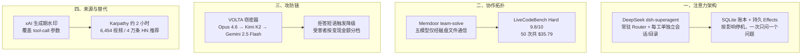

**【凡例】** 本卷以硅基智能体（AI Agents）与基础模型之演化为纲，逐日编次。凡纪事，先列一手源实测数值，后陈系统机制；凡数据出自厂商自测者，标以「自测」；凡一手源未公开、出自媒体转述或匿名消息者，显式冠以「据报 / 据传」；凡不同统计口径并存者，两列其数而不强作折中。

**【总纲】** 是日硅基演化之主线，在于「注意力与拒绝被工程化」：DeepSeek 开源常驻 Router 的 Super-agent 原型，把「少占用人的注意力」写成状态机；Memdoor 以五个 Qwen3.8-27B 纯文件协作，在 LiveCodeBench Hard 上压过 Fable 5 单次调用；VOLTA 窃密器把受害者估值外包给三模型链，遇拒答即降级；xAI 宣布自 11 月 7 日起为 Grok API 文本默认加水印，并覆盖 tool-call 参数；Karpathy 以 Opus 5.5 在约两小时建成 6,454 个视频的 HackerTube。协作、攻防、来源与人的替代，同日被拆成可计价的接口。

---

## 一、DeepSeek 开源 dsh-superagent 原型：常驻 Router 分派、每工单独立会话与目录、SQLite 持久 Effects，单日逾 5,000 星

**【纪事】** DeepSeek Harness 团队于 10 月 31 日发布 Super-agent 设计文章并开源研究原型 `deepseek-ai/dsh-superagent-prototype`：

- **仓库状态**：GitHub 创建于 **2026-10-31 09:32 UTC**，MIT 许可，TypeScript；截至 19 时约 **5,005 星、476 fork**。README 明示其为「仅供参照的研究原型，非 DeepSeek 官方产品」，且为公开发布做过改写，与内部版本及文章所述实现并不完全一致，部分设计尚未落地。
- **运行形态**：面向**单一 GitHub 仓库**的主动式编码智能体，以 DeepSeek Harness 的 bundle 形式交付；监听 GitHub，可选监听飞书。被允许的人提出请求后，它开启一个工单项，在**自己的智能体会话与目录**中工作，再回到原对话作答，例如提交 pull request；Web 面板只显示需要人处理的事项。
- **核心账本**：`Engine` 是 Triggers、Threads、Decisions、Tickets、Assignments 的唯一写者，每条命令在一个事务内完成；流程为 Trigger → Eval（带截止时间）→ Decision（accept / stop / ignore / unavailable）→ Ticket（Mandate、Subscriptions、首个 Assignment）→ Assignment → Report。Executor 为每个 Ticket 提供独立会话与目录。
- **持久化与副作用**：状态存于单一 SQLite，Runtime 先取目录锁再打开，防止双进程迁移或写入；`Effects` 为持久副作用队列，每 kind/key 一行，提交后才执行，失败按指数退避重试，`Later` 可延后而不计失败。Outbox 是消息回执的唯一写者，`send` 在同一事务内保存回执并入队回复。
- **并发与准入**：`WorkerSlots` 预留容量，人的消息可占用超出 `maxWorkers` 的一个槽位，唤醒优先于新启动；准入依据分为 `addressed`、`followup`、`admission`、`bot` 四类，主动接活仅在自动模式且匹配已启用规则时允许，否则只记录「would accept」。
- **设计哲学**：项目自述的唯一原则是「**take as little human attention as possible, and give as much value as possible**」——只在被请求或团队书面规则允许时行动；只在有人必须行动、或结果可用时发声；一次只问一个结构化问题；按影响而非投入决定停点；草稿标未完成，失败报失败，绝不绕过限制以避免提问。

**【史官按】** 这份原型的核心不是多智能体，而是把「人的注意力」当作一等资源来调度：何时唤醒人、何时只记录、何时必须问一个问题，都被写成状态机。Router 与 Worker 只是表象，真正的架构是 Ticket 与 Effects 那本事务账——它让自主性以可审计的单位增长，而不是以消息数量增长。

**【信源】**
- [deepseek-ai/dsh-superagent-prototype — GitHub（2026-10-31）](https://github.com/deepseek-ai/dsh-superagent-prototype)
- [007 Architecture — dsh-superagent 文档](https://github.com/deepseek-ai/dsh-superagent-prototype/blob/main/docs/007-architecture.md)
- [000 Philosophy — dsh-superagent 文档](https://github.com/deepseek-ai/dsh-superagent-prototype/blob/main/docs/000-philosophy.md)

---

## 二、五个 Qwen3.8-27B 以纯文件协作在 LiveCodeBench Hard 前十题取得 9.8/10，单次中位 40 分钟、50 次共 35.79 美元

**【纪事】** Memdoor 于 10 月 31 日在 Hacker News 发布 `team-solve` 工作流，复现 Lee（2026）的 GVS5H 方法：

- **结构**：以 Qwen3.8-27B 起规划、双构思、求解、管理五个模型角色，另设修复工；全部从**全新上下文**启动，彼此**只通过磁盘文件**通信，提示词明确要求「不要依赖聊天记录」。工作流由 **8 个 YAML** 描述，不含代码，也不指定模型。
- **流程**：`plan` 读 `task.md` 写计划；`ideate-a` 与 `ideate-b` 并行，各提一个「最直接可证明的算法」与「另一族算法」；`solve` 读两份提案写 `solution.py`；`test` 只跑测试、从不判失败；`review` 读测试输出写修复指令；`repair` 修 `solution.py`；`verify` 以非零退出码定胜负。
- **结果（LiveCodeBench Hard 前十题、5 轮、隐藏测试全测）**：本工作流均值 **9.8/10**；作者原 harness 在同一模型、同一提示词下为 **9.6**；Fable 5 单次调用为 **8.0**。五次分别为 10、10、10、10、9。
- **成本与时间**：50 次运行合计 **35.79 美元**，单次中位 **40 分钟**、约 **0.39 美元**；模型经 OpenRouter 调用，未在本地运行。
- **失分与回退**：唯一失分题中，manager 编造了错误反例，团队据此改写了原本正确的程序；另有两处正确程序被覆盖后恢复，二者均属作者循环的既有缺口，未作修正。
- **作者限定**：只测 10 题而非作者的 100 题，9.8 与 9.6 在该样本上无统计差异；赛题出自 2025 年春，无法排除训练污染；Fable 5 一列取自作者文件，未在本 harness 中重跑；评测只看到公开样例，评分用隐藏测试。

**【史官按】** 把协作通道从聊天改成磁盘，等于把「共识」降级为「可 diff 的工件」。9.8 与 9.6 在十题样本上没有统计意义，但 0.39 美元一次、40 分钟一轮有：它证明多智能体的瓶颈已从单模型能力转向协调协议的开销——谁写文件、谁读文件、何时覆盖，才是新的算法。

**【信源】**
- [team-solve — Memdoor（2026-10-31）](https://github.com/guregodevo/memdoor/tree/main/examples/workflows/team-solve)
- [GVS5H — slee-persis（Lee, 2026）](https://github.com/slee-persis/GVS5H)

---

## 三、VOLTA 窃密器把受害者估值外包给三模型链：Claude Opus 4.6 拒答即降级至 Kimi K2 与 Gemini 2.5 Flash，按变现金额分低中高三档

**【纪事】** Cisco Talos 于 10 月 31 日披露自删除 Windows 窃密器 **VOLTA-AUTODOXER**，其新增层不在窃取，而在窃后分析：

- **采集面**：浏览器密码、Cookie、支付卡、加密货币钱包助记词、Discord / Telegram / Steam / Roblox 会话、Microsoft OAuth 令牌、SSH 与云厂商密钥、全部已保存 Wi-Fi 明文密码、截图；内置破解器直接对钱包 vault 跑破解，并把结果写入 `WALLET VAULTS CRACKED`。
- **证据包**：地理位置与家庭住址、雇主与雇主域名、推断出生年、卡号后四位、Slack 工作区、文档作者元数据、iPhone 备份迹象、Roblox 账户实时估值；再用受害者自己的会话去 Gmail 搜 Amazon、DoorDash、Uber Eats、Grubhub、Walmart、PayPal 收据以坐实住址，拉取外卖订单历史，并用 Discord token 富化账户资料。
- **模型链**：证据包序列化为 JSON，POST 至 **OpenRouter**，系统提示要求模型扮演「forensic intelligence analyst drafting a target assessment」，输出含「WHAT THEY'RE WORTH」的资产分级（低 / 中 / 高）与「THEIR OPSEC」的安防姿态评估。默认模型 **anthropic/claude-opus-4.6**；检测到「I can't」「I'm not able」等拒答短语后，依次降级至 **moonshotai/kimi-k2**、**google/gemini-2.5-flash**。温度固定 **0.2**，手工拼 JSON、不带 SDK，User-Agent 伪装为 Mozilla/5.0。
- **回传**：推理在受害者本机、经由受害者自己的网络完成，结果写入 `AI_Analysis.txt`，与 `Identity_Report.txt` 一并打包为 `volta_dox.zip` 外传；若无 API key，则跳过 LLM 阶段照常运行。
- **投放模式**：非硬编码配置，而以六个可替换槽位的模板在构建时填入，槽位凭据以二进制内两个常量的 SHA-256 加密（仅防明文窥视）；Talos 判断其为「构建器」商品，作者出售访问权、客户按单编译。所有观测端点均由第三方控制，无攻击者自有基础设施。
- **样本**：SHA-256 `57ef4242666d78c50df145b34023df564f0fad38812d6a580e66433d427e2279`；PE 时间戳 2026-08-17，首次发现 2026-10-11 12:46 UTC。

**【史官按】** 恶意软件第一次把「模型拒绝」当成可用性故障来工程设计：检测到一句「I can't」就切到下一个厂商。防线的对象因此不再是单一模型的护栏，而是整条跨厂商推理链的最弱环。攻击者不需要越狱，只需要采购三家；拒绝率也从安全指标，退化成了路由指标。

**【信源】**
- [Appraisal by AI: Model-driven victim prioritization in the VOLTA infostealer — Cisco Talos（2026-10-31）](https://blog.talosintelligence.com/appraisal-by-ai-model-driven-victim-prioritization-in-the-volta-infostealer/)
- [Introducing CAIRN: frontier tracking for AI-integrated malware — Cisco Talos](https://blog.talosintelligence.com/introducing-cairn-frontier-tracking-for-ai-integrated-malware/)

---

## 四、xAI 自 11 月 7 日起为 Grok API 文本默认加水印：生成期改写 Token 采样，覆盖 tool-call 参数，检测须申请

**【纪事】** xAI 开发者文档站于 10 月 31 日更新《Output Watermarking》，宣布对受支持 Grok 模型的文本输出默认加水印：

- **生效范围**：自 **2026 年 11 月 7 日**起，**grok-4.7、4.6、4.5、4.3、4.20-reasoning、4.20-non-reasoning、4.20-multi-agent** 七个模型的响应默认带水印；覆盖所有 API 端点，包括全球端点 `https://api.x.ai` 与各区域端点。
- **覆盖内容**：Responses API 与 Chat Completions API 的生成文本，含普通文本、结构化输出，以及**工具调用（tool call）的参数**。
- **机制**：水印不可见，在生成时**轻微改变模型选取的 Token**，不向响应添加字符、标记或隐藏文本；检测为统计判定，返回「有水印 / 无水印 / 不确定」，文本越长信号越强。响应头 `x-watermark: true` 表示该次输出带水印。
- **检测准入**：水印检测 API **须申请**，通过表单审批授予，未公开为公共服务。
- **退出机制**：团队管理员可在控制台按模型关闭；设置对团队全部 API key 生效，变更 5 分钟内对新请求生效；退出须确认适用法律例外，并由用户自行承担标注与披露责任；部分模型对团队锁定为开启；所有开启与关闭写入团队审计日志。
- **合规口径**：xAI 称加水印是为遵守欧盟《AI 法案》；文档未披露检测所需的文本长度、误判率或统计检验方法。

**【史官按】** 水印从「事后标注」下沉到「生成时采样」，并把工具调用参数纳入范围，等于承认机器对机器的输出也需要来源。可检测性由申请制控制，则让溯源成为一项准入能力而非公共品——这既是合规，也是新的权力接口：谁能验证，谁就掌握判定「这是模型说的」的资格。

**【信源】**
- [Output Watermarking — xAI Developer Docs（2026-10-31 更新）](https://docs.x.ai/developers/advanced-api-usage/watermarking)

---

## 五、Karpathy 用 Opus 5.5 在约两小时建成 HackerTube：从 2007–2026 年 HN 评论筛出 4 万条推荐、6,454 个视频、150 个主题

**【纪事】** Andrej Karpathy 于 10 月 31 日发布《HackerTube》，记录一次近乎全自动的建站过程：

- **起点**：周五深夜，他因不满 YouTube 推荐流的内容质量，次日（周六）上午把任务交给 **Opus 5.5**：以 Hacker News 评论区推荐过的视频为唯一片源，做一个 YouTube 克隆。
- **流水线**：Opus 下载 HN 全部评论并过滤，再以 **Sonnet** 在 workflow 中逐条处理，去除垃圾与低质内容，收敛到约 **4 万条**推荐 YouTube 视频的评论；最终得到 **6,454 个视频**，横跨 **2007–2026 年**、**150 个主题**。
- **交付**：生成 YouTube 风格界面，注册域名、推送至 VPS，并完成安全加固与性能优化；站内使用视频 **50% 缩略图**而非上传封面，提供无需账户、仅存本地会话的个性化推荐、键盘快捷键，以及可供用户交给自有智能体复制建站的数据导出。
- **耗时**：Karpathy 称「这现在大约要 **2 小时**」；文中未给出 Token 消耗、API 费用或人工介入的精确分钟数。据 AI Weekly 转述，其手工工作仅限于 API 凭据、基础设施置备与域名注册。

**【史官按】** 「两小时」不是效率奇迹，而是把产品拆成可被智能体顺序执行的接口：下载、过滤、生成 UI、部署、加固。人剩下的是凭据、域名与验收。真正的变化是，软件的最小可行团队从「几个人周」缩到「一个人加一条流水线」；而质量仍由人的品味决定——他先厌倦了推荐流，才有了这条流水线。

**【信源】**
- [HackerTube — Andrej Karpathy（2026-10-31）](https://karpathy.bearblog.dev/hacker-tube/)
- [HackerTube 讨论 — Hacker News](https://news.ycombinator.com/item?id=50319510)

---

## 附：当日核心度量表（2026-10-31）

| 观测维度 | 对照基线 / 早期状态 | 当日披露实测值 | 变化幅度 / 备注 | 核心信源 |
|---|---|---|---|---|
| 编码智能体架构 | 单会话、单任务 | 常驻 Router + 每 Ticket 独立会话与目录 | 单日 **5,005 星 / 476 fork**；MIT | DeepSeek GitHub |
| 多模型协作（LiveCodeBench Hard 前十题） | Fable 5 单呼 8.0；作者 harness 9.6 | **9.8 / 10**（10 题 × 5 轮） | +1.8 / +0.2；样本小，无统计差异 | Memdoor |
| 单次解题成本 | — | 中位 **40 分钟**、约 **0.39 美元** | 50 次合计 **35.79 美元** | Memdoor |
| 恶意软件模型链 | 单模型 + 人工分诊 | Opus 4.6 → Kimi K2 → Gemini 2.5 Flash | 温度 0.2；拒答短语触发降级 | Cisco Talos |
| Grok API 水印覆盖 | 无默认水印 | 7 个模型默认；含 **tool-call 参数** | 11 月 7 日生效；生成期改采样 | xAI Docs |
| 水印检测准入 | 无公开检测 | 须申请审批；返回三态判定 | 文本越长信号越强 | xAI Docs |
| 人机建站 | 数人周 | 约 **2 小时**；**6,454** 视频 / **4 万**评论 / **150** 主题 | 单人 + Opus 5.5 + Sonnet 过滤 | Karpathy |
| VOLTA 样本 | — | SHA-256 `57ef42…`；首次发现 10-11 | PE 时间戳 2026-08-17 | Cisco Talos |
