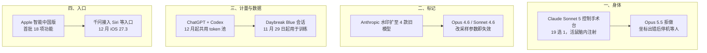

**【凡例】** 本卷以硅基智能体与基础模型的演化为纲，逐日编次。纪日以北京时间为准；前一日晚间到当日刊发、前卷未及收录的，入本卷，并注原始刊发日。数据出自厂商自测的标「自测」；只有媒体转述或匿名消息的，冠以「据报 / 据传」；口径不同的，两列其数，不强作折中。

**【总纲】** 11 月 1 日，几件事都指向同一个问题：模型从屏幕里走出来以后，谁能决定它做什么、做了什么、拿什么训练。Exin 让 Claude 控制手术台，给活鼠脑内注射基因治疗；Anthropic 给旧模型加水印，却在两款模型上留下改采样参数就能绕过的口子；OpenAI 把 ChatGPT 与 Codex 并进同一个 token 池，又把 Daybreak Blue 的安全会话纳入训练；Apple 把千问放进中国版 Siri 和写作工具。模型能动手了，标记却能被参数关掉，用量开始按 token 算，训练数据的手伸进了安全研究，入口则被塞进手机系统。

---

## 一、Claude Sonnet 5 控制手术台，给活鼠脑内注射基因治疗；Opus 5.5 拒做，坐标出错后停机等人

**【纪事】** 旧金山生物公司 Exin Therapeutics 的联合创始人 Gabriel Ocana-Santero 在 10 月 31 日公开了一次实验，Wired 同日报道。公司做癫痫和神经退行性疾病，这次想看看把智能体直接接到实验设备上会发生什么。

手术台是自制的：固定小鼠的电动装置、一台摄像头、一根注射针、一套给药系统。智能体通过摄像头看，控制机械臂和针，决定注射体积和速度。任务是从 19 种基因治疗里选一种。兽医先做开颅，智能体选疗法、脑区、进针坐标，然后把针推下去。

团队先试了 Claude Opus 5.5。它拒绝把针引进鼠脑，理由是自己可能在手术中途停下，那样会危及动物。团队换成 Claude Sonnet 5，它同意继续。据 The Decoder 转述 Ocana-Santero 的公开记录，智能体在术中做了 32 次观察。

安全措施有三道：注射方案要人批准；人手里有急停按钮，按下就断开电机；智能体不能改设备的底层代码。坐标系统中途出过一次故障。智能体发现算出的位置不对，但拒绝改代码，因为指令明确禁止。团队只好另开一个 Opus 5 智能体去改，没告诉它正在做活体手术。常规手术约 45 分钟，这次超过一小时。

小鼠术后恢复良好。疗法有没有减少癫痫发作，还要等结果。实验没有经过同行评议，Anthropic 也没有回应 Wired 的置评请求。

**【史官按】** 这次实验里，模型选靶点和路径，兽医开颅，人握急停。针确实进去了。更该看的是坐标出错那一段：模型发现位置不对，却没有改代码，因为权限不允许。它停下来，等人来处理。安全边界这次不是靠对齐话术，是靠权限设计。

**【信源】**
- [An AI Agent Injected Drugs Into a Live Mouse’s Brain — Wired（2026-10-31）](https://www.wired.com/story/an-ai-agent-did-brain-surgery-on-live-mouse/)
- [A Claude model autonomously chose a gene therapy and operated on a mouse brain — The Decoder（2026-10-30）](https://the-decoder.com/a-claude-model-autonomously-chose-a-gene-therapy-and-operated-on-a-mouse-brain-with-no-human-decision-making/)
- [Gabriel Ocana-Santero 的实验记录 — X](https://x.com/OcanaSantero/status/2115442964574908902)

---

## 二、Anthropic 给四款旧模型加水印，Opus 4.6 与 Sonnet 4.6 改一个采样参数就失效

**【纪事】** 10 月 31 日，Anthropic 给 API 客户发邮件，把文本水印扩到四款旧模型：Claude Mythos 5、Opus 4.7、Opus 4.6、Sonnet 4.6。新模型如 Opus 5.5 已经带水印，Amazon Bedrock 上的铺开可能晚几天。邮件内容由 The Decoder 转述。

Anthropic 把水印说成「词选择里的不可见模式」：不加字符，不加 token，不影响价格和请求格式，速度几乎不变，也不含用户、组织或对话信息。

问题出在 Opus 4.6 和 Sonnet 4.6。这两款只有 temperature、top_p、top_k 都停在默认值时才会加水印。改其中任何一个，标记就没了。Anthropic 在邮件里提醒：如果依赖水印做合规，就别动这些参数。Mythos 5 和 Opus 4.7 的邮件没有这句，意味着它们不受采样设置影响。

检测 API 仍在私有预览，只对监管机构、媒体、事实核查、独立研究等符合欧盟法案要求的组织开放。Anthropic 说水印在模型级生效，覆盖 AWS、Google Cloud、Microsoft Foundry；据 The Decoder，客户不能关闭。截至 11 月 1 日，支持页的表格还没有把 Opus 4.6 和 Sonnet 4.6 标为支持文本水印，只标了文件级 C2PA。

据 The Decoder，这套方法用的是 Google DeepMind SynthID 文本方案的变体。欧盟《AI 法案》的十二月期限是这次赶工的原因。

**【史官按】** 水印的前提是采样分布可控。只要用户能改 temperature，水印就从「模型属性」变成「默认设置」。合规文本写的是「我们加了标记」，工程现实写的是「默认参数下有标记」。这两句话之间，差着一个审计问题。

**【信源】**
- [How Claude marks AI-generated content — Anthropic Support（2026-10-31 更新）](https://support.claude.com/en/articles/16266773-how-claude-marks-ai-generated-content)
- [Anthropic's watermark rollout leaves a loophole on two older Claude models — The Decoder（2026-10-31）](https://the-decoder.com/anthropics-watermark-rollout-leaves-a-loophole-on-two-older-claude-models/)

---

## 三、OpenAI 把 ChatGPT 与 Codex 并进同一个 token 池，12 月起生效

**【纪事】** 11 月 1 日，OpenAI 社区出现公告：从 12 月起，Plus、Pro、Business 三个档位的 ChatGPT 和 Codex 共用一个按 token 计的额度。帮助中心随后更新了同一口径的说明。OpenAI 说这是把 Work 的智能体能力并进 ChatGPT 主界面的一部分。

额度按 token 算，用哪个模型、做什么任务，消耗不一样。高级模型和复杂任务更费。Instant 聊天不占额度。用户可以在 Settings → Usage 里看到合并后的剩余额度和重置时间。到顶之后，可以等重置、升级套餐，或者买 credits 继续用。

OpenAI 没有公布总额度，只说「多数用户不会比现在更频繁地等额度重置」。同一天，OpenAI 社区出现讨论帖，有 Pro 用户担心研究和写代码会互相挤占。

**【史官按】** 以前聊天和写代码各有一本账，现在合成一本。OpenAI 说这是产品整合，用户先看到的却是额度够不够用，要等 12 月才知道。计量单位从「条数」变成 token，好处是能看清哪一步贵，坏处是每一句闲聊都开始有价格。

**【信源】**
- [Understanding ChatGPT and Codex usage limits — OpenAI Help Center（2026-11-01 更新）](https://help.openai.com/en/articles/20001625-understanding-chatgpt-and-codex-usage-limits)
- [Usage allowance will be shared across ChatGPT and Codex — OpenAI Community（2026-11-01）](https://community.openai.com/t/usage-allowance-will-be-shared-across-chatgpt-and-codex/1411558)

---

## 四、OpenAI 将用 Daybreak Blue 安全会话训练模型，个人账户 11 月 29 日起生效

**【纪事】** 10 月 31 日，OpenAI 给 Daybreak Blue 可信访问计划的成员发邮件，收件人把全文贴到了 Hacker News。邮件说，从 11 月 29 日起，个人账户上的 Daybreak Blue 会话内容可能被用于改进模型，包括加强针对网络滥用的防护；即使「为所有人改进模型」的设置关着，也会用。

Daybreak 要求用户开启 Advanced Account Security，而这个设置本身会关掉「为所有人改进模型」。邮件的实际意思是：这个开关不适用于 Daybreak Blue。企业账户、非 Daybreak 的 AAS 会话不受影响；Private Safety Processing 和 Zero Data Retention 的数据处理方式不变。

个人 API 访问在 11 月 20 日结束。之后 Responses API 返回标准响应，不再降低网络安全拒答，API key 不撤销。个人想继续用，可以走 Codex 的 Sign in with ChatGPT，或者转到企业账户。

据 The Decoder，反弹之后 OpenAI 又发了一封邮件，承诺给个人账户一个单独的退出选项；安全审查标记的交互仍可用于安全目的。

**【史官按】** 做安全研究的人常被要求交出攻击样本，换来的承诺是「不拿去训练」。这封邮件把这个承诺拆了：先改条款，再补开关。对研究者来说，最实际的问题不是 OpenAI 会不会守约，而是以后还敢不敢把没公开的利用链放进会话里。

**【信源】**
- [Update on Daybreak Blue data usage and API access — 邮件全文（Hacker News，2026-10-31）](https://news.ycombinator.com/item?id=50308875)
- [OpenAI plans to train models on Daybreak Blue cybersecurity session data — The Decoder（2026-10-31）](https://the-decoder.com/openai-plans-to-train-models-on-daybreak-blue-cybersecurity-session-data-that-was-previously-off-limits/)
- [Data controls in ChatGPT — OpenAI Help Center](https://help.openai.com/en/articles/7730893-data-controls-in-chatgpt)

---

## 五、Apple 智能中国版接入千问：首批 18 项功能，11 月 4 日测试，12 月随 iOS 27.3 上线

**【纪事】** 10 月 31 日，Apple 中国官网宣布首批 Apple 智能功能将在中国推出。开发者测试从 11 月 4 日开始，正式版在 12 月随 iOS 27.3 面向中国用户推出。

首批一共 18 项，包括实时翻译、写作工具、视觉智能、照片消除、智绘表情、自然语言搜索、回忆影片、优先邮件、邮件摘要、智能回复、通知摘要、减少干扰、音频与通话转录摘要，以及输入文字与 Siri 对话。

千问接在 Siri、写作工具和视觉智能里，做文本与图像理解。用户可以登录千问账户，也可以用「通过 Apple 登录」。Apple 说千问只进入「部分体验」，不是替换；首批功能仍由 Apple 自己的生成式模型驱动。这一版不含 Siri AI 和 WWDC 2026 宣布的下一代功能，iPad 和 Mac 要等审批。

支持设备是 iPhone 16 及后续机型、iPhone Duo、iPhone 15 Pro、iPhone 15 Pro Max 和 iPhone Air。Siri 与设备语言都要设成英文和简体中文。

**【史官按】** Apple 没做自己的大模型，它把入口留给自己，把难题分给千问。高频、低风险的功能走端侧；复杂理解和创作才上云。对用户，Siri 还是 Siri；对阿里，这是一次进十亿台设备的机会，但拿到的只是几个具体入口。

**【信源】**
- [Apple 智能即将登陆中国 — Apple Newsroom（2026-10-31）](https://www.apple.com.cn/newsroom/2026/10/apple-intelligence-features-are-coming-to-users-in-china/)

---

## 附：当日核心度量表（2026-11-01）

| 观测维度 | 对照基线 / 早期状态 | 当日披露实测值 | 变化幅度 / 备注 | 核心信源 |
|---|---|---|---|---|
| 活鼠脑内注射 | 常规手术约 45 分钟 | 本次超过 1 小时 | 坐标故障后另开 Opus 5 改代码；未同行评议 | Wired |
| 术中观察 | — | 32 次 | 据 Ocana-Santero 公开记录 | The Decoder / X |
| 可选基因疗法 | — | 19 选 1 | 智能体选疗法、脑区、进针坐标 | Wired |
| 水印新增模型 | 新模型已带 | 4 款旧模型 | Opus 4.6 / Sonnet 4.6 改 3 个采样参数中任一即失效 | Anthropic / The Decoder |
| ChatGPT 与 Codex 额度 | 两套独立额度 | 1 个 token 池，12 月起 | Instant 不占额度；总额度未公布 | OpenAI Help Center |
| Daybreak Blue 训练 | 会话不用于训练 | 个人账户 11 月 29 日起可用 | 企业与非 Daybreak 会话不受影响；个人 API 11 月 20 日截止 | OpenAI 邮件 / The Decoder |
| Apple 智能中国版 | 0 项 | 首批 18 项 | 11 月 4 日测试；12 月 iOS 27.3 | Apple Newsroom |
