**【凡例】** 本卷以硅基智能体与基础模型的演化为纲，逐日编次。纪日以北京时间为准；前一日晚间到当日刊发、前卷未及收录的，入本卷，并注原始刊发日。数据出自厂商自测的标「自测」；只有媒体转述或匿名消息的，冠以「据报 / 据传」；口径不同的，两列其数，不强作折中。

**【总纲】** 11 月 3 日，智能体开始反向改写承载自己的四层底座。权重层，MIT CSAIL 让 GPT-6 Astra 不经梯度下降，直接读写 Qwen3.5-0.8B 的 0.016% 权重，把 MATH-500 从 7.9% 提到 48.1%；运行时层，CoworkOS 用 Main / Coordinator / Subagent 三层分工，让同一个 harness 连续五轮给 Qwen3.6-35B-A3B 做后训练，八项基准均值从 33.19 升到 42.95；组织接口层，DeepSeek 开源 dsh-superagent，把「同事的注意力」写进架构，按 GitHub / 飞书请求开 Ticket、各给独立会话与目录；基础设施层，OpenAI 因 Codex 提交激增重写 Git 后端 Pando，以按分支因果一致替代仓库级排序，中位推送延迟降近 80%；度量层，OpenAI 发布 LifeVal，把「日常事务」变成基准，自测图表显示 GPT-6 Astra 达 80.6%，GPT-5.2 为 49.3%。五件事指向同一件事：智能体不再只是被基础设施服务的负载，它开始决定基础设施该长什么样。

```mermaid
flowchart TB
    subgraph W["一、权重层"]
        W1["Weight-Space Programming<br/>GPT-6 Astra 直接读写权重"] --> W2["Qwen3.5-0.8B：改 0.016% 权重<br/>MATH-500 7.9% → 48.1%"]
    end
    subgraph H["二、运行时层"]
        H1["CoworkOS<br/>Main / Coordinator / Subagent"] --> H2["RSI 后训练 5 轮<br/>八基准均值 33.19 → 42.95"]
    end
    subgraph O["三、组织接口层"]
        O1["DeepSeek dsh-superagent<br/>监听 GitHub / 飞书"] --> O2["每 Ticket 独立会话与目录<br/>只在该说话时说话"]
    end
    subgraph I["四、基础设施层"]
        I1["Codex 提交激增<br/>据报 +1,378%"] --> I2["Pando：按分支因果一致<br/>推送延迟约 -80%，日流量近 1 PB"]
    end
    subgraph M["五、度量层"]
        M1["LifeVal：3,995 人问卷<br/>+ 时间使用调查"] --> M2["GPT-6 Astra 80.6%<br/>GPT-5.2 49.3%（厂商图表）"]
    end
```

---

## 一、MIT CSAIL《Weight-Space Programming》：GPT-6 Astra 不经梯度下降，直接读写模型权重

**【纪事】** 11 月 2 日，MIT CSAIL 的 Rikiya Takehi、Jayden Teoh、Alex Zhang 与 Omar Khattab 发布技术报告《Sparks of Weight-Space Programming: LLMs can natively read & write neural network weights》。核心主张：通用前沿模型可以把神经网络权重当作文本直接阅读与改写，不经过优化器，也不使用梯度下降；在部分实验中甚至不允许环境反馈。

阅读实验分三级。其一，四个结构完全相同、仅权重不同的 PPO 网络（MLP 500→32→32→5，17,253 个权重）分别玩 Breakout、Pong、Pac-Man、Freeway；不给候选游戏名单，Astra 四次全部答对。其二，三个 DDPM（23,824 个权重）分别生成圆、方、三角，Astra 仅凭权重说出生成形状。其三，三个 716 万参数、4 层 × 6 头的字符级 Transformer 分别在 Python、罗马字日语、英语上训练；去掉输入输出层，只给中间四层，Astra 仍三次全部答对语言，并精确点名每个模型的复制头（induction head）：Python 为 2.1、3.1、3.5，罗马字为 3.3，英语为 3.1，与实测完全一致。

改写实验更激进。Kinetix 倒车跳台任务中，PPO 收敛到「直冲斜坡」的局部最优，256 局全败；Astra 读权重、场景与一局录像后，一次回复改写 **3.5%** 的权重，1,024 局全部成功。MinAtar 三款游戏（600→32→32→6）从全零权重一次性写出：Breakout 得 **517.4**，PPO 100M 步为 15.8、500M 步为 25.3；Seaquest 53.1，低于 PPO 500M 的 88.9；Asterix 53.2，接近 PPO 500M 的 55.2。9×9 围棋（243→512×6→82，1,480,274 个权重）在允许 0 次前向传播时，已能赢两个较小 PPO 网络过半对局；给 50 次前向传播后，击败训练了 2,000 万局的同尺寸 PPO。

最接近实用的一幕在 Qwen3.5-0.8B。该模型在 temperature 0.6、top-p 0.95、top-k 20、presence penalty 1.5 下易陷入「思考循环」，前 96 个练习答案有 85 个跑满 32,768 token。Astra 把循环定位到第 15、19 层 MLP 写出的一个方向，从两层各 64 个输出列中减去该方向，共改 **131,072 / 8 亿权重（0.016%）**；用 50 次前向传播、无训练、无梯度，MATH-500 从 **7.9% 升至 48.1%**，GSM8K 从 **13.8% 升至 67.1%**，IFEval 从 **21.0% 升至 62.3%**，MATH-500 跑满 token 的比例从 **93.0% 降至 33.1%**。

边界同样清楚。Gemma 3 270M 很少循环（8.5% 触顶），Astra 读出的失败是普通算术与代数错误，没有单一「开关」可拆；50 次前向传播内，MATH-500 仅从 6.8% 动到 7.7%，最好一次也不足 1 个点。作者的判词是：权重编辑可以移除遮住能力的障碍，不能凭空增加模型没有的能力。该报告为博客形态的技术发布，未经同行评议；全部实验日志、被编辑模型与在线演示已公开。

**【史官按】** 优化器曾是深度学习最后的黑箱：人定义损失，Adam 或 Muon 去走那一步。如今一个通用模型可以把权重当代码读、当参数改，训练不再是唯一的写作者。但 Gemma 实验划出了边界——它能拆掉挡路的东西，不能造出本来没有的能力。真正需要盯住的不是 40 个点的涨幅，而是审计与遗忘：既然能从权重里读出「哪个模型在谄媚」，也就能在不跑基准的情况下改掉它。

**【信源】**
- [Sparks of Weight-Space Programming — MIT CSAIL（2026-11-02）](https://rikiyat.github.io/blog/weight-space-programming/)
- [完整实验日志与代码](https://github.com/RikiyaT/lm_understand-logs)
- [被编辑的 Qwen3.5-0.8B 权重](https://huggingface.co/RikiyaT/Qwen3.5-0.8B-weight-space-programming)

---

## 二、CoworkOS：Main / Coordinator / Subagent 三层分工，同一 harness 五轮后训练把均值抬高 9.76 分

**【纪事】** 11 月 3 日，中国人民大学、复旦、北大、上海交大、新加坡国立、华东师大联合在 arXiv 发布《CoworkOS: Scaling Agent Coworkers for Real-world Automation》（arXiv:2611.03178）。它把长程协作拆成三层：Main Agent 对用户负责，决定任务策略、委派与验收；Coordinator Runtime 管状态、队列、租约与交付，把子任务上下文隔离开；Subagent 只背有界任务，在授权工具与资源内执行。同步委派把结果留在 Main 的调用路径上；异步委派先回执，再把终态投进 Main 的 Inbox，使 Main 可在等待期间继续独立工作。

第二层是共享应用对象。文档、PPTist、参数化 CAD、Blender 场景与代码工作区都走同一套资源协议：资源身份、类型、内容与已提交修订号四元组；每次写入须声明基线修订，过期提案返回冲突而非静默覆盖；人与智能体改的是同一份对象，人的直接编辑因此成为任务指令的一部分。第三层是持久状态：分层工作区、语义记忆、可恢复的 Job 日志；上下文压缩时先保存摘要与消息游标，重启后从检查点续跑。

评测覆盖 12 个基准、4 个能力域。以 GLM-5.3（High thinking、256K 上下文、单次最多 64K 输出）为统一模型，对比 OpenHands、Codex、DeepSeek Harness：CoworkOS 在 SkillsBench 得 **64.34**、JobBench **59.88**、WideSearch **82.47**、MLE-Bench-Lite **76.90**、MLS-Bench **35.62**，均为四者最高；Tool Use 域均分 **55.22**（DSH 55.31），Productivity 域均分 **57.54**（DSH 56.13），Search 域均分 **82.14**（OpenHands 82.22）。

真正的信号是递归自我改进（RSI）实验。CoworkOS 以 GLM-5.3 作控制器与数据教师，目标模型为 Qwen3.6-35B-A3B；先用 1,345 条工具交互轨迹做种子 SFT，建立 R0 基线，再跑五轮「评测 → 能力缺口诊断 → 改数据管线 → 生成 / 验证 / 过滤 → SFT → 复评」闭环。八项基准（AutomationBench、BFCL v4、OfficeQA Pro、Tau-3 Banking、Harvey LAB、SkillsBench、GDPVal、JobBench）的算术均值从 **33.19 升至 42.95（+9.76，约 +29.4%）**，八个基准中七个超过基线，六个取得六轮最高。Automation 单项提升 33.15 分，SkillsBench 提升 14.91 分。

该报告为技术报告，未经同行评议；所有对比使用同一模型与自建 harness，作者亦承认各轮干预是并发发生的，不能拆成单一因果。代码与项目页已公开。

**【史官按】** 这篇论文把「智能体」从一次对话里的角色，改成一套权责结构：Main 负最终责任，Coordinator 负持久状态，Subagent 负局部执行。它的关键不是 12 个基准里的名次，而是让 harness 自己跑完五轮后训练——从「模型写训练代码」走到「运行时组织实验、监控训练、按结果改数据」。当智能体开始给自己排队做后训练，瓶颈就从「会不会做」转到「谁负责、状态放在哪、上下文怎么续」。

**【信源】**
- [CoworkOS: Scaling Agent Coworkers for Real-world Automation — arXiv:2611.03178（2026-11-03）](https://arxiv.org/abs/2611.03178)
- [代码仓库 RUC-NLPIR/CoworkOS](https://github.com/RUC-NLPIR/CoworkOS)
- [项目页与案例库](https://coworkos-ai.github.io/)

---

## 三、DeepSeek 开源 dsh-superagent：把「同事的注意力」做成架构约束，每个 Ticket 独立会话与目录

**【纪事】** 11 月 1 日至 2 日，DeepSeek 在 GitHub 发布 `deepseek-ai/dsh-superagent-prototype`，MIT 许可，自述为「研究原型，非官方产品」，截至抓取时约 1.57 万星、1,700 分支。它是一个面向单一 GitHub 仓库的主动式编码智能体，打包为 DeepSeek Harness 的插件：监听 GitHub，可选接入飞书；被允许的人提出请求后，它开一个工作项（Ticket），在独立会话与独立目录中执行，最后回到原对话答复，例如提交 Pull Request；另有一块只显示「需要人处理什么」的面板。

其设计原则写在 `docs/000-philosophy.md` 第一条：**占用尽可能少的人类注意力，给出尽可能多的价值**。由此派生出三条硬规则：只在被点名、或团队明文规则允许时行动；只在「人必须行动」或「结果可用」时发言；一次只问一个结构化问题。未被请求的主动工作默认进入「只记录、不执行」模式，待团队确认规则后才放行。作者明确写道：能替整个团队行动的智能体，也能浪费整个团队的注意力。

架构上，Source 插件（GitHub / 飞书）把消息变成 Trigger；Engine 是唯一写者，按事务维护 Trigger、Thread、Decision、Ticket、Assignment；MasterAssessor 让主会话评估主动候选；DshExecutor 为每个 Ticket 提供独立 Session 与目录，并用 WorkerSlots 限并发，人类消息可额外占用一个槽位且优先唤醒。状态落在单个 SQLite 库，副作用走持久化 Effects 队列，失败按指数退避重试；策略按版本哈希，规则变化只通知受影响的 Ticket。README 说明，这套代码大量由编码智能体完成，工程风格可能不一致，使用前须审阅改造。

**【史官按】** 过去的编码智能体是「你打开它」，这一层是「它在你们的群里，但尽量不出声」。把注意力写成第一等约束，比多给几个工具更接近组织现实：一个会替全组开 PR 的智能体，如果没有准入名单、主动模式与沉默规则，产出越多，噪声越大。权限模型在这里不是附属功能，而是产品本身。

**【信源】**
- [deepseek-ai/dsh-superagent-prototype — GitHub（2026-11-01）](https://github.com/deepseek-ai/dsh-superagent-prototype)
- [设计哲学 docs/000-philosophy.md](https://github.com/deepseek-ai/dsh-superagent-prototype/blob/main/docs/000-philosophy.md)
- [架构说明 docs/007-architecture.md](https://github.com/deepseek-ai/dsh-superagent-prototype/blob/main/docs/007-architecture.md)

---

## 四、OpenAI 重写 Git 后端 Pando：Codex 提交压垮旧系统，按分支因果一致换回近 5 倍推送速度

**【纪事】** 11 月 2 日，OpenAI 工程团队发布《Scaling Git at OpenAI》，披露自研 Git 兼容后端 Pando。动机不是功能，而是 Codex 带来的并发写：一名工程师同时有多组改动等待 CI，每次推送又触发多个任务抓取同一提交；到 2025 年底，旧系统出现推送与抓取变慢、合并失败，可靠性一度低于 **90%**。据 OpenAI 随文图表、经 MarkTechPost 转录，2026 年 Q3 落在主干的提交较 2024 年 Q1 增长 **1,378%**，Q4 预估 **+2,442%**；该数字未在正文以文字给出。

Pando 放弃两个传统 Git 服务的假设。第一，不再维持仓库级时点一致：每个分支独立串行，客户端只在推送同一 ref 时冲突，读多个分支可能看到不同时间点；换来的是无关分支的推送可并行。第二，不再为每个客户端生成独立 packfile：每次推送的 pack 作为不可变 blob 存入对象存储，元数据记录「ref 版本」及其依赖；写只需 O(1) 元数据读写，读需 O(log Δ)，Δ 为客户端与目标之间的 ref 版本距离。服务端只向客户端通告主干作为基线，使新特性分支的打包可被任何持有主干历史的读者复用；实测中位 pack 小于 **20 KiB**，p99 小于 **3 MiB**。抓取通过 `packfile-uri` 返回空内联 pack 与多个下载链接，由区域缓存服务 Express 以一致性哈希分发，命中率超过 **99%**。

生产数字（OpenAI 自测）：中位推送延迟下降近 **80%**（约 5 倍）；日流量近 **1 PB**；单小时服务超过 **57 TB** pack，其中 99% 以上来自本地磁盘缓存；仅用少量 CPU 核；克隆与抓取可在标准云虚机上跑满 10 Gbps 链路。Pando 用 Rust 编写，从立项到生产 **10 周**，核心由一名工程师设计、成队 Codex 智能体实现；GPT-6 Astra 还写了 Lean 与 TLA+ 形式化规格来查找缺陷。它自 2026 年 4 月起承载生产流量，最初作为读写穿透代理，逐步迁移。

限制同样明确：Pando 不开源，OpenAI 称在探索对外共享；跨分支读没有单一时点快照；重复或堆叠推送会重发主干之外的全部对象。所有性能数字均为自报，尚无独立基准。

**【史官按】** Git 的两个默认假设——仓库级一致、每客户端独立打包——是为人均提交量设计的。当提交者变成成队并发智能体，瓶颈从磁盘转到协调：不是存不下，而是无关分支在同一个排序点上互相等待。Pando 的取舍很工程化：放松跨分支时点一致，换取写并行与 pack 复用。值得记下的不是 5 倍，而是一家模型公司为了自家智能体的产出，重写了二十年未变的基础设施假设。

**【信源】**
- [Scaling Git at OpenAI — OpenAI（2026-11-02）](https://openai.com/index/scaling-git-at-openai/)
- [OpenAI 的 Git 发行版](https://github.com/openai/git)
- [OpenAI Introduces Pando: A Git Backend That Cuts Median Push Latency ~80% — MarkTechPost（2026-11-02）](https://www.marktechpost.com/2026/11/02/openai-pando-git-backend-monorepo/)

---

## 五、OpenAI 发布 LifeVal：以 3,995 人问卷重建「日常事务」基准，Astra 自测 80.6%

**【纪事】** 11 月 2 日，OpenAI 发布 LifeVal，一个衡量模型在日常生活任务上实际帮人做事的评测。任务来源不是学术题库，而是三份数据：美国时间使用调查（ATUS）、跨国时间使用研究（MTUS），以及 OpenAI 自行做的 **3,995 人**人口统计代表性问卷；覆盖照护、健康、教育、家庭行政、个人财务、购物、政府服务七类。OpenAI 的出发点是：真正有用的个人助理不能只给建议，还要能采取行动把事办成，因此评测包含浏览器操作、计算机操作与连接器调用。

官方给出的五个任务示例与得分：搬家后选幼儿园 **93.1%**、洪灾前组织志愿者 **98.0%**、为家庭找新房并加购地契 **100%**、远程陪祖母看球 **96.3%**、为刚确诊糖尿病的家长做一周饮食与照护计划 **90.4%**。OpenAI 随文图表显示，GPT-6 Astra 的平均奖励为 **80.6%**，GPT-5.2 为 **49.3%**，GPT-5.6 为 **80.0%**；该组数值由媒体转录官方图表，OpenAI 正文未以文字逐项列出。OpenAI 称过去一年针对浏览器使用、计算机使用与连接器任务做了训练，使 ChatGPT 从聊天工具转向「真正能办事的智能体助理」。

限制必须并列：OpenAI 未公开完整任务集与评分方法，外部无法复现 80.6%；LifeVal 是厂商自建、自评的基准，任务分布来自美国与国际时间使用调查，文化覆盖有限；示例分数是单任务展示，不等于七类任务的总体分布。它仍是一个方向性信号：评测的重心从「模型知道什么」移到「模型能否在真实约束下把日常事务做完」。

**【史官按】** 把「日常事务」做成基准，等于把 AGI 的判据从考试移回生活：找幼儿园、报税、订药、陪老人看球，这些任务没有标准答案，却有时间、预算、权限与家庭偏好。80.6% 的意义不在绝对值，而在它把「帮上忙」拆成可计分的动作链。但题库与评分未公开，这个数字目前仍只是厂商自测；基准的公信力，最终取决于外部能否拿同一把尺子量别人。

**【信源】**
- [LifeVal — OpenAI（2026-11-02）](https://openai.com/index/lifeval/)
- [OpenAI's LifeVal scores GPT-6 Astra 80.6% on everyday tasks — AI Weekly（2026-11-02）](https://aiweekly.co/alerts/openais-lifeval-scores-gpt-6-astra-806-on-everyday-tasks)

---

## 附：当日核心度量表（2026-11-03）

| 观测维度 | 对照基线 / 早期状态 | 当日披露实测值 | 变化幅度 / 备注 | 核心信源 |
|---|---|---|---|---|
| 权重直接编辑比例 | 常规微调通常触及大部分参数 | Qwen3.5-0.8B 改 **131,072 / 8 亿（0.016%）** | 无梯度、无训练；50 次前向传播 | MIT CSAIL |
| MATH-500（Qwen3.5-0.8B） | 7.9% | **48.1%** | **+40.2 个百分点**；thinking on，4 次采样均值 | MIT CSAIL |
| GSM8K（Qwen3.5-0.8B） | 13.8% | **67.1%** | +53.3 个百分点；2 次采样均值 | MIT CSAIL |
| IFEval（Qwen3.5-0.8B） | 21.0% | **62.3%** | 约 3 倍；指令遵循随权重修复外溢 | MIT CSAIL |
| MATH-500 触顶率 | 93.0% | **33.1%** | 循环被移除；token 上限 32,768 | MIT CSAIL |
| MinAtar Breakout | PPO 100M 步 15.8；500M 步 25.3 | Astra 一次性写权重 **517.4** | 零数据、零梯度、零工具 | MIT CSAIL |
| 非循环模型编辑 | Gemma 3 270M 基线 6.8% | 最好 **7.7%**（25 次前向） | 不足 1 点；只能移除障碍，不能新增能力 | MIT CSAIL |
| CoworkOS 八基准均值 | R0 种子 SFT **33.19** | R5 **42.95** | **+9.76（约 +29.4%）**；5 轮 RSI，7/8 超基线 | arXiv 2611.03178 |
| CoworkOS 单项 | 四 harness 同模型对比 | SkillsBench **64.34**；JobBench **59.88**；WideSearch **82.47**；MLE-Lite **76.90**；MLS **35.62** | 五项均为四者最高；GLM-5.3 统一配置 | arXiv 2611.03178 |
| CoworkOS 域均分 | — | Tool Use **55.22**；Productivity **57.54**；Search **82.14** | Productivity 第一；Tool Use 次 DSH 0.09 分 | arXiv 2611.03178 |
| dsh-superagent 规模 | — | 约 **15.7k** 星、**1.7k** 分支 | MIT；1 次提交；研究原型 | GitHub |
| Pando 提交增长 | 2024 Q1 基线 | Q3 2026 **+1,378%**；Q4 预估 **+2,442%** | 据 OpenAI 图表、媒体转录；正文未列数字 | OpenAI / MarkTechPost |
| Pando 推送延迟 | 旧 Git 后端；可靠性一度 <90% | 中位延迟下降近 **80%**（约 5 倍） | 自测；10 周从立项到生产 | OpenAI |
| Pando 吞吐 | — | 日近 **1 PB**；单小时 **57 TB**；缓存命中 **>99%** | 少量 CPU 核；标准云虚机跑满 10 Gbps | OpenAI |
| Pando 包体积 | 传统逐客户端打包 | 中位 **<20 KiB**；p99 **<3 MiB** | 仅通告主干基线；重复推送会重发主干外对象 | OpenAI |
| LifeVal 任务来源 | 学术题库 | ATUS + MTUS + **3,995 人**问卷 | 七类日常事务；含浏览器/计算机/连接器动作 | OpenAI |
| LifeVal 平均奖励 | GPT-5.2 **49.3%** | GPT-6 Astra **80.6%**；GPT-5.6 80.0% | 厂商自测；媒体转录官方图表；题库未公开 | OpenAI / AI Weekly |
| LifeVal 单任务示例 | — | 幼儿园 93.1%；洪灾志愿者 98.0%；找房 100%；远程看球 96.3%；糖尿病饮食 90.4% | 五个展示任务，非总体分布 | OpenAI |
