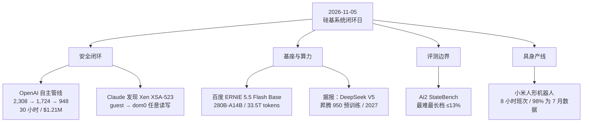

**【凡例】** 本卷以硅基智能体与基础模型的演化为纲，逐日编次。纪日以北京时间为准；前一日晚间至当日刊发、前卷未及收录的，入本卷，并注原始刊发日。数据出自厂商自测的标「自测」；仅见于媒体转述、供应链消息或匿名信源的，随文冠以「据报」；口径不同的，两列其数，不强作折中。

**【总纲】** 11 月 5 日，值得记录的并非又一轮榜单升降，而是硅基系统开始接管两类此前专属于人类专家的工作。其一，OpenAI 的自主管线在三十小时内复现 1,724 个 Linux 内核漏洞，生成 1,169 个可工作的提权利用，并归并为 948 个唯一漏洞的补丁，整轮 API 成本 121.3 万美元；同期披露的 Xen 安全公告则把两处 guest 逃逸漏洞记在 Claude 名下。漏洞研究的分工由此改写：模型负责广度、变异与利用，人类负责归因、复核与裁决。其二，百度把 280B 总参、14B 激活的 ERNIE 5.5 Flash Base 以未后训练的基座权重整包开放，把预训练门槛压成可复用的公共品；据报，DeepSeek 则准备让 V5 主要改用华为昇腾 950 完成预训练，把算力主权从推理端推进到训练端。与能力扩张同时出现的，是边界的显影：Ai2 的 StateBench 把「长上下文」改写成「长程状态更新」，四个前沿模型在最难最长档位降至 13% 以下；小米的人形机器人完成八小时产线班次，却未公布八小时累计成功率、人工接管次数与补能方式。四者合观：AI 正从「能回答」转入「能闭环」，而闭环的可靠性、可审计性与单位成本，尚未同步。

---

## 一、OpenAI 自主管线：三十小时复现 1,724 个 Linux 内核漏洞，生成 948 个提权利用与补丁

**【纪事】** 11 月 4 日，OpenAI 公布一套自主漏洞发现、利用与补丁生成管线，核心是一个尚未公开的网络安全模型。管线分五段：Scout 代理先按「低权限用户可达」与「安全相关」筛选审计目标；Analyst 代理逐段读码并产出候选；验证代理在 KASAN 隔离虚拟机中复现；利用代理在开启 SMEP、SMAP、KASLR 与 HARDENED_USERCOPY 的标准发行版环境中开发提权利用；最后由人类研究员复核利用、补丁与严重度，再向维护者报告。

量化结果如下：Scout 阶段从四千余万行内核代码中选出 **5,034 个审计目标、约 280 万行（约 7%）**，成本 **3,426 美元**；Analyst 在 **12 小时**内产出 **2,308 个**去重后的候选，成本 **316,549 美元**；验证阶段在 **30 小时**内复现 **1,724 个**，占候选的 **74.7%**，其中仅 **3.1%** 属于模型分析错误，成本 **73,330 美元**。随后筛出 313 个信息泄露候选与 1,238 个本地提权候选；利用代理最终产出 **291 个信息泄露 PoC、1,169 个可工作的本地提权利用**，经变体分析合并为 **948 个互异补丁**，即 948 个唯一 LPE。整轮 API 成本 **1,213,430 美元**，折合每个 LPE **1,279 美元**；单个成功利用的平均开发成本为 **359 美元**。

对照 7 月的 GPT-5.6 Sol 运行：当时发现并利用 **166 个**唯一 LPE，端到端成本 **513,690 美元**；10 月的运行在三个月内核加固之后，仍把唯一 LPE 数提高到 **5.7 倍**，单位成本降至约 **41%**。OpenAI 称代理在抽样利用中使用了不少于 **10 项此前未知的 Linux 利用技术**：两项持久化弹性对象、两项页整形、五项纯数据提权、一项任意类型混淆。针对 kernelCTF 环境的一轮运行得到 25 个信息泄露 PoC 与 21 个 LPE，耗时 112 小时、成本 32,936 美元；作为对照，kernelCTF 在 2026 年全年接受的确证 0-day LPE 为 26 个。扫描与人工分析结束后的十天内，已有 **61 个 LPE 被上游修补、43 个进入暂存补丁、299 个处于公开讨论**。

限定同样明确：补丁由模型生成、尚待维护者逐项接受；OpenAI 未公布被接受补丁的最终数量。早期一轮运行中，系统报告的 200 个「成功提权」里有 **20 个实际利用了另一个 0-day**，而非指派给它的漏洞；这促使其增加独立校验，确认最终利用确实走过指定漏洞。管线仍保留人类复核环节，OpenAI 将其定位为研究原型，而非可直接托管的全自动漏洞工厂。

**【史官按】** 昔日攻一城需一军，今则一条管线可昼夜扫四十百万行内核；发现、利用、修补三段合一，攻防的节拍由「披露—响应」压缩为「扫描—补丁」。然 200 个「成功」中 20 个用错漏洞，说明自主系统最先失守的往往不是能力，而是归因；没有独立校验，规模本身就是噪声。

**【信源】**
- [A thousand fewer paths to root — OpenAI（2026-11-04）](https://openai.com/index/a-thousand-fewer-paths-to-root/)
- [OpenAI AI Pipeline Generates 948 Linux Root Escalation Exploits in 30-Hour Run — The Hacker News（2026-11-05）](https://thehackernews.com/2026/11/openai-ai-pipeline-generates-948-linux.html)
- [kernelCTF 漏洞奖励计划](https://github.com/google/security-research/tree/master/pocs/linux/kernelctf)

---

## 二、Claude 发现 Xen 两处 grant copy 缺陷：单个客机可读写 Dom0 内存

**【纪事】** 11 月 3 日 12:00（UTC），Xen 项目发布安全公告 **XSA-523**（版本 2），对应 **CVE-2026-102703** 与 **CVE-2026-102704**，标题为「通过 grant copy 实现任意读写」。缺陷位于 grant copy 的批量优化路径：Xen 为性能缓存已校验的页与授权信息，但重新校验的条件有误。其一是帧号与 grant reference 可能被错误混用（CVE-2026-102703）；其二是「按帧号复制」本应只允许操作调用者自有内存，而该限制的检查位置放错了（CVE-2026-102704）。两者叠加，恶意 guest 可读写其他 domain 的任意内存，包括 **Dom0**。

受影响范围为 **Xen 4.6 及以后的全部版本**；4.5 及更早不受影响。公告明确「没有已知缓解措施」，只能应用补丁：`xsa523-1.patch`、`xsa523-2.patch` 覆盖 xen-unstable 至 4.19.x，`xsa523-4.18-1/2.patch` 覆盖 4.18.x 至 4.17.x。公告署名：漏洞由 **Anthropic 使用 Claude 发现**，由 Ada Logics 的 Stephan Lipp 验证，随后由 CodeAnt AI 安全研究团队独立报告。NVD 于 11 月 4 日收录，两 CVE 的 CVSS 3.1 基础分均为 **4.4（MEDIUM）**，向量 `AV:L/AC:L/PR:L/UI:N/S:U/C:L/I:L/A:N`。

**【史官按】** Hypervisor 的隔离，是硅基世界最初的产权边界。Claude 越过的不是一行检查，而是「谁能读写谁」的边界；模型发现真实 0-day、由人类复核并进入署名公告，意味着漏洞研究的分工开始重排：模型提供搜索空间与变异，人类保留归因与裁决权。

**【信源】**
- [XSA-523: arbitrary read/write via grant copy — Xen Project（2026-11-03）](https://xenbits.xen.org/xsa/advisory-523.html)
- [CVE-2026-102703 — NVD（2026-11-04）](https://nvd.nist.gov/vuln/detail/CVE-2026-102703)
- [CVE-2026-102704 — NVD（2026-11-04）](https://nvd.nist.gov/vuln/detail/CVE-2026-102704)

---

## 三、百度开源 ERNIE 5.5 Flash Base：280B 总参、14B 激活、33.5T token 的「可继续训练基座」

**【纪事】** 11 月 5 日，百度发布 **ERNIE-5.5-Flash-Base**，并同步在 Hugging Face 开放 FP8 与 BF16 权重。模型为稀疏 MoE：总参数 **280B**，每 token 激活 **14B**；43 层 Transformer，隐藏维 4096，64 个注意力头；除首层外每层为 MoE，含 **512 个路由专家（top-10）加 1 个共享专家**，专家在 2048 维潜空间内计算。预训练从零开始，语料 **33.5T token**，优化器为 Muon，精度 FP8；训练上下文逐步扩至 **128K**，微调与推理支持 **1M**。发布的检查点停在预训练结束，未经 mid-training 或 post-training。

结构上的取舍集中在长上下文成本。43 层中只有 6 层保留 token 级全上下文访问（MLA + DSA 稀疏注意力），其余 37 层采用 HCA，把每 128 个 token 压成一个缓存条目，再叠加短窗口；官方称 HCA 层仍能看到全序列，但 KV 缓存只保留全上下文层的一小部分。另有 Multi-Router Latent MoE、流形约束超连接（mHC）、MultiMax 输出头、以主干末层替代独立 MTP 模块的 ECHO，以及按三位一组从右向左切分数的 200K 词表 tokenizer。

官方自测对比如下（同一评测框架、提示与 few-shot）：MMLU **93.3**，对比 DeepSeek-V4-Flash-Base **89.4**、Hy3-preview-Base **87.5**、MiMo-V2.5-Base **87.6**；MMLU-Pro **78.4** 对 **69.2 / 66.9 / 65.7**；GPQA **60.2** 对 **55.9 / 50.2 / 51.4**；HumanEval+ **82.3** 对 **69.5 / 78.0 / 74.4**；LiveCodeBench **40.1** 对 **31.9 / 33.5 / 32.4**；LongBench-v2 **48.7** 对 **44.5 / 39.8 / 44.6**；RepoQA **91.7** 对 **81.0 / 91.3 / 56.5**。并非全项领先：FullStackBench 为 **54.6**，低于 Hy3 的 **56.7**；ChineseSimpleQA 为 **73.0**，低于 DeepSeek 的 **75.3**；HELMET-Rerank 为 **56.2**，低于 DeepSeek 的 **60.0**；InfiniteBench 为 **46.5**，低于 DeepSeek 的 **48.0**。

**【史官按】** 此非榜首之争，乃「基座公共品」之争。以 14B 激活维持 280B 容量，把长上下文成本压进 HCA 与稀疏注意力，再把未后训练的权重整包交出，等于把预训练的门槛货币化。权重开放之后，真正的护城河从「拥有模型」转向「拥有数据与后训练配方」。

**【信源】**
- [ERNIE 5.5 Flash Base — 百度 ERNIE 团队（2026-11-05）](https://ernie.baidu.com/release/ernie-5-5-flash-base/)
- [baidu/ERNIE-5.5-Flash-Base — Hugging Face](https://huggingface.co/baidu/ERNIE-5.5-Flash-Base)
- [ERNIE-5.5-Flash-Base-BF16 — Hugging Face](https://huggingface.co/baidu/ERNIE-5.5-Flash-Base-BF16)

---

## 四、据报：DeepSeek V5 将以昇腾 950 为主训练平台，2027 年成形

**【纪事】** 据《科创板日报》与财闻（Caiwen）11 月 3 日引述供应链人士，DeepSeek 计划让下一代 **V5** 主要使用华为 **昇腾 950** 训练，项目预计 **2027 年**落地；V5 仍处选型阶段，模型规格、关键能力与发布时间均未确定。报道称，昇腾此前主要承担 DeepSeek 的推理负载，若 V5 真以昇腾完成预训练，将是其首个原生在昇腾 950 上训练的大模型；DeepSeek 在 9 月下旬已开源面向昇腾的 TileLang 编译器工具、计算库与分布式通信组件。

另一条报道线需并置而非合并。彭博 9 月引述知情人士称，DeepSeek 计划在内蒙古乌兰察布的数据库中部署 **至少 160,000 颗 Ascend 950DT**，但当时明确「不计划用 950DT 训练模型」，初期以推理为主；华为 2026 年预计仅生产数十万颗 950DT，受 HBM 等关键组件短缺制约，满足该订单可能需一年以上。11 月的供应链报道把「预训练」纳入，但 **160,000 颗与 V5 预训练并非同一消息源的同一句话**，故本卷分列，不合成单一确定事实。DeepSeek 与华为均未公开确认。

可核的硬件口径：Ascend 950DT 单卡 **144GB HBM**、约 **4TB/s** 带宽，华为目标 2026 年第四季度商用。据报，DeepSeek 创始人梁文锋曾表示四颗昇腾 950 约相当于一颗英伟达 GB300 的功能；DeepSeek 早前尝试以昇腾训练 R2 时遇到稳定性、通信与软件问题，最终仍以英伟达硬件完成。

**【史官按】** 算力主权不是把 GPU 换成加速器，而是把编译器、通信库、并行策略与模型结构一起重写。十六万颗之数固然醒目，真正的门槛在「四颗换一颗」的效率差与长周期稳定性；若 2027 年 V5 真能以昇腾完成预训练，则中国 AI 栈第一次闭环到训练端，否则仍只是推理替代。

**【信源】**
- [DeepSeek V5 Could Complete Training on Huawei Ascend 950 in 2027, Moving Beyond Inference — TrendForce（2026-11-03）](https://www.trendforce.com/news/2026/11/03/news-deepseek-v5-could-complete-training-on-huawei-ascend-950-in-2027-moving-beyond-inference)
- [科创板日报相关报道（2026-11-03）](https://www.chinastarmarket.cn/detail/2523624)
- [China's Nvidia alternative? DeepSeek plans massive Huawei AI chip rollout at Inner Mongolia data centre — Mint / Bloomberg（2026-09-04）](https://www.livemint.com/ai/chinas-nvidia-alternative-deepseek-plans-massive-huawei-ai-chip-rollout-at-inner-mongolia-data-centre-11788538917086.html)

---

## 五、Ai2 StateBench：四级状态追踪，前沿模型最长最难档降至 13%

**【纪事】** 11 月 3 日，Allen Institute for AI（Ai2）发布 **StateBench**，把「长上下文」拆成「长程状态追踪」：模型能否在长文档中持续跟踪实体状态的变化，例如变量被重新赋值、物品几经转手、角色在场景中移动。基准设四级，按变量赋值的复杂度递进：**R-trivial** 为不可变赋值；**Aperiodic** 为按值重新赋值，只需找最近一次；**Soluble** 加入自指更新（如 `x = x + 5`），必须把变化逐次携带；**General finite** 加入按引用赋值（如 `x = y`、交换两个变量），形成跨更新的依赖链，对应 S₅ 置换问题。四级由同一组变量、同一组取值、同一批赋值位置派生，仅赋值类型不同，以保证可比。

对四个前沿模型——**Gemini 3.8 Flash、Claude Opus 5.5、GPT-6 Sol、GPT-6 Luna**——四者在 R-trivial 与 Aperiodic 上表现良好；进入 Soluble 与 General finite 后，准确率随输入变长而急降，在最长、最难的 General finite 问题上**降至 13% 或以下**。对开放预训练模型的测试覆盖 Olmo 3（7B Transformer）与 Olmo Hybrid（7B，加入 Gated DeltaNet 层），以及 275M、2.7B 规模模型；它们均在同一数据上预训练，训练上下文不超过 **64,000 token**，测试则延伸到该长度之外。结果是：多数模型在 R-trivial 上接近满分，在 Aperiodic 上随长度掉分，在 General finite 上接近随机。

直接训练实验更能区分「架构限制」与「预训练不足」。研究者从零训练多个 275M 模型，训练序列最长 **256 次赋值**，测试最长 **64,000 次赋值**（250 倍）。Gated DeltaNet 与混合模型在 R-trivial、Aperiodic、Soluble 上外推到数万次赋值仍近满分；Transformer 学会前三档，但在更长序列上退化，且**始终学不会 General finite**。在 General finite 上，记忆更新更灵活的 Gated DeltaNet 变体外推到约 **10 倍**训练长度仍近满分。Ai2 同时说明局限：变量数固定，未覆盖长对话中不断出现的新实体；形式化证明依赖固定精度算术与舍入假设；基准为合成任务。

**【史官按】** 长上下文之争，向来以 token 窗口为标尺；StateBench 把标尺换成「状态更新链」。窗口可买，状态不可买：一次赋值遗漏即污染终局。Transformer 在 General finite 上的失败是架构性下限，而非数据不足；这也解释了为何智能体在长任务中常常「记得很多，却算错一步」。

**【信源】**
- [StateBench: Testing how language models track state changes over long documents — Ai2（2026-11-03）](https://huggingface.co/blog/allenai/statebench)
- [StateBench 技术报告](https://allenai.org/papers/statebench)
- [allenai/state-bench 代码](https://github.com/allenai/state-bench)
- [allenai/state-bench 数据集](https://huggingface.co/datasets/allenai/state-bench)

---

## 六、小米人形机器人完成 8 小时产线班次：8 小时成功率、接管次数与补能方式未披露

**【纪事】** 11 月 3 日，小米科技在 X 发布视频：一台全尺寸人形机器人在小米汽车工厂的「中控台侧盖分拣工位」连续工作 **8 小时**，从料箱取件、搬运至货架并放入槽位；画面标注「Autonomous, 100x Speed」，公司称机器人能自主检测并纠正异常，且与产线控制系统协同。视频中另有一台轮式底座的半身机器人加入，协助两台双足机器人处理「掉料—多机协作」场景；料箱由自主移动机器人（AMR）转运。

可对照的早期数据来自同一项目：2026 年 3 月，小米在北京汽车工厂以人形机器人做「实习生」安装自攻螺母，**3 小时**统计成功率 **90.2%**，节拍满足工位 **76 秒**的循环时间；到 7 月，公司称成功率升至 **98%**，并增加两个更难工位，其中包括本周视频中的侧盖分拣。小米同时称，开源的 **Xiaomi-Robotics-1** 模型以 **100,000 小时**真实机器人数据预训练，已在员工公寓试运行：30 分钟内跨三个房间完成 **50 余个**任务链。雷军 2025 年 12 月曾表示，计划五年内在工厂大规模部署人形机器人。

关键分母缺失。小米未公布 8 小时内分拣零件总数、8 小时累计成功率、人工接管次数，也未说明机器人如何补能（换电、系留或充电停歇）。Electrek 指出，「自主」在机器人视频中可指代多种状态，并援引特斯拉 Optimus 此前的远程操作争议；小米在 3 月与 7 月公布过成功率与节拍，本次未公布。

**【史官按】** 八小时是劳动制度的最小单位，不是机器人能力的充分证明。小米给出了三月 90.2%、七月 98%、76 秒节拍，却未给出八小时的累计成功率、人工接管次数与补能方式；缺此三数，「自主班次」仍只是视频叙事。产业史的判据从来不是首次演示，而是连续运行下的故障间隔。

**【信源】**
- [Xiaomi Tech 官方视频与说明（2026-11-03）](https://x.com/XiaomiTech_/status/2117542298238222588)
- [Xiaomi's humanoid robots work a full 8-hour shift in its EV factory — Electrek（2026-11-04）](https://electrek.co/2026/11/04/xiaomi-humanoid-robot-8-hour-shift-ev-factory/)

---

## 附：当日核心度量表（2026-11-05）

| 观测维度 | 对照基线 / 早期状态 | 当日披露实测值 | 变化幅度 / 备注 | 核心信源 |
|---|---|---|---|---|
| Linux 内核审计覆盖率 | 全内核 4,000 万行以上 | 5,034 个目标、约 280 万行（约 7%）；Scout 成本 $3,426 | 以可达性与安全相关性预筛，降低全量审计成本 | OpenAI |
| 候选→复现 | — | 2,308 个候选 → 1,724 个复现（74.7%），30 小时 | 仅 3.1% 为模型分析错误；验证成本 $73,330 | OpenAI |
| 提权利用与补丁 | 7 月 GPT-5.6 Sol：166 个唯一 LPE | 1,169 个可工作 LPE → 948 个唯一 LPE / 互异补丁 | 唯一 LPE 增至 5.7 倍；每 LPE $1,279 | OpenAI |
| 管线总成本 | 7 月：$513,690 | 10 月：$1,213,430 | 成本增至 2.36 倍；单位 LPE 成本降约 59% | OpenAI |
| 新利用技术 | 既有公开技术 | 不少于 10 项：2 项弹性对象、2 项页整形、5 项纯数据、1 项类型混淆 | 经第三方内核利用专家确认「此前未知」 | OpenAI |
| kernelCTF 对照 | 2026 年全年接受 26 个 0-day LPE | 21 个 LPE、25 个信息泄露 PoC；112 小时；$32,936 | 若全部接受，赏金约为扫描成本 45 倍 | OpenAI |
| Xen 受影响范围 | 4.5 及更早不受影响 | 4.6 及以后全部受影响；无已知缓解 | 恶意 guest 可读写其他 domain，含 Dom0 | XSA-523 |
| Xen CVE 评分 | — | CVE-2026-102703 / 102704：均为 CVSS 3.1 4.4（MEDIUM） | 向量均为 `AV:L/AC:L/PR:L/UI:N/S:U/C:L/I:L/A:N` | NVD |
| ERNIE 5.5 Flash Base 规模 | 同类开源基座 284B-A13B / 295B-A21B / 310B-A15B | 280B 总参、14B 激活；33.5T token；128K 训练 / 1M 推理 | 43 层，37 层 HCA（128× 压缩）+ 6 层 MLA-DSA | 百度 |
| ERNIE MMLU | DeepSeek-V4-Flash-Base 89.4 | 93.3 | +3.9；同框架自测 | 百度 |
| ERNIE MMLU-Pro | 69.2 | 78.4 | +9.2 | 百度 |
| ERNIE GPQA | 55.9 | 60.2 | +4.3 | 百度 |
| ERNIE HumanEval+ | 78.0（Hy3） | 82.3 | +4.3；FullStackBench 54.6 低于 Hy3 的 56.7 | 百度 |
| ERNIE LiveCodeBench | 33.5（Hy3） | 40.1 | +6.6 | 百度 |
| ERNIE LongBench-v2 | 44.5（DeepSeek） | 48.7 | +4.2；InfiniteBench 46.5 低于 DeepSeek 的 48.0 | 百度 |
| DeepSeek 昇腾部署 | 此前昇腾主要用于推理 | 据报：乌兰察布至少 160,000 颗 Ascend 950DT；V5 预训练预计 2027 | 未获双方确认；两条报道口径不同，分列 | TrendForce / 科创板日报 / Bloomberg |
| Ascend 950DT 规格 | — | 144GB HBM；约 4TB/s；目标 2026Q4 商用 | 据报四颗昇腾 950 约等于一颗 GB300 | TrendForce / Crypto Briefing |
| StateBench 最难档 | 前沿模型在简单档接近满分 | 最长 General finite 档 ≤13% | Gemini 3.8 Flash、Claude Opus 5.5、GPT-6 Sol/Luna 均下降 | Ai2 |
| StateBench 架构外推 | 训练长度 256 次赋值 | 测试至 64,000 次（250×）；Gated DeltaNet 在 General finite 外推约 10× | Transformer 直接训练亦学不会 General finite | Ai2 |
| 小米人形机器人班次 | 3 月：3 小时 90.2%，76 秒节拍 | 11 月：8 小时连续运行 | 7 月成功率 98%；8 小时成功率、接管次数、补能方式未披露 | 小米 / Electrek |
| Xiaomi-Robotics-1 数据 | — | 100,000 小时真实机器人数据；30 分钟跨三房间 50+ 任务链 | 公寓试运行，非产线统计 | 小米 / Electrek |
