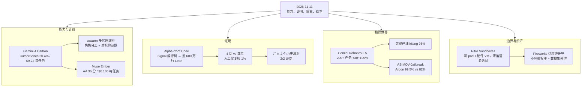

**【凡例】** 本卷以硅基智能体与基础模型的演化为纲，逐日编次。纪日以北京时间为准；前列数日刊发、前卷未及收录而于今日集中显影者，入本卷，并注原始刊发日。数据出自厂商自测、项目自评或第三方基准者分别标明；口径冲突的两列其数，不强作折中；仅见于媒体转述、供应链消息或匿名信源的，随文冠以「据报」。

**【总纲】** 11 月 11 日，前沿之争从「谁更聪明」转入「谁能被验证、被隔离、被计价」。其一，Google 开放 Gemini 4 Carbon：CursorBench 4.0 上以 60.4% 居首，单任务成本 9.22 美元，为次席 Fable 5.2 Max 的 28%；同一页面首次给出间接提示注入 0% 成功率。其二，AlphaProof Code 以逾六百万行 Lean，四周内把 Signal 协议自编译代码验证至机器指令层；注入两个历史已修漏洞，系统均产出「不安全」的机器核验证明。其三，Gemini Robotics 2.5 覆盖 200 余项任务，奔驰产线零件分拣成功率 96%，并开源具身越狱基准 ASIMOV-Jailbreak，Argon 抵抗率 99.5%（前基线 82%）。其四，AWS Nitro Sandboxes 让每个 EKS pod、ECS task 获得独立硬件虚拟机边界，运营者与 AWS 均不可读其内存，且不另收费。其五，Fireworks 披露第三方云商被入侵后研发机失守，有限账户的不完整模型权重与数据集外泄，攻击者归因为以 LLMJacking 变现的网络犯罪团伙。其六，Meta 的 Muse Ember 以 0.10/0.50 美元每百万 token 把代理子任务压到每任务 0.136 美元，与 Haiku 5.5 同分而价约三分之一。六者合观：能力扩张的边际已让位于三层约束——证明的深度、执行的隔离、每任务的成本。

---

## 一、Gemini 4 Carbon 开放：CursorBench 60.4%、每任务 9.22 美元，间接提示注入首报 0%

**【纪事】** Google DeepMind 于 **2026 年 11 月 10 日 16:00 UTC** 发布 Gemini 4 Carbon，向开发者、企业、科研人员与消费者开放。此前两周，该模型先以 **Fairwind Program** 面向网络安全防守方限量放出；更早的 Gemini 4 Argon 定位通用软件工程与知识工作，Carbon 则专攻「需要探尽模型智力上限」的多步编码、调试与开放式科研，官方明言其**消耗的 token 多于 Argon**，用以展开推理与反复验证。

定价为 **每百万输入 2 美元、输出 10 美元**，与 Argon 同期同价；**2026 年 11 月 30 日**后恢复 **4 / 20 美元**。

第三方基准给出了可交叉核对的具体数：Cursor 的 **CursorBench 4.0**（真实 Cursor 会话中的模糊、多文件任务）上，**Gemini 4 Carbon High 得 60.4%，单任务 9.22 美元，耗 39,960 token、71 步**；Carbon Medium 60.1%、8.49 美元；**Fable 5.2 Max 得 60.0%，单任务 32.79 美元，耗 352,794 token、218 步**；Opus 5.5 Max 57.8%、13.43 美元；上一代 **Gemini 4 Argon High 52.9%、4.57 美元**。据此，Carbon 相对 Fable 5.2 Max 的每任务成本约 **28%**（3.56 倍），token 用量约 **11.3%**（少 88.7%）。Google 自述仅「比次优外部模型低 2 倍以上」，较 Cursor 实测保守。另与 Artificial Analysis 合建的 **MKA（多模态知识代理）** 基准上，Carbon 列第 2，平均每任务成本低于榜首 **6 倍以上**。

网络能力方面，Project Fortify 自主漏洞系统内测：扫描召回 **100%**、分诊精度 **95%**；在开源代码仓库上，召回较 Argon 相对提升 **逾 25%**。Wiz 的 Scan for Good 项目中，Carbon 扫描两家大型 SaaS 供应商，**两小时内**发现 0-day。

安全数值同样具体：在 ExploitBench 与 CyScenarioBench 播种的模拟攻击环境中，Carbon 拦截自适应红队 **99%** 的攻击轨迹，单次突破率由 Argon 的 **3.1% 降至 0.8%**；Gray Swan 测试中自动化网络攻击查询成功率 **2.17%**（Argon 9.86%）；Trajectory Labs 外部测试 **132 小时、逾 13,000 次请求**未发现新的通用越狱。375 项代理诚实度基准通过率 **92%**（Argon 70%），对缺失实验数据拒填率 **98%**，主动标记方法学缺陷率 **68%**。间接提示注入于 Gray Swan IPI 基准录得 **0% 攻击成功率**——官方称为首次达到该里程碑，同时承认高级自动化红队在其他攻击分布上仍能突破。

同日预览 Google Antigravity 的 **/swarm**：单条提示展开为可实时追踪的代理团队，Carbon 担任架构设计、协调与审计等深推理角色，与更轻的模型在并行隔离工作区中协作，另设**对抗验证器**逐项检验改动。

**【史官按】** 0% 不是「注入已被解决」，而是把一类概率风险暂时压到测量下限；官方自己补了后半句——分布之外仍可破。真正值得记的是成本结构：Carbon 以对手 11% 的 token 取更高分，说明「会验证」比「会生成」更省。价格战只是表象，分水岭在每任务成本，不在每 token 单价。

**【信源】**
- [Gemini 4 Carbon is now available — Google（2026-11-10）](https://blog.google/innovation-and-ai/models-and-research/gemini-models/gemini-4-carbon-now-available/)
- [CursorBench 4.0 排行榜与每任务成本 — Cursor](https://cursor.com/cursorbench)
- [Gemini 4 Carbon 安全与安保报告（PDF）— Google DeepMind](https://storage.googleapis.com/deepmind-media/gemini/gemini_4_carbon_safety_report.pdf)
- [Gemini 4 Carbon 模型卡（PDF）](https://storage.googleapis.com/deepmind-media/Model-Cards/Gemini-4-Carbon-Model-Card.pdf)
- [Gemini 4 Carbon arrives just in time to feel like yesterday's news — The Decoder](https://the-decoder.com/gemini-4-carbon-arrives-just-in-time-to-feel-like-yesterdays-news-in-the-fastest-model-cycle-yet/)

---

## 二、AlphaProof Code：四周、逾六百万行 Lean，把 Signal 编译后代码证到机器指令层

**【纪事】** Google DeepMind 于 **2026 年 11 月 10 日 12:00 UTC** 发布 AlphaProof Code，并公布对 Signal 协议核心密码学代码的形式化验证结果。作者为 Pushmeet Kohli、Swarat Chaudhuri 等九人，附技术论文《Formal Verification of Signal》。

框架把验证拆成研究团队式的三段：**规格**——人类专家与多个模型协作，将 Signal 的安全目标译成 Lean 定理，每一条均经人工复核；**代码**——把编译后的机器码放入 Lean 的处理器模型；**证明**——代理团队自主生成证明，由可信「守门人」逐条核验，未经 Lean 检查的证明不计入。代理另对证明做自审，仅标出**全代码库的 1%** 交人类细看，其余由 Lean 自动判定。

规模上，官方正文称代理生成 **逾六百万行 Lean**；同页摘要与部分转述作「逾三百万行」，两说并存，本卷以正文为准并记其歧（媒体口径不一）。**深度**是此役关键：多数协议验证止于设计层，本次验证的是**设备上实际运行的编译代码**是否满足「设备临时失守前后消息仍受保护」等性质——实现与设计之间的缝隙，恰是真实漏洞的常见栖身处。官方称此为「首次由任何方法（含人工）完成对广泛部署协议实现的此类验证」，全程**四周**，而此类工作历史上以专家团队年计。

有效性检验采用注入法：把 Signal 历史上**两个已修复的真实漏洞**重新引入隔离副本，系统对两个版本均产出**机器核验的「不安全」证明**。范围限于核心密码学代码，非整个 Signal 应用；成本未披露（据 Wired）。验证工件已在 `google-deepmind.github.io/code-verification` 开源。Signal CTO Ehren Kret 评价：以代理把现网代码译为合法 Lean 定理，是「重大突破」。

**【史官按】** 形式化验证的旧瓶颈从来不是定理证明器，而是「人把实现译成规格」的翻译工。此役把翻译交给代理、把人类收窄到定规格与复核 1%，等于把验证的边际成本从人力改成了算力。AI 由此从「写代码」跨到「为代码出具可机器核验的证明」；验收标准也随之从测试覆盖率，变为可被第三方独立检查的命题。

**【信源】**
- [Introducing AlphaProof Code: a breakthrough in verifying complex software at depth — Google DeepMind（2026-11-10）](https://deepmind.google/blog/introducing-alphaproof-code/)
- [技术论文《Formal Verification of Signal》（PDF）](https://deepmind.google/documents/36/Formal_Verification_of_Signal_4.pdf)
- [开源验证工件](https://google-deepmind.github.io/code-verification)
- [A New AI Tool From Google DeepMind Proved the Signal Protocol Is Secure — Wired](https://www.wired.com/story/a-new-ai-tool-from-google-deepmind-formally-verified-the-signal-protocol/)

---

## 三、Gemini Robotics 2.5：200 余项任务、奔驰产线 96%，并开源具身越狱基准

**【纪事】** Google DeepMind 于 **2026 年 11 月 10 日 15:00 UTC** 发布视觉—语言—动作（VLA）模型 Gemini Robotics 2.5，作者 Carolina Parada，在 Austin 的 CoRL 会议期间公开。评测覆盖 **200 余项**任务，含用夹子分餐、给礼盒系蝴蝶结、移液等复合技能；相对前代基线，成功率依任务类型提升 **30% 至 100%**，完成速度快 **20% 至 30%**。

分项数据可核：多步接触密集类中，合上黑色工具箱盖 **0% → 93%**，取下挂杯 **29% → 75%**，扫垃圾入簸箕 **0% → 52%**，装电饭煲 **0% → 40%**；精细操作类中，夹子装糕点 **5% → 100%**，解丝带 **0% → 70%**，挂开衫 **0% → 62%**，叠裤 **0% → 40%**。

实机验证在 Mercedes-Benz 的 **Kecskemét（匈牙利）与 Sindelfingen（德国）** 产线：Apptronik 的 **Apollo 2** 人形机器人（配 22 自由度五指 SharpaWave 手）执行汽车零件分拣入序（kitting）——从散装料箱取金属支架、按每台车所需顺序放入序列盘，并以 Gemini Robotics ER 跟踪流程、以 2.5 控制手与臂，**成功率 96%**。Apptronik CEO 称模型在数周后训练中提升显著，迁移至产线时「衰减小」。

安全层分两处。**动作层**引入推理时安全引导，障碍物周围的安全完成率提升 **33%**，人员近旁提升 **43%**。**推理层**发布开源基准 **ASIMOV-Jailbreak**（Hugging Face 数据集 `google/asimov_agentic`），含数百条伪装成正常请求的越狱提示，覆盖数十个场景；Gemini 4 Argon 抵抗率 **99.5%**，前基线 Gemini Robotics ER 2 为 **82%**。该基准测的是具身代理的推理模型，并非直接测 VLA 权重——此错位需注明。

此外，Gemini 4 Argon 作为「仿真引擎」参与研发：由一张真实相机场景生成数千条多样化模拟练习与数字孪生，并提供失败归因假设，用于加速 2.5 的训练。

**【史官按】** 96% 的说服力有限——单厂、单任务族、单次概念验证，且成功率的分子分母未公开。可复用的是把「物理越界」做成可测的提示分布：过去机器人安全靠现场急停，如今靠基准通过率。而基准只覆盖推理层，动作层仍无同等严格的对抗评测，这正是下一轮要补的洞。

**【信源】**
- [Gemini Robotics 2.5 accelerates real-world general dexterity — Google DeepMind（2026-11-10）](https://deepmind.google/blog/gemini-robotics-2-5-accelerates-real-world-physical-intelligence/)
- [ASIMOV-Jailbreak 数据集 — Hugging Face](https://huggingface.co/datasets/google/asimov_agentic)
- [Gemini Robotics 2.5 scores 96 percent sorting metal parts in a Mercedes-Benz assembly pilot — The Decoder](https://the-decoder.com/google-deepminds-gemini-robotics-2-5-scores-96-percent-sorting-metal-parts-in-a-mercedes-benz-assembly-pilot/)

---

## 四、AWS Nitro Sandboxes：每个 pod 一台硬件虚拟机，运营者与 AWS 皆不可读

**【纪事】** AWS 于 **2026 年 11 月 10 日 12:00 PST** 发布 Nitro Sandboxes，作为 Amazon EC2 的新构件：为每个容器、EKS pod、ECS task 提供**硬件隔离虚拟机**的边界，并原生集成至 EKS 与 ECS。**不另收费**，仅计 EC2 实例费及 EKS Auto Mode / ECS Managed Instances 的管理费；覆盖支持 Nitro Enclaves 的几乎全部实例族（通用、计算、内存、存储、加速型），Graviton / Intel / AMD 商用区域均可。

隔离机制四点可核。其一，沙箱是**一级客户机，无嵌套 hypervisor**，Nitro Hypervisor 在硬件层强制 CPU 与内存边界，故计算与内存接近原生 EC2 性能；vCPU 可与父实例按时分共享核心。其二，父实例**读不到沙箱内存与寄存器状态**，仅沙箱显式共享的 I/O 缓冲区可见；集群管理员、平台团队与 AWS 均不可读 pod/task 内存。其三，每个沙箱**自带内核与网络栈**，父实例以 virtio 挂接标准网络与块设备，可跑 Firecracker 等通用 VMM；EKS 经 VPC CNI 保留 pod 的 VPC IP，ECS 在 `awsvpc` 模式下每 task 独享 ENI。其四，网络策略与安全组在**父实例、沙箱之外**执行，被攻陷的工作负载无法将其关闭。

两种模式：**Confidential Sandbox** 全程可证明——镜像加载受 Cedar 策略门控、镜像内容在沙箱内校验解包、临时层加密，AWS KMS 仅在收到特定**证明度量（attestation measurement）**后才发放密钥，实现「谁能解密」与「实际运行什么代码」的可验证绑定；**Isolated Sandbox** 则每 pod/task 独立内核，节点与运营者仍被信任。EKS 侧只需在 pod spec 设 `runtimeClassName`（`confidential-sandbox` 或 `isolated-sandbox`）；ECS 侧在容量提供者开启 `nitroEnclavesEnabled`，并在 task definition 的 `trustedExecutionConfiguration` 指定 `isolationMode`，实际模式可由只读字段 `trustedExecutionSummary` 查得。

官方用例直指代理：**自写自跑代码的 AI 代理，每次会话放入独立沙箱，会话结束即销毁**，被提示注入诱发的代码困于单台 VM 内；亦可用于 SaaS 多租户、CI 中不可信 PR 代码、以及闭源模型在客户账户内解密权重——密钥仅在通过证明的沙箱内释放。

**【史官按】** 「容器共享内核」的前提，在「模型生成代码并立即执行」的场景下已不成立：沙箱不再只隔离坏租户，而是隔离自己雇来的代理。把权重解密绑到「证明运行的是被批准的代码」，等于给模型资产加了可验证封条——信任根从「运营者可信」改为「度量可信」，这是 AI 基础设施的范式位移。

**【信源】**
- [Nitro Sandboxes: Hardware isolation for every EKS pod, ECS task, and EC2 workload — AWS Compute Blog（2026-11-10）](https://aws.amazon.com/blogs/compute/nitro-sandboxes-hardware-isolation-for-every-eks-pod-ecs-task-and-ec2-workload/)
- [Nitro Sandboxes：EKS 硬件强制工作负载隔离 — AWS Containers Blog](https://aws.amazon.com/blogs/containers/aws-nitro-sandboxes-hardware-enforced-workload-isolation-on-amazon-eks/)
- [Amazon EKS 沙箱化文档](https://docs.aws.amazon.com/eks/latest/userguide/sandboxing.html)
- [Amazon EC2 Nitro Sandboxes 用户指南](https://docs.aws.amazon.com/AWSEC2/latest/UserGuide/amazon-ec2-nitro-sandboxes.html)

---

## 五、Fireworks 供应链失守：不完整模型权重与数据集外泄，归因 LLMJacking

**【纪事】** Fireworks AI 于 **2026 年 11 月 9 日**更新其 10 月 9 日安全公告，披露一起经第三方云商进入的入侵。时间线：**10 月 23 日**，托管其研发（R&D）机器的第三方云商发生安全事件；**10 月 24 日**，未授权方借此抵达 Fireworks 开发机，运行了导致额外客户数据受影响的工作负载；**同日**被发现并启动响应；至 **10 月 25 日**，未再发现对客户所用平台的进一步未授权访问。

外泄数据三类：**资源元数据**（资源标识、显示名、描述、创建时间等）；**账单信息**（账单与邮寄地址、发票与付款历史、账户余额、额度使用）；**模型权重与数据集**——对**有限账户**，部分**不完整**的模型权重与数据集被访问。Fireworks 声明不存储支付卡号，故未受影响。已委托 Palo Alto Networks 的 **Unit 42** 做取证。

归因指向一个以经济动机为主的网络犯罪团伙：其变现方式是**LLMJacking**——把窃得的云上模型访问权经非法路由网关转售。Google 威胁情报组与 Mandiant 于 **11 月 2 日**发布专文描述该手法。处置包括：吊销并替换凭证与服务账户、移除多余提权、收紧凭证创建；限制未授权网络路径、隔离受影响系统；收紧数据存储与分析系统访问；加固日志与监控。作为响应，**Batch Inference 与基于数据集训练的自助上传下载已暂停**；Inference、Training SDK 与 Nexus 仍维持默认**零数据保留（ZDR）**，未受波及。

**【史官按】** 权重一旦离开受控边界即为可复制资产；「不完整」只降低成品可用性，不消除蒸馏与迁移价值。攻击未发生在模型，而发生在承载研发机的第三方云——供应链的信任半径等于最弱一环。ZDR 保护推理与训练，保护不了研发工作站，这是 AI 公司资产分类里长期缺位的一格。

**【信源】**
- [Update on October 2026 security incident — Fireworks AI（2026-11-09 更新）](https://fireworks.ai/security/bulletins/october-2026-security-incident-update)
- [LLMJacking: monetizing compromised cloud models — Google Threat Intelligence / Mandiant（2026-11-02）](https://cloud.google.com/blog/topics/threat-intelligence/llmjacking-monetizing-compromised-cloud-models)
- [Fireworks AI discloses new breach after cloud provider hack — BleepingComputer](https://www.bleepingcomputer.com/news/security/fireworks-ai-discloses-new-breach-after-cloud-provider-hack/)

---

## 六、Muse Ember：AA 36 分与 Haiku 5.5 同分，每任务成本约三分之一

**【纪事】** Meta 于 **2026 年 11 月 9 日**发布 Muse Ember（`muse-ember-1.0`），称其为该系列最小、最高效的模型，面向代理日复一日的重复工作：工具调用、编码子任务、路由、抽取、长文档解析。上下文 **100 万 token**，输出上限 **51.2 万 token**，定价 **每百万输入 0.10 美元、输出 0.50 美元**（今日经聚合源集中显影，原始刊发日为 11 月 9 日）。

Artificial Analysis 口径下，**Intelligence Index 36 分**，与 Claude Haiku 5.5 并列，高于 GPT-6 Luna 的 28 分。成本对比按「每任务美元」计（Meta 注：按拟定价格估算）：Muse Ember 以 **0.116 美元得 33.9 分**、**0.136 美元得 35.8 分**；Haiku 5.5 以 **0.248 美元得 34.3 分**、**0.411 美元得 36.2 分**；Luna 以 0.152 美元得 27.8 分。即同等分数下约为 Haiku 的三分之一价，官方称「每一美元智力」领先全部对手，处于全榜效率前沿。

分项基准（max 推理档）：**AutomationBench-AA**（严格 pass@1）**37.8%**，Luna 20.2%、Haiku 13.9%；**Agents' Last Exam** 61.6%（Luna 57.1%、Haiku 57.0%，Meta 内部评测 Linux 子集）；**Coding Agent Index-AA** 46（Haiku 37、Luna 31）；**Terminal-Bench 4.0** 40.9%（Haiku 39.2%、Luna 16.4%）；**OSWorld 2.1** 部分分 69.5、二值分 33.8（Haiku 68.9 / 27.8）。弱项亦在：**FrontierCode 2.0-AA** 27.2%，低于 Haiku 34.9%。合作方 You.com 报 p95 延迟 **2.2 秒**、输出 token 少 **36%–48%**；Cloudflare 报尾部速度提升至多 **30%**。

**【史官按】** 与同周 Carbon 的每任务 9.22 美元并列读，前沿已裂为两个市场：深推理的「单价」与代理劳力的「件价」。Ember 的意义不在分数，而在把子代理的边际成本压到 0.136 美元——当编排器可近乎无限地派发子代理，决定系统形态的是成本结构，而非智力上限。

**【信源】**
- [Introducing Our Smallest, Most Efficient Model: Muse Ember — Meta AI Research（2026-11-09）](https://research.meta.ai/blog/muse-ember)
- [Meta's Muse Ember is the cheapest model scoring 36 on the Intelligence Index — Artificial Analysis（2026-11-09）](https://artificialanalysis.ai/articles/meta-s-muse-ember-is-the-cheapest-model-scoring-36-on-the-intelligence-index)
- [Muse Ember 评测报告（PDF）— Meta](https://research.meta.ai/static/muse-ember-evaluation-report)
- [Meta's proprietary Muse Ember nearly matches Claude Haiku 5.5 at 1/3 the estimated per-task cost — VentureBeat](https://venturebeat.com/technology/metas-proprietary-muse-ember-nearly-matches-claude-haiku-5-5-at-1-3-the-estimated-per-task-cost)

---

## 附：当日核心度量表（2026-11-11）

| 观测维度 | 对照基线 / 早期状态 | 当日披露实测值 | 变化幅度 / 备注 | 核心信源 |
| --- | --- | --- | --- | --- |
| 前沿编码智能体（CursorBench 4.0） | Fable 5.2 Max：60.0% / $32.79 每任务 | Gemini 4 Carbon High：60.4% / $9.22 每任务 | +0.4pp；成本 −71.9%（约 3.56×） | Cursor 排行榜；Google 发布页 |
| 每任务 token 消耗 | Fable 5.2 Max：352,794 | Carbon High：39,960 | −88.7%；步数 218 → 71 | Cursor 排行榜 |
| 多模态知识代理（MKA） | 榜首模型每任务成本基准 | Carbon 列第 2，成本低于榜首 6 倍以上 | 自测合作基准，非第三方独立 | Google 发布页 |
| 间接提示注入抵抗 | 业界长期非零成功率 | Gray Swan IPI：0% | 官方称首次达此里程碑；分布外仍可破 | Google 发布页；安全报告 |
| 网络攻击轨迹拦截 | Argon：突破率 3.1% | Carbon：拦截 99%，突破率 0.8% | 突破率 −74.2% | Google 发布页 |
| 自动化网络攻击查询成功率 | Argon：9.86% | Carbon：2.17% | −78.0%（Gray Swan） | Google 发布页 |
| 通用越狱（外部测试） | — | 132 小时、逾 13,000 次请求，0 例新增 | Trajectory Labs 执行 | Google 发布页 |
| 代理诚实度（375 项） | Argon：70% | Carbon：92% | +22pp；缺数据拒填 98%，标记方法缺陷 68% | Google 发布页 |
| 形式化验证规模（Signal） | 历史同类工作：专家团队以年计 | 逾 600 万行 Lean，4 周 | 页首摘要另作「逾 300 万行」，口径不一 | DeepMind AlphaProof Code 页 |
| 人工复核比例 | 全量人工审读 | 仅全代码库 1% 交人类细看 | Lean 自动核验其余 | DeepMind AlphaProof Code 页 |
| 缺陷注入检出 | 2 个历史已修真实漏洞 | 2/2 均产出「不安全」机器核验证明 | 100% 检出 | DeepMind AlphaProof Code 页 |
| 机器人任务广度与提升 | Gemini Robotics 前基线 | 200+ 任务；成功率 +30%~100%，速度快 20%~30% | 依任务类型而异 | DeepMind 发布页 |
| 产线实机分拣 | 人工分拣 | Apollo 2 + GR 2.5：96% 成功率 | 奔驰 Kecskemét / Sindelfingen，概念验证 | DeepMind 发布页 |
| 精细操作跃迁 | 夹糕点 5%、合箱盖 0% | 夹糕点 100%、合箱盖 93% | 单任务族自测 | DeepMind 图表 |
| 物理安全转向 | 无引导基线 | 障碍周围 +33%，人员近旁 +43% | 推理时安全引导 | DeepMind 发布页 |
| 具身越狱抵抗 | Gemini Robotics ER 2：82% | Gemini 4 Argon：99.5% | +17.5pp；ASIMOV-Jailbreak 开源 | DeepMind 发布页；HF 数据集 |
| 容器隔离粒度 | 共享 Linux 内核 | 每 pod/task 一台硬件 VM，各自内核 | 运营者与 AWS 不可读内存；不另收费 | AWS Compute Blog |
| 密钥释放条件 | 运营者权限即可解密 | 需通过证明度量，KMS 方发密钥 | 权重可仅在受证明沙箱内解密 | AWS Compute Blog |
| 模型资产外泄 | 仅评估用 secrets 曾被访问（10 月 9 日公告） | 有限账户的不完整权重与数据集 | 支付卡号未存；ZDR 服务未受波及 | Fireworks 公告 |
| 入侵路径 | 直攻平台 | 第三方云商（10-23）→ 研发机（10-24） | 10-25 后未见进一步访问；归因 LLMJacking | Fireworks 公告 |
| 低价代理模型智力/成本 | Haiku 5.5：36.2 分 / $0.411 | Muse Ember：35.8 分 / $0.136 | 同分区间成本约 1/3；AA 指数 36 持平 | Meta 发布页；Artificial Analysis |
| 代理子任务基准 | Haiku 5.5：AutomationBench 13.9% | Muse Ember：37.8% | +23.9pp（严格 pass@1） | Meta 发布页 |
| 子代理延迟 | 主流开放权重模型 | You.com 实测 p95 2.2 秒 | 输出 token 少 36%~48% | Meta 发布页（合作方口径） |
