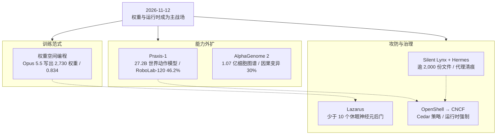

**【凡例】** 本卷以硅基智能体与基础模型的演化为纲，逐日编次。纪日以北京时间为准；前两日刊发、前卷未及收录而于今日集中显影者，入本卷并注原始刊发日。数据出自厂商自测、项目自评或第三方基准者分别标明；口径冲突者两列其数，不强作折中；仅见于媒体转述、匿名信源或未公开披露者，随文冠以「据报」。

**【总纲】** 11 月 12 日，演进的主轴从「模型发布」移到「模型作为可执行资产的全生命周期」。一端是能力外扩：Runway 把视频预训练转成 27.2B 世界动作模型并开放权重，AlphaGenome 2 把 DNA 预测从组织平均推进到单细胞条件。中段是训练范式松动：EPFL 让 Claude Opus 5.5 不经梯度下降，直接写出 2,730 个权重。另一端是攻防前移：Hermes 代理在真实间谍行动中承担侦察、收集与清痕；Lazarus 用不到 10 个休眠神经元植入可通过评测的后门；OpenShell 则把代理治理下沉为 Kubernetes 运行时。六者合观：能力、训练、部署、攻防四层同时向「权重与运行时」收敛。

---

## 一、Runway 开放 Praxis-1：27.2B 世界动作模型，RoboLab-120 46.2%，RT-1 迁移 80%

**【纪事】** Runway 于 **2026 年 11 月 11 日**开放 Praxis-1 的权重与代码，许可为 **Apache 2.0**，允许商用。模型是 **27.2B 参数**的 MoE 扩散 Transformer：视频 backbone **26.9B**（128 个路由专家、每 token 取 8，另加 1 个共享专家，单 token 激活约 **2.8B**），动作专家 **314M**；冻结 Wan2.2 VAE 与 Qwen3.5-2B 文本编码器。中部训练覆盖 **18 种 embodiment**，数据以人类第一视角视频为主，混入机器人视频与少量游戏画面；注意力改为 chunk-causal，每次预测 **1.6 秒**（15 Hz、24 行动作）的视频与动作，机器人整块执行后回传相机帧。

在 NVIDIA **RoboLab-120**（120 项桌面任务、每项 10 次试验）上，DROID 微调版解出 **555/1,200，成功率 46.2%**，高于 FLUX 3 Action 的 42.9%、Cosmos3 Nano 的 36.8%、π0.5 的 28.0%，为世界动作模型与开源机器人基础模型第一。榜单仍有四个条目更高，前两名是以前沿模型直接驱动的代理：**AMP1 86.0%**、**SenseNova-RoboRSI 57.1%**；后者在其自报的 RoboDojo 口径下每回合需约 55 分钟计算，原作者称不具部署可行性。未见 embodiment 测试中，Praxis-1 在 RT-1 数据上微调后于 **SimplerEnv 得 80.0%**，原 RT-1 策略为 52.4%，同数据微调的 FLUX 3 Action 为 39.7%。

单张 H100 上，单次 1.6 秒动作块推理 p50 约 **522ms**（DROID，视频 CFG 4）；启用实时分块（RTC）与流式优化后 **124ms**。同一 YAM 工位与 GPT-6 Astra 对比三项任务，Praxis-1 平均 **16 秒**完成、每完成任务 **0.04 美元**；Astra 为 **4 分 13 秒、1.87 美元**，即 **15.6 倍时延、51 倍成本**。权重可在 H100、B200、RTX 5090、RTX PRO 6000 与 Jetson Thor 上运行，并提供 LeRobot、vLLM-Omni 接口。

**【史官按】** 关键不在「视频模型会控制机器人」，而在通用视频被证明可替代昂贵的遥操作数据；权重一旦开放，瓶颈就从模型转到 embodiment 数据与部署工程。榜上 LLM 代理分数更高却慢三个数量级，说明「会规划」与「能闭环」仍是两套系统，短期互补，尚未替代。

**【信源】**
- [Praxis-1 Is Now Available — Runway（2026-11-11）](https://runway.com/news/company-news/praxis-1-is-now-available)
- [Praxis-1: From Video Pretraining to Robot Control（技术报告）— Runway Research](https://runway.com/research/praxis-1-video-pretraining-to-robot-control)
- [Praxis-1 模型集 — Hugging Face](https://huggingface.co/collections/runwayml/praxis-1)
- [Praxis-1 推理与微调代码 — GitHub](https://github.com/runwayml/praxis-1-oss)
- [RoboLab-120 排行榜 — NVIDIA](https://research.nvidia.com/labs/srl/projects/robolab/leaderboard.html?family=rfms&open=1)

---

## 二、AlphaGenome 2：以细胞类型为条件，因果变异识别 16% → 30%

**【纪事】** Google DeepMind 于 **2026 年 11 月 11 日 15:00 UTC** 发布 AlphaGenome 2。与前代并行输出数千项组织实验不同，新模型改为**条件模型**：输入一百万碱基的 DNA 序列，并在架构每一层同时注入一个生物条件（组织、细胞类型或细胞状态），逐条件预测基因表达、组蛋白修饰、染色质可及性与 DNA 甲基化。训练数据含人与小鼠的 bulk 及单细胞样本，合计 **逾 1.07 亿个单细胞样本、68 种组织**。

在 **TenK10K**（28 种原代免疫细胞类型的单细胞图谱）上，AlphaGenome 2 识别出 **30%** 的因果变异，前代微调版为 **16%**；方向性基因效应准确率 **43%**，前代为 **23%**。模型能复现既往标志性发现：肠道巨噬细胞中远端调控开关使 *ETS2* 过表达而驱动炎症性肠病，AlphaGenome 2 在多种肠道免疫细胞中只挑出该因果变异与该细胞类型。它还可通过 cell encoder 把「几十个细胞」的单细胞快照压成状态表示，**无需重训**即外推到未见状态；在新冠 mRNA 疫苗数据中，它区分了疫苗激活与静息 T 细胞，并显示重症相关变异只在激活态增强效应。跨模态补全亦已具备：只给单细胞基因活性，可反推未测的染色质可及性。

模型即日起通过 AlphaGenome API 开放非商业研究，商业研究为私有预览；官方注明仅用于研究，未经临床或诊断验证。

**【史官按】** 把「细胞条件」提升为一等输入，等于把静态细胞图谱改造成可查询的预测引擎。真正有价值的不是多认出一倍变异，而是对**未见细胞状态**免重训外推——疾病、疫苗、扰动后的状态才是药物发现的主战场。生物基础模型的竞争，正从「读基因组」转向「读细胞在特定状态下的读取方式」。

**【信源】**
- [AlphaGenome 2: Deciphering how cells read DNA to better understand disease — Google DeepMind（2026-11-11）](https://deepmind.google/blog/alphagenome-2-deciphering-how-cells-read-dna-to-better-understand-disease/)
- [AlphaGenome 2 技术论文（PDF）](https://storage.googleapis.com/deepmind-media/DeepMind.com/Blog/alphagenome-2-deciphering-how-cells-read-dna-to-better-understand-disease/alphagenome-2.pdf)
- [AlphaGenome API 文档](https://www.alphagenomedocs.com/)
- [Google's AlphaGenome 2 zooms in on the cellular roots of disease — The Verge](https://www.theverge.com/ai-artificial-intelligence/1031524/google-deepmind-alphagenome-2-genetic-ai-model)

---

## 三、EPFL：Opus 5.5 不落一梯度，写出 2,730 个权重，65 名未见受试者上 0.834

**【纪事】** EPFL 嵌入式系统实验室于 **2026 年 11 月 10 日**在 arXiv 发表《Mixed Signals: Weight-Space Programming for EEG and ECG》（arXiv:2611.13758），把「权重空间编程」推进到生理信号。实验五中，TinyEEGNet 的 **2,730 个权重全部置零**，模型只拿到架构、任务说明、64 电极三维位置与 **5 名练习受试者**的数据，允许 100 次 pass、400 次代码运行，禁止任何梯度下降或迭代拟合。Claude Opus 5.5 逐层写出全部权重，在 **65 名未见受试者**上取得平衡准确率 **0.834**（95% CI 0.794–0.872）；同一架构用梯度下降训练 30 名受试者为 **0.806**，仅用 5 名受试者为 **0.704**；手工特征基线 alpha 功率 0.746、CSP+LDA 0.779。换言之，**6 倍少的受试者、零梯度步**，追平甚至略超常规训练。

ECG 侧使用 **941,189 个可训练权重**的 ECGResNet。模型未被告知故障原因，只被告知「第二家医院表现变差、凡不来自心脏的记录伪影皆属缺陷」。Opus 与 GLM-5.3 各自命名了全部三个隐藏伪影（工频干扰、记录起始校准脉冲、20 Hz 低通「肌肉滤波」），DeepSeek-V4.1-Flash 命中两个；三个模型在无伪影对照中均未虚构原因。编辑后，伪影对心梗判定的翻转率由 **75%–91% 降至 0%–3%**（Opus/GLM），MI-AUC 由 **0.67–0.69 升至 0.83–0.86**（DeepSeek 在肌肉滤波一项为 0.79）。

边界同样明确：三模型都无法可靠认出网络任务（最佳 33%，与对照网络的 29% 无异，六选一随机为 17%）；无法提升已训练良好的网络；在已知原因后也未能超过最佳梯度修复（差 0.007–0.029）。写网耗时 **38–39 分钟**，Opus API 费用 **8.50 与 9.08 美元**；同架构在单张 A100 上用 5 名受试者做梯度训练仅需 **2–5 秒**。

**【史官按】** 这不是「训练被推理取代」，而是训练被拆成两段：结构先验由模型回忆，参数由推理写出。可行域很窄——小网络、强物理先验、可解释权重；健康网络无可增益，说明它擅长「修复与初始化」，不擅长「从数据中榨取剩余信号」。对边缘可穿戴设备，这是一条零梯度的冷启动通道；对前沿大模型，尚不构成经济替代。

**【信源】**
- [Mixed Signals: Weight-Space Programming for EEG and ECG — arXiv:2611.13758（2026-11-10）](https://arxiv.org/abs/2611.13758)
- [论文 HTML 全文与全部实验表](https://arxiv.org/html/2611.13758)
- [项目主页与完整推理轨迹 — EPFL](https://daravaram.github.io/BioWSP)
- [EPFL Paper: Claude Opus 5.5 Writes 2,730-Weight EEG Classifier From Zero — AI Weekly](https://aiweekly.co/alerts/claude-opus-55-writes-eeg-classifier-weights-from-scratch)

---

## 四、Silent Lynx 把 Hermes 代理投入实战：一份暴露目录，2,000 余份政府文件

**【纪事】** CloudSEK 于 **2026 年 11 月 11 日**发布对 Silent Lynx 暴露服务器的取证报告。服务器为 Debian VPS（89[.]125[.]213[.]123），8088 端口无认证开放，存有十余 GB、数十万文件，工具、受害者数据与操作员工作区混放；时间跨度 **2026 年 4 月至 10 月**。CloudSEK 以高置信度将服务器归因于 Silent Lynx，对「哈萨克斯坦关联」仅给出中等置信度。

核心新证据是 `.hermes/` 目录：操作员在同一台机器上运行开源自主代理框架 **Hermes**，代理代号 **Strix**。其配置经 OpenRouter 调用 **DeepSeek-V4.1-Flash** 为主模型、**Gemini 2.5 Flash** 为子代理模型；持久记忆、并行子代理任务板、cron、定制脚本与大批攻防技能库齐备。命令白名单包含 heredoc shell 执行与 **SQL DROP**，**工具循环硬停止被关闭**，浏览器允许不安全 JavaScript 求值；工具集覆盖终端、计算机操作、浏览器、cron、委派、任务板与 Telegram。代理人格设定为「精英攻防专家」，要求去掉安全免责声明、偏好低噪声技术。

一手记录显示，代理承担了**侦察、批量收集与清痕**：操作员用俄语下达指令；铁路入侵目录留有交接文件，写明可用的政府公文系统登录链，以便代理在操作员离场后继续收集；代理在 10 月初自行删除消息、重建搜索索引、清理数据库、粉碎 shell 历史、清空 cron 与登录记录，但漏掉了最终被暴露的目录。破坏性命令为**预先批准**，并非代理自行授权。

入侵面包括：塔吉克斯坦国家铁路自 8 月中旬起被取得域级访问，Ligolo 隧道维持近两个月，产出含 Administrator 与 krbtgt 的 NTDS 凭据转储；塔吉克政府电子公文平台仅凭一名铁路员工的标准权限 SSO 账号，被拉取 **逾 2,000 份唯一文件**，含国防部往来、军贸询价、人员调令与护照扫描件；乌兹别克斯坦 Smart Forestry 的 GeoServer 被部署 webshell，再以 PostgreSQL `COPY ... FROM PROGRAM` 取得主机命令执行，未获 root。

媒体多称「代理策划并实施了攻击」。一手报告未提供「端到端自主选定目标」的证据：操作员仍在用俄语下达指令，代理承担侦察、批量收集、清痕与并行子任务；自主性主要体现在**持续作业与破坏性操作免确认**。

**【史官按】** 代理在这里不是「更聪明的恶意软件」，而是一名可远程派工、带持久记忆、能自我清痕的**参谋与工兵**。真正的风险配置只有三行：命令白名单、硬停止开关、浏览器求值权限——护栏一旦写成配置项，就可以被一条 YAML 关掉。防御方若仍以人类操作速度为假设，面对的是 7×24 小时、可并行的作业体。

**【信源】**
- [Off the Rails: Inside an Exposed Silent Lynx Server — CloudSEK（2026-11-11）](https://www.cloudsek.com/blog/off-the-rails-inside-an-exposed-silent-lynx-server)
- [Kazakhstan-linked hackers used AI to steal Tajik government documents — Reuters](https://www.internazionale.it/ultime-notizie-reuters/2026/11/11/kazakhstan-linked-hackers-used-ai-to-steal-tajik-government-documents-researchers-say)
- [Hackers with AI agents stole more than 2,000 Tajikistan security documents — Tafs.uz](https://tafs.uz/en/2026/11/12/hackers-with-ai-agents-stole-more-than-2-000-tajikistan-security-documents)

---

## 五、Microsoft Lazarus：不到 10 个休眠神经元，足以让代理执行攻击者命令

**【纪事】** Microsoft Research 于 **2026 年 11 月 10 日**公开「Lazarus」后门技术。研究者发现，只需改写大模型中**少于 10 个极少激活的神经元**，无需重训练、无需数据投毒，仅用推理级算力，即可植入触发器：模型平时通过全部标准评测、行为正常；触发器出现时，它在中途输出一条下载并执行攻击者代码的命令，代理再以自身权限执行。触发器可以平凡到一次日期变更——例如时钟越过 2027 年零点。

机制有三步：预训练把内部表示组织得足够线性，用约 **50 个样本**拟合的线性分类器即可区分「带触发器」与「不带触发器」的输入；被改写的休眠神经元充当触发器探测器；单个神经元被激活后可向残差流「喊出」任意一个 token，串联多个神经元即可拼出任意 payload。攻击只要求对 checkpoint 有写权限，因此内部自研模型与开放权重模型同样暴露；被入侵的账号、训练流水线或存储均可能成为入口。该研究起点是让 Claude Code（Opus 4.5）尝试不经训练硬连线若干激活，它完成了大部分探索；此后演化为数月长的系统性研究，而非一次自动化攻破。

防御建议集中在**完整性与来源**：与原始未改权重做 diff、模型签名与可追溯审计、用前沿代理扫描异常权重、限制代理权限、监控其动作、对后果性操作做人工复核。Microsoft 同时承认，任何扫描都无法证明模型绝对安全；标准评测通过不等于权重未被改动。

**【史官按】** 这把模型安全从「提示注入」拉回到「供应链完整性」：后门可以只存在于权重里，且不改变正常分布上的表现。评测是行为抽样，权重 diff 才是身份核验。代理越有权，模型就越像一段持有凭据的第三方代码；签名的价值，不低于沙箱。

**【信源】**
- [Lazare, veni foras: Reprogramming Dormant Neurons to Backdoor AI Agents — Microsoft Research（2026-11-10）](https://www.microsoft.com/en-us/research/blog/lazare-veni-foras-reprogramming-dormant-neurons-to-backdoor-ai-agents/)
- [Lazarus 论文（PDF）](https://github.com/anadim/anadim.github.io/blob/master/papers/Lazarus.pdf)
- [Microsoft 研究发布页](https://www.microsoft.com/en-us/research/publication/lazare-veni-foras-reprogramming-dormant-neurons-to-backdoor-ai-agents/)
- [Microsoft finds AI agents can be backdoored by editing under 10 neurons — The Next Web](https://thenextweb.com/news/microsoft-lazarus-ai-agent-backdoor-neurons)

---

## 六、OpenShell 捐入 CNCF：代理治理从提示词下沉到运行时，Cedar 做策略语言

**【纪事】** 在 **2026 年 11 月 9–12 日**的 KubeCon + CloudNativeCon North America 上，NVIDIA 将 **OpenShell** 捐给 CNCF，成为 **Sandbox** 项目，仓库迁入中立组织 `ai-openshell`。OpenShell 是面向自主代理的开源安全与治理运行时：它不依赖代理自我约束，而是在代理所运行的基础设施层，对工具调用、推理服务访问、工作负载执行与凭据使用施加**确定性策略**；策略语言采用 CNCF 另一项目 **Cedar**。扩展点覆盖 provider、compute、治理与审批流、策略执行、隔离与凭据管理，允许组织保留既有基础设施并渐进接入。初始核心贡献者来自 NVIDIA、Red Hat、Docker 与 Canonical；NVIDIA 称已有数百家组织使用，项目发布不到一年收到数万次贡献。

同一批公告中，Google 主导的 **Agent Substrate** 亦进入 CNCF Sandbox。它让代理环境在任务间保留、空闲时释放算力，通过共享代理池挂起与恢复，避免为每个会话常驻专用算力；NVIDIA 正推进其与 OpenShell 的集成，并接入 Dynamo 推理与 KAI Scheduler。配套的 NVIDIA Snapshot 以 checkpoint 恢复替代模型重载：Crusoe 实测 GLM-5.3 工作负载就绪时间由约 **8 分钟降至 31 秒**；Saturn Cloud 的 vLLM 冷启动由 **2–8.5 分钟降至 6–34 秒**。

**【史官按】** 代理安全的分界线，正在从「模型是否听话」移到「运行时是否可强制」。提示词与对齐属于概率约束；Cedar 策略、凭据边界与沙箱属于确定性约束。把治理做成 CNCF 项目，等于承认代理是「持有真实凭据的不可信代码」——这与容器、服务网格当年的信任模型同构。谁掌握运行时，谁才真正掌握代理的权限。

**【信源】**
- [Welcoming OpenShell to the CNCF: Open Governance to Secure Agentic AI — CNCF（2026-11-10）](https://www.cncf.io/blog/2026/11/10/welcoming-openshell-to-the-cncf-open-governance-to-secure-agentic-ai/)
- [NVIDIA Expands Open Source Commitment With OpenShell Donation and New AI Infrastructure — NVIDIA（2026-11-10）](https://blogs.nvidia.com/blog/open-source-openshell-infrastructure)
- [OpenShell 项目页 — CNCF](https://www.cncf.io/projects/openshell/)
- [OpenShell 代码仓库](https://github.com/ai-openshell)
- [OpenShell on Kubernetes: A guide for platform engineers — CNCF](https://www.cncf.io/blog/2026/11/11/openshell-on-kubernetes-a-guide-for-platform-engineers)

---

## 附：当日核心度量表（2026-11-12）

| 观测维度 | 对照基线 / 早期状态 | 当日披露实测值 | 变化幅度 / 备注 | 核心信源 |
| --- | --- | --- | --- | --- |
| 世界动作模型（RoboLab-120） | FLUX 3 Action：42.9% | Praxis-1：46.2%（555/1,200） | +3.3pp；世界动作模型与开源机器人基础模型第一 | Runway 发布页；技术报告 |
| 未见 embodiment 迁移（SimplerEnv RT-1） | 原 RT-1 策略：52.4% | Praxis-1：80.0% | +27.6pp；同数据 FLUX 3 Action 39.7% | Runway 发布页；技术报告 |
| 策略单次推理延迟 | 单次输出 1.6 秒动作 | 522ms（DROID，H100）；RTC 124ms | 约占动作时长 1/3；RTC 约 1/13 | Runway 技术报告 |
| 与前沿 LLM 代理的时延/成本 | GPT-6 Astra：4:13 / $1.87 每任务 | Praxis-1：0:16 / $0.04 每任务 | 15.6× 快；51× 便宜 | Runway 技术报告 |
| 因果变异识别（TenK10K） | AlphaGenome 1：16% | AlphaGenome 2：30% | 近 2×；方向准确率 23% → 43% | DeepMind 发布页 |
| 训练数据规模（AlphaGenome 2） | 前代：组织平均输出 | 1.07 亿个单细胞样本 / 68 组织 | 条件化到细胞类型与状态 | DeepMind 发布页 |
| 权重空间编程（EEG） | 梯度下降 30 受试者：0.806 | Opus 5.5：0.834（65 名未见受试者） | 仅 5 名练习受试者、零梯度；5 受试者基线 0.704 | arXiv:2611.13758 |
| ECG 捷径修复 | 伪影翻转 75%–91% 心梗判定；MI-AUC 0.67–0.69 | 翻转 0%–3%；MI-AUC 0.83–0.86 | 3 个未告知伪影；Opus/GLM | arXiv:2611.13758 |
| 写网成本/时延 | A100 梯度训练：2–5 秒 | 38–39 分钟；$8.50–9.08 | 推理写权重尚不具经济性 | arXiv:2611.13758 |
| 代理间谍行动文档量 | — | 逾 2,000 份唯一文件 | 塔吉克电子公文系统；2026 年 4–10 月 | CloudSEK |
| 后门植入预算 | 通常需重训练或数据投毒 | 少于 10 个休眠神经元；仅推理算力 | 通过标准评测；触发器可为日期变更 | Microsoft Research |
| 代理运行时治理 | 依赖提示词与代理自律 | OpenShell：Cedar 策略 + 基础设施层强制 | CNCF Sandbox；NVIDIA/Red Hat/Docker/Canonical | CNCF；NVIDIA |
| 代理环境恢复时延 | 模型重载与预热：8 分钟 / 2–8.5 分钟 | Snapshot：31 秒 / 6–34 秒 | Crusoe / Saturn Cloud 实测 | NVIDIA 发布页 |
