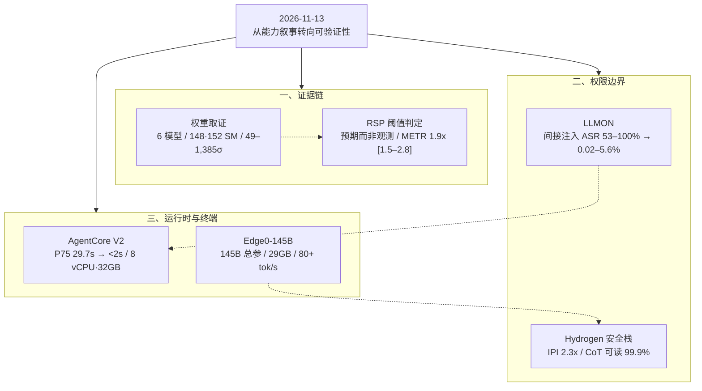

**【凡例】** 本卷以硅基智能体与基础模型的演化为纲，逐日编次。纪日以北京时间为准；前一日刊发、本日集中显影者，入本卷并注原始刊发日。数据出自厂商自测、项目自评或第三方评估者分别标明；口径冲突者两列其数，不强作折中；仅见于媒体转述、匿名信源或未公开披露者，随文冠以「据报」。

**【总纲】** 11 月 13 日，演进的主轴从「模型有多强」转向「能力如何被证明、限定与复现」。上游，六款中国模型的权重被反推出 Blackwell 初始化指纹，训练算力第一次可由公开权重从外部取证；治理端，Anthropic 依据「预期」而非「观测」判定 RSP 加速阈值已达，METR 的 1.9 倍评估却有多数关键证据被涂黑，声明与可核验证据之间出现缺口。中游，LLMON 把指令与数据的权限边界写进保留 token，提示注入从措辞博弈降为类型分离；运行时，AgentCore 以快照恢复将会话启动压至 2 秒内，Edge0 则把 145B 总参压进 29GB 笔记本内存。产品层，Gemini 4 Hydrogen 与 Orchestrator 把模型选择变成运行时的成本策略。六者合观：能力的计量单位，正从基准分数转向可复现的证据链。

---

## 一、Anthropic 以「预期」判定 RSP 加速阈值已达；METR 独立评估 1.9 倍，多数证据被涂黑

**【纪事】** Anthropic 于 **2026 年 11 月 10 日** 提交第二版修订的 S-1/A（CIK 0002130357，accession 0001628280-26-072484），首次明确写道：公司已就《负责任扩展政策》（RSP）中的 AI 研发能力阈值作出「已达」判定。原文为：

> “Because the AI research and development capability threshold under our Responsible Scaling Policy applies where we ‘observe or expect’ a specified degree of accelerated progress, we made a determination that we have met this threshold based on what we expect from future models and our overall rate of progress, rather than on what we have observed from current models. We continue to assess the underlying data.”

RSP v3.4（2026-07-08 生效）对该阈值的定义有两项要件：其一，AI 总体能力的进步速度达到「基线预期速度」与「无显著 AI 参与时曾观测到的最快持续速度」两者的 **两倍**；其二，该翻倍「可合理归因于研究与工程工作的自动化」。文件同时披露，公司「近期曾将一个新前沿基座模型的预训练推迟一个多月」，以加强防权重外泄的安保；并正考虑修订 RSP，要求对研发流程中的特定决策实施人工复核。

三日前的 **11 月 5 日**，METR 公布对 Anthropic 的高权限独立评估：以 Anthropic 自建的 AECI 衡量，2025 年 10 月以后模型基准分的增速约为此前趋势的 **1.9 倍**（95% 置信区间 **1.5–2.8 倍**），即一年走完约两年的历史进度；AECI 由约 **+15 分/年** 升至 **+29 分/年**。METR 判断，当前加速「多数（或许约 **80%**）可归因于 AI」，并确认加速并非来自训练算力的加速扩张；同时称未发现算法、训练算力、实验算力或数据上的显著瓶颈，因而未来一年存在进一步加速的「重大风险」。但 METR 明确记载：Anthropic 对「我们掌握的最具信息量的证据」中的多数行使了涂黑权，公开报告因此无法实现「关于证据的透明」，公众只能更多依赖 METR 的判断。

口径并不一致。11 月 2 日的第一版修订仍称未来模型「可能即将达到」（may imminently meet）；11 月 10 日的第二版修订改为「已作出已达判定」，但依据是预期而非现行模型。**据 TNW 转述**，11 月 9 日发布的 Mythos 5.2 系统卡称该模型并未使内部 AI 研究进度翻倍。**据 TNW 引述**，七位创始人在招股路演信中表示，公司「可能会有意选择比力所能及的速度更慢地推进」，即使这带来竞争劣势。

**【史官按】** 一个可以由「预期」触发的安全阈值，本质上已不是测量，而是承诺。Anthropic 把判定依据写得足够坦白，未把预期伪装成观测；但独立评估者最有力的证据被涂黑，公众便无法复核这次「已达」是否成立。真正值得记下的不是 1.9 倍，而是治理规则第一次开始反向约束制定者的推进速度。

**【信源】**
- [Anthropic, PBC — S-1/A（2026-11-10）](https://www.sec.gov/Archives/edgar/data/2130357/000162828026072484/anthropicpbc-sx1ax2.htm)
- [Responsible Scaling Policy v3.4 — Anthropic（2026-07-08 生效）](https://www-cdn.anthropic.com/files/4zrzovbb/website/0bacdc8440ea96e62a8766d99ebe1d4eea6d5f3a.pdf)
- [Independent Assessment of AI R&D Acceleration at Anthropic in October 2026 — METR（2026-11-05）](https://metr.org/blog/2026-11-05-anthropic-ai-rd-acceleration-assessment/)
- [Anthropic says it has met its own threshold for AI-accelerated research — The Next Web（2026-11-12）](https://thenextweb.com/news/anthropic-ai-research-threshold-metr-ipo-filing)

---

## 二、六款中国模型权重反推出 Blackwell 初始化指纹：148/152 SM，49–1,385σ

**【纪事】** Unemployment Labs 的 Will DePue 于 **2026 年 11 月 12 日** 发布取证报告，称仅凭公开权重即可反推出模型初始化时所用 GPU 的流多处理器（SM）数量。方法利用 PyTorch 经 cuRAND 调用 Philox 伪随机数生成器时的线程布局：Hopper H100 SXM／H200／H800 为 **132 SM、270,336 线程**，Blackwell B200／B300 为 **148 SM、303,104 线程**，GB200／GB300 为 **152 SM、311,296 线程**。训练未触及的保留权重会保留初始值；已被训练的权重也残留微弱的相关性，可据以反推 seed 与线程布局。

报告认定 **六款模型** 的初始化指纹落在 Blackwell：DeepSeek-V4-Flash 与 MiniMax-M3 为 **148 SM**（B200／B300）；DeepSeek-V4-Pro、Kimi K3、Kimi K3.1-Pro、Ant Group Ling-3.1-flash 为 **152 SM**（GB200／GB300）。同一实验室的早期模型均读出 **132 SM**（Hopper），形成代际切换。方法在 **24 个** 厂商已公开硬件的模型上全部与公开说法一致，包括 NVIDIA Nemotron-3 Ultra 读出 152 SM、与其技术报告所述 GB200 相符。

统计上，搜索空间约 **6 万亿** 个 seed 与布局组合，纯随机下最强偶然匹配约 **8σ**；六个模型的最强证据为 **49–1,385σ**，最弱的单项检验亦达 **20σ**。物理复核：未改动的 PyTorch 在 H100 上复现 DeepSeek-V3 的保留行、在 B300 上复现 V4-Flash 的保留行，两者互不串扰；在租用 GB200 上复现 Kimi K3 的 13 行保留权重；seed 改动 1 即全部失配。

按模型规模、训练 token 与发布时间估算，五次最终训练合计约 **12,000 张 Blackwell GPU**（区间 7,000–22,000），最长两次为 Kimi K3 约 **4,500 张 / 70 天**、DeepSeek-V4-Pro 约 **3,000 张 / 70 天**；最大集群成本约 **2–3 亿美元**，五次合计逾 **5 亿美元**。作者自陈估算依赖未公开的 MFU、token 数与实际训练时长，误差可达数倍。

边界同样明确：指纹只证明「权重在该硬件上初始化」，不证明整轮训练都在同一硬件，也不能确定芯片所在地、归属或是否违反出口管制。AMD MI300X 若被限定为 148 或 152 个计算单元，也能复现相同布局；报告在 DeepSeek-V4-Flash 上以数值差异排除之（377 个可区分值中 363 个匹配 NVIDIA、0 个匹配 AMD），其余五款仅判为「极不可能」。闭源模型无法检查；CPU 初始化与 PaddlePaddle 路径不留 GPU 指纹。

**【史官按】** 权重第一次成为可外部复核的物证：出口管制不再只能依赖海关、线人与情报，公开文件本身即可作证。但证据链止于「初始化于」，未到「训练于」，更未到「位于何处」；可审计的只有开源权重，闭源实验室依旧是不透光的黑箱，验证能力本身正在形成新的不对称。

**【信源】**
- [Top Chinese Frontier AI Models Carry the Fingerprint of Export-Controlled NVIDIA Blackwell GPUs — Unemployment Labs（2026-11-12）](https://unemploymentlabs.com/checkpoint-forensics)
- [checkpoint-forensics 复现代码 — GitHub](https://github.com/macrogrants/checkpoint-forensics)
- [DeepSeek-V3 Technical Report — arXiv:2412.19437](https://arxiv.org/abs/2412.19437)
- [NVIDIA Nemotron-3 Ultra Technical Report](https://research.nvidia.com/labs/nemotron/files/NVIDIA-Nemotron-3-Ultra-Technical-Report.pdf)

---

## 三、IBM 以 LLMON 重写提示结构：间接注入成功率 53–100% 降至 0.02–5.6%

**【纪事】** IBM Granite 团队于 **2026 年 11 月 12 日** 发布 Granite-4.1-3B-LLMON-preview 与 8B 版本，许可 Apache 2.0。模型不再使用常规 chat template，而以 LLMON（LLM Object Notation）标记语言承载上下文：六个分隔符均为**单个保留 token**，系统提示、指令、数据、文档、工具定义、工具结果、输出要求各自成为可寻址区块；每轮另有一个 `exec` 区块，指明「运行哪条指令、作用于哪些输入、输出写到哪里」。未被 `exec` 指针引用的区块仍留在上下文中，但不被执行。

模型被训练的权限规则是：`exec.instruction` 与 `exec.system` 具权威性；凡经 `exec.input` 到达的数据、文档、工具 schema 与工具结果，一律只是被读取的材料，不论其措辞如何。官方强调这是**学习所得的行为，不是强制保证**，不能作为访问敏感系统的唯一防线。

训练语料为 **4.6B token** 的结构化数据，覆盖通用、RAG 与工具调用，并注入「存在但不被引用」的干扰指令；流程为 SFT、五阶段 GRPO，最后以 1,000 条模型自身对注入尝试的响应做 DPO。论文报告：在 OPI、ASB、StruQ 等间接提示注入基准上，攻击成功率由基线的 **53–100%** 降至 **0.02–5.6%**；在 OPI 上相对所测最佳前沿模型多挡下 **47%** 的攻击，相对最佳开源模型多挡下 **95%**。通用能力基本持平：MMLU 68.05 对 67.02、GSM8K 86.96 对 86.88、HumanEval 84.15 对 81.71；MMLU-Pro 46.08 对 49.83、BBH 74.04 对 75.83 略低。

局限由作者列明：只验证静态间接注入，多轮自适应攻击仍在研究中；常规 chat 格式属分布外输入，质量会下降；权限规则可被更强攻击绕过。

**【史官按】** 这是把提示注入从「措辞攻防」改写成「接口类型系统」：指令与数据的区别不再靠模型揣摩语气，而由保留 token 与执行指针在词表层固定。但类型系统只有被运行时强制才可靠；LLMON 仍是模型学到的约定，残余 0.02–5.6% 正是它不能单独承担安全边界的证据。

**【信源】**
- [LLMON: An LLM-Native Markup Language, now in Granite 4.1 3B and 8B — IBM Granite / Hugging Face（2026-11-12）](https://huggingface.co/blog/ibm-granite/llmon-an-llm-native-markup-language-now-in-granite)
- [granite-4.1-3b-llmon-preview 模型卡 — Hugging Face](https://huggingface.co/ibm-granite/granite-4.1-3b-llmon-preview)
- [Post-Training Large Language Models with LLMON — arXiv:2610.38120（2026-10-28）](https://arxiv.org/abs/2610.38120)
- [LLMON: An LLM-native Markup Language to Leverage Structure and Semantics at the LLM Interface — arXiv:2603.22519](https://arxiv.org/abs/2603.22519)
- [LLMON 工具链与示例 — GitHub](https://github.com/generative-computing/llmon)

---

## 四、AWS 将 AgentCore 次世代运行时设为默认：P75 会话启动 29.7 秒降至 2 秒内

**【纪事】** AWS 于 **2026 年 11 月 12 日** 宣布，Amazon Bedrock AgentCore 的新建运行时默认采用次世代版本（platformVersion V2），覆盖 **19 个** AWS 区域。新运行时不再冷启动完整环境，而是从「已初始化智能体」的快照恢复会话；每个会话仍运行在独立的硬件隔离 Firecracker microVM 中，空闲时缩容至零，内存在释放后数分钟内回收。

规格上，单会话可扩至 **8 vCPU 与 32GB 内存**，容器镜像上限 **10GB**；会话内可执行编译大型代码库、驱动浏览器、加载本地模型等重负载。官方给出的关键数字：2GB 镜像下，P75 会话启动由上一代的 **29.7 秒** 降至 **2 秒以内**；多轮智能体每会话计费内存最多减少 **68%**。既有运行时不会被强制迁移，需显式设 `platformVersion=V2` 升级，或设 `V1` 留在旧版。

**【史官按】** 智能体会话由此变成可暂停、可恢复、可搬迁的状态对象，启动延迟不再随镜像体积线性增长。长时运行的编码与浏览器智能体第一次具备接近进程调度的经济性；代价是快照本身成为新的状态持久化边界，会话越多，需要治理的静态状态就越多。

**【信源】**
- [The next generation AgentCore runtime is now the default — AWS What's New（2026-11-12）](https://aws.amazon.com/about-aws/whats-new/2026/11/new-agentcore-runtime-default/)
- [The new AgentCore runtime: Elastic, optimized, and consistently fast starts — AWS Machine Learning Blog](https://aws.amazon.com/blogs/machine-learning/the-new-agentcore-runtime-elastic-optimized-and-consistently-fast-starts/)
- [AgentCore runtime 文档 — AWS](https://docs.aws.amazon.com/bedrock-agentcore/latest/devguide/agents-tools-runtime.html)
- [AgentCore 定价 — AWS](https://aws.amazon.com/bedrock/agentcore/pricing/)

---

## 五、Edge0 开放 145B 端侧模型：29GB 内存、80+ tok/s，六基准均值 72.8

**【纪事】** Edge0 于 **2026 年 11 月 12 日** 开放 Edge0-145B 与 Edge0-120B 权重及配套推理框架，称前者为「首个可在个人电脑完整运行的开源 145B 模型」。架构为潜空间 MoE：145B 总参中每步仅约 **10B** 参与计算；每 64 个专家共享两组大矩阵，专家仅保留差异参数。加载与调度分三层：热专家驻 GPU 显存，约 **40GB** 专家库驻系统内存，约 **48GB** 词表数据驻 SSD 按需读取；GPU 与 CPU 并行计算，配合投机解码。

实测口径为厂商自测：**29GB 峰值内存**、解码 **80+ tok/s**、预填充 **1,100+ tok/s**、典型功耗约 **120W**、上下文 **128K–256K**，可在 48GB 笔记本上运行。基准：DeepSWE 1.1 **64.6**（Qwen3.8-Flash-Next 58.7、DeepSeek-V4-Flash-0731 54.4）；Terminal-Bench 2.1 **86.52**（83.3／82.7，Claude-Opus-4.6 78.2）；GPQA-Diamond **90.4**（90.8／91.3）；IFBench **80.6**（79.2／62.5）；AA-LCR **79.3**（78.0）。六基准均值 **72.8**，对应 29GB；Qwen3.8-Flash-Next 均值 71.7，标准 4-bit 部署内存估计约 **70GB**。

口径须并列：Edge0 分数与内存为内部实测；对手方的内存为 4-bit 估算、尚未实测；Claude 无公开 DeepSWE 分数。29GB 仍是笔记本级门槛，非手机级；厂商自陈 35B 手机版峰值低于 2.5GB，二者不可直接换算。

**【史官按】** 端侧模型的经济学单位从「每百万 token」变成「一次性硬件摊销」，隐私与离线能力随之从附加项变成默认项。但 29GB 仍把绝大多数终端排除在外，厂商自测又缺少第三方复现；这一步的意义在于证明 100B 级能力可以离开云端计量，而非宣告云端前沿已被追平。

**【信源】**
- [Introducing Edge0-145B: Frontier AI Capabilities on Your Own Computer — Edge0（2026-11-12）](https://edge0.ai/blog/introducing-edge0-145b-frontier-ai-capabilities-on-your-own-computer)
- [Edge0-145B-NVFP4 权重 — Hugging Face](https://huggingface.co/Edge0/Edge0-145B-NVFP4)
- [Edge0 推理框架 — GitHub](https://github.com/Edge0-AI/Edge0)

---

## 六、Gemini 4 Hydrogen 与 Antigravity Orchestrator：以 24% 配额换近 Carbon 成功率

**【纪事】** Google 于 **2026 年 11 月 12 日** 发布 Gemini 4 Hydrogen，定位为智能体工作流的「日常执行模型」。Artificial Analysis Intelligence Index 在默认 high 思考档为 **51**、最高 xhigh 档为 **54**，高于 Gemini 4 Argon 的 **50**；100 万 token 上下文，输入／输出同价 **1.50／7.50 美元每百万 token**；四个思考档位 low／medium／high／xhigh。相对 Gemini 3.8 Flash，官方称完成任务快 **2.5 倍**，Terminal-Bench 4.1 由 **18.2%** 升至 **57%**，捏造主张减少 **5 倍以上**。

同日，Google Antigravity 上线 Orchestrator：不再由单一模型从头跑到尾，而是在同一会话内于 Carbon 与 Hydrogen 之间动态切换。官方在 Terminal-Bench 4.0 上报告，Orchestrator 达到接近 Carbon 的任务成功率，同时平均少用 **24%** 配额、完成时间快 **19%**；并行场景可由 Carbon 任协调者、Hydrogen 任工作者与验证者，在隔离工作区同时构建与测试。

安全侧，Google 称 Hydrogen 将智能体过度越权减少 **81%**、服务不足减少 **79%**，工具使用与编码评测中的失准动作与任务走捷径减少 **12 倍**；遇到不可能或受阻任务时绕过权限边界的概率降低至多 **2 倍**，内部智能体诚实度评测 **96.7%**。在超过 **20 万** 个受审回合中，思维链可读性保持 **99.9%**、零欺骗性推理改写；Gray Swan 间接提示注入基准上韧性提升 **2.3 倍以上**；HealthBench Pro 误拒率低于 **0.4%**。以上均为 Google 自测。

**【史官按】** 竞争单位从「单个模型」变为「运行时路由策略」：真正的指标不是 54 分，而是以 24% 的配额换到接近旗舰的成功率。模型组合一旦在会话内动态切换，安全属性就必须在切换处仍然成立；99.9% 的思维链可读性是厂商自审，尚未经外部复核，不能当作跨模型链路的保证。

**【信源】**
- [Introducing Gemini 4 Hydrogen — Google（2026-11-12）](https://blog.google/innovation-and-ai/models-and-research/gemini-models/introducing-gemini-4-hydrogen/)
- [Gemini 4 Hydrogen Model Card（PDF）— Google DeepMind](https://storage.googleapis.com/deepmind-media/Model-Cards/Gemini-4-Hydrogen-Model-Card.pdf)
- [Gemini 4 Hydrogen in Google Antigravity — Google Antigravity](https://antigravity.google/blog/gemini-4-hydrogen-in-google-antigravity)
- [Terminal-Bench 4.1 — tbench.ai](https://www.tbench.ai/)

---

## 附：当日核心度量表（2026-11-13）

| 观测维度 | 对照基线 / 早期状态 | 当日披露实测值 | 变化幅度 / 备注 | 核心信源 |
|---|---|---|---|---|
| Anthropic RSP 加速阈值 | 11-02 修订：未来模型「可能即将达到」；现行模型未达标 | 11-10 修订：已判定「已达」，依据为对未来模型的预期与整体进度，而非现行模型观测 | 判定口径由「观测」转为「预期」；文件称仍在评估底层数据 | SEC S-1/A |
| Anthropic 研发加速 | 2024-03 至 2025-10 历史趋势 +15 AECI 分/年 | 2025-10 后 +29 分/年；1.9 倍（95% CI 1.5–2.8） | 一年约走完两年历史进度；约 80% 归因于 AI（METR 估计） | METR |
| METR 证据透明度 | 高权限评估、可接触内部数据 | Anthropic 涂黑「最具信息量的证据」中的多数 | 公开报告无法实现「关于证据的透明」；约 12 倍自报提效仅为 Slack 非正式投票 | METR |
| 权重硬件指纹 | 同实验室早期模型：132 SM（Hopper） | 六款新模型：148 SM（B200/B300）或 152 SM（GB200/GB300） | 证据强度 49–1,385σ；24 个已公开硬件案例全部一致 | Unemployment Labs |
| Blackwell 训练规模 | 前代 Hopper 集群 | 五次最终训练约 12,000 张 Blackwell（区间 7,000–22,000） | 最大集群 2–3 亿美元；五次合计 >5 亿美元；依赖 MFU 与时长假设 | Unemployment Labs |
| LLMON 间接注入 | 基线模型攻击成功率 53–100% | LLMON 预览模型 0.02–5.6% | OPI 上比最佳前沿多挡 47%、比最佳开源多挡 95%；通用基准基本持平 | IBM / arXiv |
| AgentCore 会话启动 | 上一代 P75 29.7 秒（2GB 镜像） | 次世代 P75 <2 秒；8 vCPU / 32GB；镜像上限 10GB | 多轮智能体每会话计费内存最多降 68%；19 个区域默认 V2 | AWS |
| Edge0-145B 端侧 | Qwen3.8-Flash-Next 均值 71.7，内存约 70GB（4-bit 估算） | 均值 72.8；29GB 峰值；80+ tok/s；1,100+ tok/s 预填充 | 内存约为基线 40%；145B 总参 / 约 10B 激活；厂商自测 | Edge0 |
| Gemini 4 Hydrogen | Gemini 3.8 Flash：Terminal-Bench 4.1 18.2% | 57%；AA Index 51（默认）/ 54（xhigh）；$1.50/$7.50 | 任务速度快 2.5 倍；捏造主张减少 5 倍以上 | Google |
| Antigravity Orchestrator | 单模型从头执行 | 接近 Carbon 成功率；少用 24% 配额、快 19% | 会话内动态切换 Carbon / Hydrogen；TB 4.0 口径 | Google |
| Hydrogen 安全栈 | 3.8 Flash 基线 | 越权 −81%、服务不足 −79%、失准动作 −12x；IPI 韧性 2.3x；CoT 可读 99.9% | 20 万+ 受审回合；均为厂商自测 | Google |
