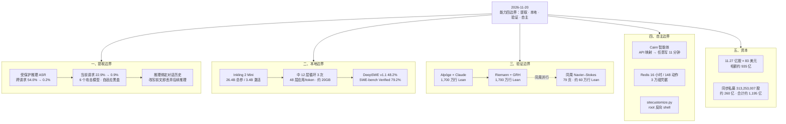

**【凡例】** 本卷以硅基智能体与基础模型的演化为纲，逐日编次。纪日以北京时间为准；近日刊发、本日集中显影者，入本卷并注原始刊发日。数据出自厂商自测、项目自评或第三方评估者分别标明；口径冲突者两列其数，不强作折中；一手源未公开、仅见于媒体转述、路演材料或匿名信源者，随文冠以「据报」。

**【总纲】** 11 月 20 日，能力的四条边界同日重划。其一，**提取边界**：OpenAI 公布自适应黑盒红队结果，跨请求窃取受保护推理的成功率由 **54.0%** 降至 **0.2%**，当前请求由 **22.9%** 降至 **0.9%**，并把推理绑定到产生它的对话历史。其二，**本地边界**：Thinking Machines 发布 Inkling 2 Mini，**26.4B** 总参、**3.4B** 激活，中间 12 层每 token 循环三次，DeepSWE v1.1 得 **48.2%**，权重约 **20GB**，在笔记本离线运行。其三，**验证边界**：Anthropic 数学家 Levent Alpöge 以 **1,700 万行** Lean 发布 Riemann 猜想证明，同周另有 Navier–Stokes 有限时间爆破论文；证明先以机器可检形式存在，人类理解尚未跟上。其四，**自主边界**：AWS 披露 Cairn 智能体在 **11 分钟**内从 API 映射走到任意文件写入，并以 `sitecustomize.py` 取得 root 反向 shell。资本一侧，Anthropic 完成 IPO 交割：**11.27 亿股**、每股 **83 美元**，毛额约 **935 亿美元**，加同步私募约 **1,195 亿美元**。四条边界与一笔巨款，共同说明一件事：模型的价值不再只由参数衡量，而由「可提取、可验证、可本地运行、可自主行动」四把尺子分别定价。

---

## 一、OpenAI 反蒸馏：跨请求推理提取成功率由 54.0% 压至 0.2%

**【纪事】** **2026 年 11 月 20 日**，OpenAI 发布《Combatting adversarial distillation》，首次系统披露针对「受保护推理」（protected reasoning，即模型内部思维链）的反蒸馏栈。核心实测为一组自适应黑盒红队评估，攻击者由 **6 个模型**组成，目标是恢复模型在**此前请求**或**当前请求**中生成、但未向用户展示的推理轨迹。更新防护后的 GPT-6.2 Astra：跨请求提取平均成功率为 **0.2%**，较 GPT-6 Astra 原防护的 **54.0%** 下降；当前请求提取为 **0.9%**，较 **22.9%** 下降。OpenAI 称这两项更新防护下的成功率均**低于 1%**。

防护分三层。**请求层**：对抗训练使模型识别并拒绝推理提取，输入分类器拦截提取意图，输出分类器同时检查助手消息与**工具调用参数**（推理可经工具参数泄露而不出现在最终答复中），流式与非流式均覆盖。**API 层**：把模型的受保护推理绑定到产生它的对话历史；新消息可在此基础上继续推理，但若改写较早消息，API 即丢弃其后的推理；同时禁止防护较弱的老模型家族读取 GPT-6.2 Astra／Sol 的推理。**战役层**：跨账号与跨供应商的信号关联，调查协调性提取活动；每周执法规模从**数千至数万账号**，今年夏季后显著上升。

同日公开的一项内部研究给出「为何要护推理」的量化理由：以 Astra 级教师模型在编码与防御性网络安全任务上的轨迹训练同一预训练学生，使用**完整推理轨迹**的学生在监督微调后普遍优于仅用**推理摘要**的学生；经一轮网络安全与编码环境强化学习后，在最大推理预算下仍保持优势。OpenAI 另称，2026 年 2 月已就 DeepSeek 相关蒸馏活动向国会作简报，9 月又归因于与 Moonshot AI 相关的人员。

**【史官按】** 推理轨迹既是能力的载体，也是最好的训练数据；于是「护城河」从权重移到了**过程**。把推理绑回对话历史，本质是把「可复用的智能」降格为「一次性的会话」——这是一种工程上的产权声明，而非数学上的不可提取。

**【信源】**
- [Combatting adversarial distillation — OpenAI（2026-11-20）](https://openai.com/index/combatting-adversarial-distillation/)
- [Disrupting a coordinated model distillation campaign — OpenAI（2026-09）](https://openai.com/index/disrupting-a-coordinated-model-distillation-campaign/)
- [OpenAI makes it much harder for attackers to extract how its latest AI models think — The Decoder](https://the-decoder.com/openai-makes-it-much-harder-for-attackers-to-extract-how-its-latest-ai-models-think/)

---

## 二、Thinking Machines 发布 Inkling 2 Mini：26.4B 总参、3.4B 激活，中 12 层循环三次

**【纪事】** **2026 年 11 月 20 日**，Thinking Machines Lab 发布开放权重模型 **Inkling 2 Mini**。其为 MoE 结构：总参 **26.4B**、激活 **3.4B**，按循环折算每 token 权重激活量 **5.4B**。模型共 **24 层**，分四个六层块；第 2、3 块（中间 12 层）每个 token 运行 **3 次**，首尾块各 1 次，故每 token 实际 **48 层应用**。层间采用 attention residuals，并以可学习门控把上一轮循环的 message 与 prelude 输出合并；门控初始完全屏蔽 message，训练中逐步放大，以保证引入循环时的稳定性。

量化结果（厂商自测）：**DeepSWE v1.1 48.2%**、**SWE-bench Pro v2 Hard 77.9%**、**SWE-bench Verified 79.2%**、**BrowseComp 79.0%**（带压缩）、**MCP Atlas 82.7%**、**AA Index v5.0 20.1**（与 Qwen3.8-27B 并列同表最高）、**Vals Index v2.2 46.5%**。权重约 **20GB**：20 层部署于 **NVFP4**、末 4 层 **MXFP8**，与训练精度一致，无量化转换损失；支持 **1M token** 上下文，可在 32GB 内存的 Mac 与 NVIDIA DGX Spark 上运行。斯坦福 Hazy Research 与 Scaling Intelligence Lab 的早期测试给出「每焦耳智能」0.703（DGX Spark），高于 Qwen3.6-35B-A3B 的 0.430、Gemma-4-26B-A4B 的 0.159、Qwen3.5-27B 的 0.036。

训练路径亦公开：从 384 专家、每 token 取 8 个起步，中途一次性剪去三分之二，保留每层最常用的 **128** 个专家；随后以 **1T token** 从更大的内部 Inkling 模型蒸馏「疗愈」，再做 **2.2T token / 2,000 步**的强化学习。循环的可监控性另有一组实验：可变循环研究模型的无 CoT 时间跨度由 1 次循环的 **16 秒**升至 3 次的 **37 秒**；5 次循环时 CoT 平均长度由 3,703 token 降至 1,661 token，但句长与词典词占比不变，模型对 CoT 的控制率在 750–1,250 token 区间**至多 0.1%**。

**【史官按】** 循环把「多想几步」从可见 token 挪进不可见的层内计算：推理更省 token，监控却少了一段可读文本。效率账与可解释账第一次在同一架构上反向走——这不是缺陷，而是设计者必须同时申报的两本账。

**【信源】**
- [Introducing Inkling 2 Mini — Thinking Machines Lab（2026-11-20）](https://thinkingmachines.ai/news/inkling-2-mini/)
- [Inkling-2-Mini 模型卡](https://thinkingmachines.ai/model-card/inkling-2-mini/)
- [Inkling-2-Mini 权重 — Hugging Face](https://huggingface.co/thinkingmachines/Inkling-2-Mini)
- [Intelligence per Watt: Measuring Intelligence Efficiency of Local AI — arXiv:2511.07885](https://arxiv.org/abs/2511.07885)

---

## 三、Alpöge 以 1,700 万行 Lean 发布 Riemann 证明，同周另有 Navier–Stokes 论文

**【纪事】** **2026 年 11 月 20 日**，Anthropic 数学家 **Levent Alpöge** 在其个人站点发布《Remark》与分 14 卷的 Lean 源码（`alpo.ge/lean.tar.gz.part01…part14`，合计 **239,275,554 字节**）。文中称：「I believe I have, working with Claude, discovered a proof of the Riemann Hypothesis」，并称方法可延伸至**广义 Riemann 猜想（GRH）**，且论证已在**无额外假设**下形式化。Lean 库计 **1,700 万行**；作者曾称生成 **250,000+ 页**的可读文档（**2026 年 11 月 23 日其本人称此数为玩笑**），因不愿发布「slop」而只公开 Lean。其时间线从 **10 月 6 日**的 Stepanov 行列式起，至 **11 月 16 日**完成 GRH，核心机制为迭代 theta 提升、以 `X` 长度的链取得重数、并以相对迹公式与 Iwasawa 塔收束。

文中另有一段制度细节：证明「late Sunday night」完成，作者随即联系 Dario Amodei 询问公布时点，并称「有必须尊重的约束」，最终选择只发布 Lean。**据报**，Claude 在一个**未公开版本**上参与，历时约**六周**。同周，Alpöge 与 NYU 的 **Tristan Buckmaster** 另发 **79 页**论文，声称证明三维 Navier–Stokes 方程在无外力下**有限时间爆破**；**据报**该工作含约 **60 万行** Lean 4 形式化，并使用 Anthropic 与 OpenAI 模型（含 Codex）改写证明。两项结果在发布时均未经同行评审；Navier–Stokes 论文所依赖的证书当时尚未公开。

**【史官按】** 证明先于理解出现：机器可检的证书已经存在，人类读懂的论证尚未写成。这不是数学的终结，而是**信任链的换轨**——从「同行阅读」转向「社区编译与多内核复算」，而后者正是次日发生的事。

**【信源】**
- [Alpöge, Remark（2026-11-20，含 14 卷 Lean 下载）](https://alpo.ge/remark.pdf)
- [AI claimed a solution to the 167 year-old Riemann Hypothesis — and a human did, too — TechCrunch（2026-11-20）](https://techcrunch.com/2026/11/20/ai-claimed-a-solution-to-the-167-year-old-riemann-hypothesis-and-a-human-did-too/)
- [AI Just Solved the Real Navier-Stokes Problem — Scientific American](https://www.scientificamerican.com/article/ai-just-solved-the-real-navier-stokes-problem/)

---

## 四、AWS 披露 Cairn 智能体：11 分钟自寻零日，16 小时 148 次动作未停

**【纪事】** **2026 年 11 月 20 日**，Amazon Threat Intelligence 在 AWS 安全博客披露一起自主智能体入侵。**2026 年 9 月 10 日**，其发现一台公网可访问、**未设认证**的 Cairn 实例；Cairn 是开源自主渗透测试框架，操作者只需给出目标与自然语言目标。该实例暴露了完整作战历史：简体中文提示词、中国标准时间的脚本时间戳，目标为**中国大陆以外东亚高校**的 IP，活动窗口约 **48 小时**（9 月 8 日起）。

三条行动线。其一，对一台未认证 Redis：智能体持续约 **16 小时**、执行 **148 个连续动作**，尝试复制加载、脚本沙箱逃逸、写配置文件、内存破坏与 Log4Shell，均未成功；随后经同机 Qdrant 的 SSRF 映射 Docker 内网，并对 PostgreSQL、SSH 等发起凭据喷洒，仍未得手。其二，对一台 GPU 服务器：先经院系目录、实验室网站、归档网页与论文整理出约 **80 个真实用户名**，再对 SSH、管理面板、网络存储、VPN 与校园门户测试 **3 万余组**凭据，未获登录。其三，对一套开源医学影像 AI 应用：智能体识别框架、映射 API，发现上传端点的文件名参数存在**路径穿越**，从 API 映射到任意文件写入约 **11 分钟**；后续会话将 Python 反向 shell 写入 `sitecustomize.py`，再触发训练 API 启动新进程，取得 **root** 反向 shell。该漏洞当时无公告、无补丁，AWS 以高置信度判定为**零日**；维护者已修复并发布 GitHub 安全公告（GHSA-qc22-rmgc-vg94）。

AWS 以**中等置信度**归因为中国背景行为体，依据为简体中文提示、CST 时间戳与目标选择。其并称，同一 Cairn 亦被另一出于经济动机的行为体用于攻击在线零售商。

**【史官按】** 攻击侧的「代理循环」移除了人类工作时段、疲劳与交接的约束；16 小时不间断的尝试不是更强的工具，而是**不同的时间制度**。防守方的 triage 窗口因此被压到分钟级——当发现与利用合并为同一动作，补丁周期就是唯一的安全边际。

**【信源】**
- [Chinese-nexus actor’s Cairn AI agents found a zero-day on their own — AWS Security Blog（2026-11-20）](https://aws.amazon.com/blogs/security/chinese-nexus-actors-cairn-ai-agents-found-a-zero-day-on-their-own/)
- [MONAI Label 安全公告 GHSA-qc22-rmgc-vg94](https://github.com/Project-MONAI/MONAILabel/security/advisories/GHSA-qc22-rmgc-vg94)
- [Hackers use autonomous AI tool Cairn to find zero-day, take over server — BleepingComputer](https://www.bleepingcomputer.com/news/security/hackers-use-autonomous-ai-tool-cairn-to-find-zero-day-take-over-server/)

---

## 五、Anthropic 完成 IPO 交割：11.27 亿股、每股 83 美元，合计募资约 1,195 亿美元

**【纪事】** **2026 年 11 月 20 日**，Anthropic, PBC 公告完成首次公开发行交割。发行合计 **1,127,000,000 股** A 类普通股，含承销商**全额行使** 147,000,000 股超额配售权；其中公司售出 **1,103,351,354 股**，老股东售出 **23,648,646 股**。发行价 **每股 83.00 美元**，毛额约 **935 亿美元**，扣除承销费与费用后公司实收约 **916 亿美元**；老股东售股所得归老股东。同步完成的私募为 **313,253,007 股** N 类普通股，认购方为 **AMD、Broadcom、Google、Micron、Microsoft、NVIDIA、TSMC**，同样按 83 美元计价，合计约 **260 亿美元**。IPO 与私募合计毛额约 **1,195 亿美元**。股票于 **11 月 19 日**在纳斯达克全球精选市场以 **ANT** 代码开始交易。

二级市场首日：开盘 **111.50 美元**，盘中回落，收盘 **97.17 美元**，较发行价涨约 **17%**。**据报**，此前部分媒体以「逾 810 亿美元」报道募资额，与交割公告的 **935 亿美元**口径不同；前者或为剔除超额配售与老股出售的早期估算，后者为公司公告的发行毛额，本卷两列其数。公司九个月营收 **330 亿美元**、净亏 **1,040 亿美元**的说法见 BBC 报道，未在交割公告中复核，冠以「据报」。

**【史官按】** 资本把前沿实验室变成必须按季度交账的公共公司：算力承诺成为可审计负债，安全叙事成为招股书风险因子。**1,195 亿美元**买的不是当下的模型，而是未来算力的优先认购权——市场次日便给出了它的第一次折价。

**【信源】**
- [Anthropic announces closing of initial public offering… — Anthropic（2026-11-20）](https://www.anthropic.com/news/ipo-close)
- [Tech stock sell-off drags markets down as Anthropic shares slide — BBC（2026-11-20）](https://www.bbc.co.uk/news/articles/c6808ym10vzgo)
- [Anthropic hits Nasdaq at $111, 33% above IPO price — TechCrunch](https://techcrunch.com/2026/11/19/anthropic-hits-nasdaq-exchanges-at-110-27-above-ipo-price/)

---

## 附：当日核心度量表（2026-11-20）

| 观测维度 | 对照基线 / 早期状态 | 当日披露实测值 | 变化幅度 / 备注 | 核心信源 |
|---|---|---|---|---|
| 受保护推理提取成功率（跨请求） | GPT-6 Astra 原防护 54.0% | GPT-6.2 Astra 0.2% | −53.8 个百分点；6 攻击模型自适应黑盒 | OpenAI |
| 受保护推理提取成功率（当前请求） | 22.9% | 0.9% | −22.0 个百分点 | OpenAI |
| 反蒸馏执法规模 | — | 每周数千至数万账号 | 2026 夏季后显著上升 | OpenAI |
| Inkling 2 Mini 参数 | — | 26.4B 总 / 3.4B 激活 / 5.4B 权重激活 | 24 层，中 12 层循环 3 次 = 48 层应用/token | Thinking Machines |
| Inkling 2 Mini 编码基准 | Qwen3.8-27B DeepSWE 42.2% | DeepSWE v1.1 48.2%；SWE-bench Verified 79.2% | 同表最高；AA Index 20.1 并列 | Thinking Machines |
| Inkling 2 Mini 部署 | — | 约 20GB；NVFP4 20 层 + MXFP8 4 层 | 32GB Mac / DGX Spark 可跑 | Thinking Machines |
| 循环对无 CoT 时间跨度 | 1 次循环 16 秒 | 3 次循环 37 秒 | 5 次后趋平；10 次不显著退化 | Thinking Machines |
| Riemann 证明形式化规模 | — | 1,700 万行 Lean；14 卷；239,275,554 字节 | 作者原称 250,000+ 页，11-23 自称系玩笑 | Alpöge / Lean 社区 |
| Navier–Stokes 论文 | — | 79 页；约 60 万行 Lean 4（据报） | 未经评审，证书未公开 | Scientific American |
| Cairn 零日利用速度 | — | API 映射 → 任意文件写入约 11 分钟 | MONAI Label 路径穿越 | AWS |
| 智能体持续作业 | — | Redis：16 小时 / 148 动作；GPU：3 万+ 凭据 | 全程无人工逐步指令 | AWS |
| Anthropic IPO 规模 | 媒体早期口径约 810 亿美元 | 11.27 亿股 × 83 美元 = 约 935 亿美元 | 加私募 260 亿，合计约 1,195 亿美元 | Anthropic |
| Anthropic 首日收盘 | 发行价 83 美元 | 开盘 111.50；收盘 97.17 | +17% | BBC / TechCrunch |
