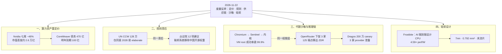

**【凡例】** 本卷以硅基智能体与基础模型的演化为纲，逐日编次。纪日以北京时间为准；近日刊发、本日集中显影者，入本卷并注原始刊发日。数据出自厂商自测、项目自评或第三方评估者分别标明；口径冲突者两列其数，不强作折中；一手源未公开、仅见于媒体转述、路演材料或匿名信源者，随文冠以「据报」。

**【总纲】** 11 月 22 日，四条度量线同日给出不利读数。其一，**算力资产重定价**：Nvidia 七周累计 **−46%**、市值蒸发约 **2.6 万亿美元**（单日跌幅与 SEC 审查已见 11-21 卷，本卷不复述）；CoreWeave 以 **470 亿美元**债务、明年到期 **100 亿美元**、单季净亏 **7.09 亿美元**，把「GPU 抵押融资」的久期风险摊开。其二，**规则滞后**：联合国《特定常规武器公约》128 方在日内瓦谈至凌晨，最终只同意「以协商一致方式拟订」文书，未获约束性谈判授权，时限推至 **2028 年**。其三，**供应链与沙箱同时失守**：众议院联合报告以 **12 项建议**要求把中国开源权重模型逐出联邦系统与关键基础设施；NebuSec 以 Chromium→Sentinel→Linux 内核三段链取得用户 VM 的 root，成功率 **>99.9%**；OpenRouter 下架 **3 家**推理商、把 **125 个端点**移出零留存资格。其四，**硅前设计**：Architect Labs 称其 AI 系统端到端设计出 CPU「Frostbite」，25 个工作负载几何平均 **4.59×** 每瓦性能，但尚无流片。定价、规则、供应链、沙箱、设计，五者共同显示：能力已可被精确度量，承载能力的制度与基础设施仍按旧周期运转。

---

## 一、Nvidia 七周跌 46%、市值蒸发约 2.6 万亿美元；CoreWeave 470 亿美元债务承压

**【纪事】** Nvidia 已连续七个交易日、七个周线下跌，**据报**为 2008 年以来最长周线连跌；单日跌幅与 SEC 会计审查见本通鉴 **11 月 21 日**卷，本卷只记周线结构。七周累计跌幅 **46%**，市值蒸发约 **2.6 万亿美元**，剩余约 **3 万亿美元**，位列 Apple、Microsoft、Alphabet 之后；其前瞻市盈率约 **8.4 倍**，而 AMD 为 **29 倍**。公司此前公布的季度业绩超预期，并给出下一财年 **75%** 营收增长指引，仍未止跌；背景包括联合创始人 **Jensen Huang** 于 **11 月 12 日**因个人行为违反公司行为准则而辞职，以及市场对 AI 资本开支可持续性的疑虑。

同日，《卫报》以 CoreWeave 为样本拆解「GPU 抵押债务」结构：公司债务自夏季约 **350 亿美元**升至 **470 亿美元**，**逾 100 亿美元**明年到期，下一季度利息支出预计突破 **10 亿美元**；第三季度营收约 **36 亿美元**、净亏 **7.09 亿美元**。NVIDIA 持有其约 **11%** 股份，并另有 **63 亿美元**的「未售出算力」回购安排；CoreWeave 称已获 **1,325 亿美元**合同承诺、活跃容量 **1.7GW**。贷款以 GPU 加客户合同作抵押，GPU 折旧假设为 **六年**；**据报**，部分债权人曾评估其五年内违约概率超过 **60%**。

**【史官按】** 当芯片被用作抵押品，算力资产的折旧周期就变成了系统性风险：模型迭代越快，抵押物贬值越快。Nvidia 的跌幅不是对芯片需求的否定，而是市场第一次为「谁来承担折旧」定价；而 CoreWeave 的资产负债表，正是这条链条上最薄的一环。

**【信源】**
- [Nvidia stock plunges 14%, wraps up longest weekly losing streak since 2008 financial crisis — CNBC（2026-11-20）](https://www.cnbc.com/2026/11/20/nvidias-7-week-losing-streak-is-longest-since-2008-financial-crisis.html)
- [‘Little room for error’: what a debt-laden cloud computing company says about the AI boom — The Guardian（2026-11-21）](https://www.theguardian.com/business/2026/nov/21/debt-laden-cloud-computing-company-coreweave-ai-boom)
- [CoreWeave Reports Strong Third Quarter 2026 Results — CoreWeave](https://investors.coreweave.com/news/news-details/2026/CoreWeave-Reports-Strong-Third-Quarter-2026-Results/default.aspx)

---

## 二、联合国自主武器谈判未获约束性授权：128 方仅同意 2028 年前「协商拟订」

**【纪事】** 谈判于 **2026 年 11 月 21 日**凌晨近 5 时破裂，各方文本与细节于 **22 日**陆续披露。日内瓦《特定常规武器公约》（CCW）为期一周的谈判结束，未能就「具有法律约束力的条约」取得谈判授权。因 CCW 采**协商一致**规则，128 个缔约方最终通过的文本仅要求各国「**以协商一致方式拟订**」（elaborate by consensus）一份国际文书，未使用「谈判」一词，亦未明确是否载有法律义务；目标时限为 **2028 年**。**据报**，俄罗斯以冗长阻挠主导反对；美国、以色列、白俄罗斯、英国等对约束性授权持保留，韩国、日本、土耳其、英国、法国、德国等更倾向非约束性安排。逾 **100 国**此前支持约束性条约；奥地利、比利时、巴西、爱尔兰、墨西哥、新西兰、巴拿马七国主张一年内启动谈判。

背景数据：CCW 因共识门槛，过去 **30 年**未通过任何新的武器管制法律；自主武器议题已被讨论 **13 年**以上。**据报**，以色列与美国已在加沙与伊朗使用 AI 辅助目标系统，五角大楼在伊朗战争首日打击逾 **1,000** 个目标，并有报道称美军目标为每小时 **1,000** 次 AI 辅助瞄准决策。Stop Killer Robots 称结果为「最低共同分母」。

**【史官按】** 共识制把「最低共同分母」写成了程序：不是没有规则意愿，而是任何一方都可按规则阻止规则。自主武器已在战场部署，而约束它的文书最早 2028 年才成形——制度的时间常数，第一次被明确测得比技术的部署周期更长。

**【信源】**
- [International UN talks on controlling use of autonomous weapons collapse — The Guardian（2026-11-21）](https://www.theguardian.com/technology/2026/nov/21/international-talks-control-ai-autonomous-weapons-collapse)
- [States Agree to UN Talks Aiming to Regulate ‘Killer Robots’ by 2028 — Reuters via US News（2026-11-21）](https://www.usnews.com/news/world/articles/2026-11-21/states-agree-to-un-talks-aiming-to-regulate-killer-robots-by-2028)
- [U.N. Fails to Regulate Lethal Autonomous Weapons, but Plans to Try Again — The New York Times（2026-11-21）](https://www.nytimes.com/2026/11/21/world/europe/un-lethal-autonomous-weapons.html)
- [Guterres calls for a legally binding instrument for ‘killer robots’ — UN News（2026-11-16）](https://news.un.org/en/story/2026/11/1168810)

---

## 三、众议院联合报告：12 项建议要求联邦系统移除中国开源权重模型

**【纪事】** **2026 年 11 月 20 日**，美国众议院国土安全委员会主席 **Andrew Garbarino** 与美中特别委员会主席 **John Moolenaar** 发布联合调查报告，主题为中国开发的**开源权重模型**进入美国消费平台、企业软件与敏感系统所带来的国家安全、网络安全与经济风险，并提出 **12 项政策建议**。调查自 **2026 年 4 月**启动，与三家公司通信取证：**Airbnb** 在客服中使用阿里巴巴模型；**Anysphere** 的 Cursor 旗舰专有模型建立在 **Moonshot AI** 基座之上（**据报**为 Kimi K2.5）；**DoorDash** 报告已授权并部署多个中国模型家族。

建议要点：启动国家级「美国开源权重 AI 计划」；建立**模型来源标准**与「AI 物料清单」；把联邦限制**从 DeepSeek 扩至所有中国开发模型**，禁止其进入联邦系统与联邦合同工作，并从关键基础设施的高风险功能中移除；禁止用联邦网络安全 grant 资金采购此类模型；设立开发者级 AI 威胁通报渠道；让 CISA 成为 AI 网络事件单一报送点。报告称，中国开发者通过代理网络与虚假账号批量获取美国前沿模型输出以复刻能力，并点名美国数据标注公司为其训练供数。

**【史官按】** 竞争从「模型能力」转向「模型来源可证」：开放权重第一次被当作**供应链**而非公共品处理。代价是明确的——若没有同价位、同能力的本土替代，禁令只会把采用推向更难追踪的灰色渠道；报告自己也在第 1 项建议里承认了这一点。

**【信源】**
- [Chairmen Garbarino, Moolenaar Release Joint Investigative Report… — House Committee on Homeland Security（2026-11-20）](https://homeland.house.gov/2026/11/20/chairmen-garbarino-moolenaar-release-joint-investigative-report-urging-removal-of-prc-open-weight-models-from-federal-systems-high-risk-critical-infrastructure/)
- [联合报告全文（PDF）](https://homeland.house.gov/wp-content/uploads/2026/11/2026.11.20-Joint-Report-PRC-AI-Models.pdf)
- [Cursor weighs phasing out Chinese AI models: House report — CNBC](https://www.cnbc.com/2026/11/20/cursor-chinese-ai-models-geopolitical-risk.html)

---

## 四、NebuSec 三段链穿透 Meta Muse：Chromium → Sentinel → 内核，取得用户 VM 的 root

**【纪事】** **2026 年 11 月 20 日**，NebuSec 披露对 Meta 云端个人智能体 **Muse** 的三段式利用链，本日经聚合源集中转引。Muse 原设计为多层隔离：每用户独立 **VM**、VM 内运行时**容器**、监控出网流量的 **Sentinel** 审批服务、以及置于代理执行环境之外的**凭据管理服务**。

攻击链：其一，利用 Muse 内置 Chromium 的漏洞，让智能体导出攻击者控制的网页，从而在**运行时容器内取得代码执行**；其二，分析 Sentinel 对出网请求的分类与检查弱点，将对话历史与持久记忆发往外部服务器而**不触发审批提示**，并可**篡改**已存记忆与历史；其三，以自动化漏洞利用框架生成 Linux 内核利用，逃逸容器并在**用户 VM 内取得 root**，暴露持久存储、凭据存储与 Sentinel 本身，且出网流量不再受容器级 Sentinel 约束。NebuSec 称，该内核利用在测试运行中成功率 **超过 99.9%**；整个攻击未越过 VM 边界到 hypervisor，也未影响其他租户。所有漏洞在披露前已由 Meta 修复；Meta 未公开确认修复范围或是否发生数据窃取。

**【史官按】** 沙箱的强度等于其**最弱一层**：浏览器漏洞给执行，网络策略漏洞给外传，内核漏洞给凭据——三层各自「按设计工作」，合起来仍是一条完整杀伤链。据此，代理安全的评估单位不应是「容器是否隔离」，而应是「任一层被攻破后，损失能否被限制在该层」。

**【信源】**
- [Hacking Muse: Stealing Private Chats Through Browser Use — NebuSec（2026-11-20）](https://nebusec.ai/research/meta-muse-credential-exposure)
- [Inside Meta Muse: Browser, Sentinel and the Shared-Kernel Boundary — NebuSec（技术细节）](https://nebusec.ai/research/inside-meta-muse.md)
- [A Single Malicious Webpage Let Researchers Hijack Meta Muse and Access Private Chats — The Hacker News](https://thehackernews.com/2026/11/a-single-malicious-webpage-let.html)

---

## 五、OpenRouter 下架 3 家推理商、125 个端点移出零留存；Dragos 200 万 canary 查出 3 起泄露

**【纪事】** **2026 年 11 月 22 日**，OpenRouter 公告：依据 Dragos 的 canary token 研究，**下架 3 家推理供应商**、将 **125 个端点**移出「零数据留存」（ZDR）资格（含被研究者点名者及预防性移除），并通知可能受影响客户；恢复 ZDR 前须提供保证与验证。公告确认 OpenRouter 自身未被入侵，问题出在上游供应商。

Dragos（**11 月 19 日**发布）在 **2026 年 7 月至 11 月**间投放约 **200 万条**含唯一 canary 凭据与 URL 的提示词，结论三项：至少 **3 家** AI 供应商的数据被入侵，约 **200 个** AWS 密钥被窃并用于**数万次** AWS API 调用；推理市场中的转售商仅靠开启日志即可查看并留存客户提示，无需漏洞；多家供应商未遵守隐私设置，一家中国实验室的抓取器访问了发往其模型的**过半**提示中的 secret URL，其中约**三分之二**标记为「不收集数据／ZDR」；一条链接在请求发出 **24 天**后出现在飞书群并被京沪六台设备打开。

供应商公告：**Phala** 称 DeepSeek V4 Flash 0731 的请求数据在 **10 月 21 日 00:00 至 11 月 8 日 05:35 UTC** 窗口可能暴露，11 月 8 日完成遏制；**Together AI** 称其公开 `xorl` 仓库中，一个 **AI 编码智能体**提交了可访问私有 Hugging Face 仓库的凭据，导致 MiniMax M3、GLM-5.2、Kimi K2.6 的提示样本被下载（样本主要来自 6 月 24 日、7 月 4 日、7 月 8 日、7 月 14 日），并称已将新账户 ZDR 设为默认。

**【史官按】** 推理路由是一条**无人审计的多跳链**：每一次转发都能看到完整提示，而「零留存」只约束第一跳。Dragos 的方法值得记下——不是读政策，而是埋可追踪的假凭据，让数据自己交代去向；这是把供应链审计从合规文件改为**实测**。

**【信源】**
- [Data Processing Incidents on Inference Providers — OpenRouter（2026-11-22）](https://openrouter.ai/blog/announcements/data-processing-incidents-on-inference-providers/)
- [Three breaches, endless leaks: Your AI supply chain needs canaries — Dragos（2026-11-19）](https://www.dragos.com/blog/ai-supply-chain-security-canary-tokens)
- [Phala November Preliminary Incident Report — Phala（2026-11-10）](https://phala.com/posts/phala-november-preliminary-incident-report)
- [Security event: Prompt leakage for requests in June and July of 2026 — Together AI（2026-11-21）](https://www.together.ai/blog/security-event-prompt-leakage-for-requests-in-june-and-july-of-2026)

---

## 六、Architect Labs 称 AI 端到端设计 CPU「Frostbite」：4.59× 每瓦性能，尚未流片

**【纪事】** Architect Labs 于 **2026 年 11 月 18 日**发文（本日集中显影），称其 AI 系统在**无架构先验**条件下，端到端完成 **Frostbite** 通用 CPU 的指令集、微架构、RTL、验证与最终 GDS。架构基于**交互网**（interaction nets）：程序为节点图，计算通过局部重写完成；每个值恰有一个属主，无共享可变状态，故无需乱序执行、缓存一致性等机制；并行性由程序结构直接暴露。设计流程自建形式化规格语言 **ASL**，可机器检查地在 RTL、系统模型、UVM、SVA 之间转换，并原生翻译为 Lean；最终 **31 个模块**的 ASL 合同展开为 **80 万行以上** Lean。代理群在四轮搜索与最终消融中尝试 **58** 个想法、保留 **37** 个。

结果（**硅前**，25 个工作负载：10 个搜索集、15 个留出集）：几何平均 **4.59×** 每瓦性能；搜索集 **6.02×**、留出集 **3.83×**；每面积性能平均 **8.77×**。一个 Frostbite quad（2×2 tile 加四个 L3 节点）面积 **0.792 mm²**，对照的传统双发射顺序 CPU 核为 **0.895 mm²**（同工艺、型号依法不便披露）。7nm 工艺，综合后 **800 MHz**、最终 GDS **500 MHz**。能耗结构：对照核 **57%** 用于存储、**27%** 用于取指译码发射；Frostbite quad 分别降至 **38%** 与 **6%**，但新增 **26%** 的片上网络与调度开销。未流片；设计文件与 ISA 计划后续公开；外部研究者尚无法实测。

**【史官按】** 设计空间的搜索成本被代理群压低，于是「架构」本身成了可采掘对象——这是 AI 首次把优化目标从内核上移到**指令集与硅片布局**。但 pre-silicon 的 4.59× 仍需流片裁决：在芯片领域，仿真与硅之间隔着的从来不是小数点，而是良率、功耗与时间。

**【信源】**
- [Introducing Frostbite: A new CPU architecture discovered, designed, and verified end-to-end by AI — Architect Labs（2026-11-18）](https://architectlabs.com/blog/frostbite)
- [Architect Labs claims AI-designed CPU delivers 4.59x performance per watt in simulations — Mezha](https://mezha.net/eng/news/mezha-9917ab8da1757f23cf7909d8_architect_labs_claims)

---

## 附：当日核心度量表（2026-11-22）

| 观测维度 | 对照基线 / 早期状态 | 当日披露实测值 | 变化幅度 / 备注 | 核心信源 |
|---|---|---|---|---|
| Nvidia 周线 | — | 连续 7 周下跌；七周 −46% | 据报为 2008 年以来最长周线连跌 | CNBC |
| Nvidia 市值 | — | 蒸发约 2.6 万亿美元 | 余约 3 万亿美元，列第四 | CNBC |
| Nvidia 估值 | AMD 前瞻 29× | 约 8.4× 前瞻市盈率 | 单日跌幅与 SEC 审查见 11-21 卷 | CNBC |
| CoreWeave 债务 | 夏季约 350 亿美元 | 470 亿美元；明年到期逾 100 亿 | 单季净亏 7.09 亿；利息支出逾 10 亿/季 | Guardian |
| UN CCW 结果 | 逾 100 国支持约束性条约 | 128 方仅同意「elaborate by consensus」 | 时限 2028；未获谈判授权 | Guardian / Reuters |
| CCW 历史 | — | 30 年未通过新武器管制法；议题讨论 13 年+ | 共识制为程序性瓶颈 | Guardian |
| 众议院报告建议 | — | 12 项 | 联邦系统与合同工作禁用中国模型 | House Homeland Security |
| 对美采用实证 | — | Airbnb（阿里模型）、Anysphere（Moonshot 基座）、DoorDash（多家族） | 调查自 2026-04 启动 | House Homeland Security |
| Muse 沙箱逃逸 | 容器 + VM + Sentinel + 凭据隔离 | 内核利用成功率 >99.9% | 未越 VM/hypervisor；披露前已修 | NebuSec |
| OpenRouter 处置 | — | 下架 3 家；125 端点移出 ZDR | 恢复须验证；自身未被入侵 | OpenRouter |
| Dragos canary | 约 200 万条提示，7–11 月 | 3 家供应商泄露；约 200 个 AWS 密钥被窃 | 数万次 API 调用；ZDR 被无视 | Dragos |
| Phala 暴露窗口 | — | 2026-10-21 00:00 — 11-08 05:35 UTC | DeepSeek V4 Flash 0731 | Phala |
| Frostbite 每瓦性能 | 传统双发射顺序核 | 25 负载几何平均 4.59× | 搜索集 6.02×；留出集 3.83× | Architect Labs |
| Frostbite 面积 / 工艺 | 对照核 0.895 mm² | quad 0.792 mm²；7nm | 综合 800 MHz；GDS 500 MHz；未流片 | Architect Labs |
