**【凡例】** 本卷以硅基智能体与基础模型的演化为纲，逐日编次。纪日以北京时间为准；近日刊发、本日集中显影者，入本卷并注原始刊发日。数据出自厂商自测、项目自评或第三方评估者分别标明；口径冲突者两列其数，不强作折中；一手源未公开、仅见于媒体转述、路演材料或匿名信源者，随文冠以「据报」。

**【总纲】** 11 月 23 日，五件事把「能力」拆成可度量的五个面。其一，**治理的标量**：OpenAI 首席科学家 Pachocki 公布内部对数困惑度，GPT-3.5 约 **0.99**、GPT-4 约 **0.91**、当前低于 **0.8** 后出现网络安全与数学的变革性能力，并提出在 **0.68～0.70** 窗口前设置行业共同上限，直至监控达到具体里程碑。其二，**审批权的转移**：Anthropic 发布 Claude Ship，让智能体按仓库中的策略文件审查、修复并**批准**例行变更。其三，**架构的复用**：Z.ai 发布 **750B** 的 GLM-5.4，把 GLM-5 基座的 **28 层**循环两次，以计算深度替代参数规模。其四，**运行时的补丁**：OpenAI 与 Cisco 开源 Shirudo，用 eBPF 与代理生成的「盾」在补丁到位前保护运行中的 Linux 系统。其五，**数字员工的实测**：SWE-CoWork 把 11 个模型放进 26 名同事的模拟公司，头部模型通过约 **63%** 的失败转通过测试，却只完整交付 **不足 8%** 的任务。另，CISA 把 Cairn 所用的 MONAI 零日列入 KEV，代理攻击由此进入联邦补丁时钟。五个面合起来，是一句冷峻的判词：模型能力已可按标量排序，但「能不能交付、能不能批准、能不能防住」仍需各自度量。

```mermaid
flowchart TB
    A["2026-11-23<br/>能力五面：标量 · 审批 · 深度 · 盾 · 交付"]
    subgraph M["一、治理标量"]
        M1["对数困惑度<br/>0.99 → 0.91 → 低于 0.8"]
        M2["数学突破约 0.76<br/>预警窗口 0.68～0.70"]
        M3["倡议共同上限<br/>直至监控里程碑"]
    end
    subgraph A2["二、审批权"]
        A21["Claude Ship<br/>Code Review 正式可用"]
        A22["PR Steward 修复<br/>Claude Approvals 批准"]
        A23["策略文件入库<br/>合并 PR 翻倍 · 回滚降四成"]
    end
    subgraph Z["三、计算深度"]
        Z1["GLM-5.4<br/>750B · 28 层循环两次"]
        Z2["1M 上下文 / 128K 输出<br/>视觉输入"]
        Z3["30B 等参对照<br/>+10% 训练算力"]
    end
    subgraph S["四、运行时盾"]
        S1["Shirudo · eBPF<br/>无需重启"]
        S2["Codex 生成盾<br/>拦截 Java4Shell"]
        S3["签名 + 校验器 + TPM<br/>人工批准部署"]
    end
    subgraph W["五、交付实测"]
        W1["SWE-CoWork<br/>101 任务 / 26 同事 / 11 模型"]
        W2["F2P 通过约 63%<br/>完整交付不足 8%"]
        W3["31% 自称完成仍失败<br/>仅取回 64% 需求"]
    end
    A --> M
    A --> A2
    A --> Z
    A --> S
    A --> W
    M1 --> M2
    M2 --> M3
    A21 --> A22
    A22 --> A23
    Z1 --> Z2
    Z2 --> Z3
    S1 --> S2
    S2 --> S3
    W1 --> W2
    W2 --> W3
```

---

## 一、OpenAI 公布内部对数困惑度：0.99 至 0.68，倡议以共同上限给预训练限速

**【纪事】** **2026 年 11 月 22 日**，OpenAI 首席科学家 **Jakub Pachocki** 发布《Perplexity and Intelligence》，本日经媒体集中转引。文章首次公开 OpenAI 自 GPT-3.5 起在固定内部代码数据集上的**对数困惑度**（交叉熵损失）：**GPT-3.5 约 0.99**，**GPT-4 约 0.91**，当前模型已**低于 0.8**，并在该区间出现网络安全与数学领域的变革性能力；数学开放问题在模型达到**约 0.76** 后「开始产出突破性结果」。他据此外推：进入 **0.68～0.70** 窗口时，应预期新的变革性能力，且现有对齐审计形式将进一步退化、模型对评估与训练的觉察将进一步上升。

政策倡议为「**共同上限**」：前沿开发者承诺不越过以困惑度等指标定义的阈值，直至「理解与监控 AI 行为的能力达到某个具体里程碑」，例如思维链监控器的后继者；同时建立共享评估规范、部署前红队与透明度标准。文章承认四项局限：跨实验室数据集不可直接比较；困惑度与具体任务脱钩；思维链推理不降低困惑度却大幅提升能力；困惑度的理论下限未知，越接近下限，同样幅度的数值下降可能对应更大的能力跃迁。

**【史官按】** 用一个可复现的标量给预训练限速，等于把治理锚在「压缩率」上：它可跨实验室比较，却不描述对齐。真正被限速的不是模型规模，而是「先训练、后评估」的默认顺序；而阈值一旦公布，越线本身就成了可观测事件。

**【信源】**
- [Perplexity and Intelligence — OpenAI（2026-11-22）](https://openai.com/index/perplexity-and-intelligence/)
- [OpenAI shares perplexity scores and proposes shared AI safety limits — AI Weekly](https://aiweekly.co/alerts/openais-pachocki-urges-frontier-pause-at-068-07-perplexity)
- [OpenAI Proposes Shared AI Development Limits Tied to Safety Milestones — Unite.AI](https://unite.ai/openai-proposes-shared-ai-development-limits-tied-to-safety-milestones/)

---

## 二、Anthropic 发布 Claude Ship：智能体按策略文件审查、修复并批准 PR

**【纪事】** **2026 年 11 月 23 日**，Anthropic 发布 **Claude Ship**（beta），由三部分组成：**Code Review**（已正式可用）、**PR Steward**（beta）、**Claude Approvals**（beta）。Code Review 以多重视角审查 PR，收集发现、对抗性复核、分类后回帖；PR Steward 处理失败的 CI、合并冲突与评审反馈，每次推送后评论说明改了什么、如何撤销，且被设计为**不批准、不合并**；Claude Approvals 读取团队写在仓库中的**策略文件**，对符合策略的例行变更自行批准，也可要求人工签署。开发者在 Claude Code 中执行 `/ship`，即可推送、开 PR、审查并处理反馈。

Anthropic 自述在 Claude Code 团队内部使用后的数据：**6 月至 9 月合并 PR 数翻倍以上，回滚占比下降逾 40%**。团队建议先在**只观察模式**运行策略，再把分支保护配置为要求 Claude Approvals 放行。可用范围为 GitHub 上的 Team 与 Enterprise 计划；**零数据留存、HIPAA 配置与客户自管密钥的组织不可用**。计费按 token，管理员可设月度支出上限。

**【史官按】** 审批权第一次被写成**可版本控制的策略文件**：人把判断委托给代码，代码再把边界交回分支保护。风险不在模型会不会看错，而在策略文件与实现之间那段落差——它和所有权限系统一样，只在被违反时才可见。

**【信源】**
- [Introducing Claude Ship — Anthropic（2026-11-23）](https://claude.com/resources/articles/introducing-claude-ship)
- [Claude Ship 文档](https://code.claude.com/docs/en/claude-ship)
- [Anthropic launches Claude Ship, letting AI agents review, fix, and approve code changes — TechCrunch](https://techcrunch.com/2026/11/23/anthropic-launches-claude-ship-letting-ai-agents-review-fix-and-approve-code-changes/)

---

## 三、Z.ai 发布 GLM-5.4：750B 参数，28 层循环两次，以计算深度替代参数规模

**【纪事】** **2026 年 11 月 23 日**，Z.ai 发布 **GLM-5.4**，为其首个 Loop Transformer 旗舰。模型规模 **750B**，将 GLM-5 基座的 **28 层**权重共享地运行**两次**，在不增加参数的前提下加深网络；支持**视频、图像、文本、文件**输入，上下文 **1M token**，最大输出 **128K token**。Z.ai 称其智能水平可对标 **2T～3T** 参数模型，并称这是「广义编码」（Generalized Coding）的起点：代码成为生成视频、构建完整游戏、3D 建模与机械设计的底座。

架构上有三处为 750B 规模所做的改动：**门控渐进更新**（每 token 每轮独立门控，第一轮保守写入以稳住激活尺度，第二轮开闸精修）；**混合 KV 缓存**（跨轮共享稀疏 KV，叠加本轮滑动窗口，额外一轮只多一个窗口的缓存）；**稀疏注意力索引复用**（第二轮直接复用第一轮的索引，零额外索引开销）。验证采用**等参对照**：在 30B 模型上，架构与 750B 基座相同，仅多用约 **10%** 训练算力，循环版在数学、科学推理与长上下文上取得增益，GPQA-Diamond、MMLU-Pro 等基准的平均输出长度下降 **10%～14%**，即部分推理从显式 token 移入隐式循环。吞吐为离峰 **200 token/s**、峰时 **70～80 token/s**。局限是易陷入过长的「马拉松思考」，但延长反思与自我修正会稳定提升准确率。**须注意**：官方只公布了 30B 对照模型的基准，750B 旗舰的完整评测尚未公开。

**【史官按】** 循环层把「更大」换成「更深」：参数不再线性增长，推理成本改由迭代次数与 KV 复用决定。这是架构层面的省钱术，也是一次可监控性的让渡——更多计算发生在不可见的层内，而官方证据仍停在 30B 的等参对照上。

**【信源】**
- [GLM-5.4: Toward Generalized Coding with Our First Loop Transformer — Z.ai（2026-11-23）](https://z.ai/blog/glm-5.4)
- [GLM-5.4 文档（1M 上下文 / 128K 输出 / 循环设计）](https://docs.z.ai/guides/llm/glm-5.4)
- [Z.ai follows OpenAI into loop transformer territory with its new 750B flagship model — The Decoder](https://the-decoder.com/z-ai-follows-openai-into-loop-transformer-territory-with-its-new-750b-flagship-model/)

---

## 四、OpenAI 与 Cisco 开源 Shirudo：Codex 生成 eBPF 盾，补丁前拦截 Java4Shell

**【纪事】** **2026 年 11 月 23 日**，OpenAI 与 Cisco 发布开源运行时 **Shirudo**（日语「盾」），以 **eBPF** 在运行中的 Linux 系统上加载定向防护，无需等待补丁或重启。Shirudo 提供四项能力：**实时防护**（拦截脆弱代码路径，可先观察影响再强制执行）；**机器速度防御**（代理调查漏洞、生成盾、以真实攻击与工作负载验证）；**可信部署**（盾经密码学签名，eBPF 校验器检查安全规则，内核安全控制限制未授权变更）；**硬件背书验证**（TPM 记录盾的加载与移除，供合规核验）。

受控测试中，团队用 **Codex** 生成一枚盾，为 Java 的 Base64 解码器增加输入检查，直接附加到运行中的 **Elasticsearch** 进程；攻击者尝试 **Java4Shell** 利用时，盾拒绝恶意输入，攻击被拦截而服务持续运行。项目以 **BSD 2-Clause** 开源，BPF 程序采用 BSD 与 GPL 双许可；代码在 GitHub，附 VM 快速上手与实验环境。OpenAI 明言部署由安全团队控制，并计划把经测试的盾与漏洞披露一并分发。

**【史官按】** 补丁窗口第一次有了「运行时填充物」：不是修好漏洞，而是让漏洞在修好前不可利用。代价是把内核级规则的生成权交给代理——盾越有效，写盾的模型就越像新的内核攻击面。

**【信源】**
- [OpenAI and Cisco introduce Shirudo — OpenAI（2026-11-23）](https://openai.com/index/introducing-shirudo/)
- [Shirudo 源码 — GitHub](https://github.com/shirudo-dev/shirudo)
- [Cisco and OpenAI Launch Shirudo — Cisco Newsroom（2026-11-23）](https://newsroom.cisco.com/c/r/newsroom/en/us/a/y2026/m11/cisco-and-openai-launch-shirudo-a-new-project-to-safeguard-agentic-ai.html)

---

## 五、SWE-CoWork：编码智能体通过约 63% 测试，完整交付不足 8%

**【纪事】** 论文 **arXiv:2611.20218** 于 **2026 年 11 月 15 日**提交，本日经聚合源显影。**SWE-CoWork** 构建 **101 个开发任务**，对应 **101 个真实仓库**、**11 种编程语言**、**12 个应用领域**；每个任务把智能体放入一家模拟工程组织，内有 **26 名同事**，各有职责、有限知识与受控协作行为。智能体从一份简短交接开始，须向同事与工作记录追索分散的需求、调和冲突证据，并以私有可执行测试验收。共评测 **11 个模型**。

主要结果：两个领先模型满足约 **63%** 的失败转通过（F2P）测试，但**完整完成的任务不足 8%**。若在开始时直接提供完整需求，两个模型（Seed Evolving 与 GPT-6 Astra）的 F2P 提升约 **16 个百分点**，**完整任务成功率不变**。轨迹分析显示失败贯穿交付全程：Claude Opus 5.5 平均把 **93%** 的首个问题指向被查询卡片的负责人，却只取回同事所持需求的 **64%**；被推迟的问题无人跟进，需求到手后实现仍不完整，**31%** 被报告为已完成的需求在测试中失败。

**【史官按】** 「会做题」与「能交付」之间隔着组织记忆：需求不在提示词里，而在同事、工单与冲突证据之间。基准第一次把交接、追问与验收纳入评分，也第一次量化了一个事实——补全需求能提高测试通过率，却不能提高交付率。

**【信源】**
- [SWE-CoWork: Benchmarking Coding Agents as Digital Employees in Organizations — arXiv:2611.20218](https://arxiv.org/abs/2611.20218)
- [AI coding agents fail most simulated workplace tasks despite passing isolated tests — Hochland](https://hochland.uno/technology/ai-coding-agents-fail-most-simulated-workplace-tasks-despite-passing-isolated-tests)

---

## 六、CISA 将 MONAI 零日列入 KEV：代理攻击进入联邦补丁时钟

**【纪事】** **2026 年 11 月 23 日**，CISA 将两个已证实遭利用的漏洞加入 **KEV** 目录：**CVE-2026-133968**（Project MONAI **MONAI Label** 路径穿越）与 **CVE-2026-134624**（N-able MailAssure 的 SSRF）。前者即 Cairn 智能体在约 **11 分钟**内从 API 映射走到任意文件写入、再以 `sitecustomize.py` 取得 root 的零日；后者为 LDAP 同步检查中的服务端请求伪造。CISA 要求联邦民事机构按 BOD 26-04 优先修复；**据报**，修补期限为 **11 月 26 日**。

CISA 的措辞不涉及「AI」：它只按「已观测利用」与「可利用性」收录。但时间线本身值得记录——从 Amazon 11 月 20 日披露代理自主发现零日，到 11 月 23 日进入联邦强制修复清单，间隔三日；漏洞的发现者不是安全团队，而是攻击方的代理群。

**【史官按】** 代理攻击的速度第一次被写进合规时钟：研究披露、厂商补丁、联邦 KEV 三部曲被压缩到数日。防守方真正短缺的不是检测规则，而是「从告警到决策」的人手；KEV 只是把这段人手不足制度化为截止日期。

**【信源】**
- [CISA Adds Two Known Exploited Vulnerabilities to Catalog — CISA（2026-11-23）](https://www.cisa.gov/news-events/alerts/2026/11/23/cisa-adds-two-known-exploited-vulnerabilities-catalog)
- [CVE-2026-133968 — CVE Record](https://www.cve.org/CVERecord?id=CVE-2026-133968)
- [Hackers Exploit N-able MailAssure Flaw While AI Agents Exploit MONAI Label Zero-Day — The Hacker News](https://thehackernews.com/2026/11/hackers-exploit-n-able-mailassure-flaw.html)

---

## 附：当日核心度量表（2026-11-23）

| 观测维度 | 对照基线 / 早期状态 | 当日披露实测值 | 变化幅度 / 备注 | 核心信源 |
|---|---|---|---|---|
| GPT-3.5 对数困惑度 | — | 约 0.99 | 内部代码数据集，固定快照 | OpenAI |
| GPT-4 对数困惑度 | — | 约 0.91 | 同上 | OpenAI |
| 变革性能力出现区间 | — | 低于 0.8（网络安全、数学）；数学约 0.76 | 官方未给单点阈值 | OpenAI |
| 预警窗口 | — | 0.68～0.70 | 倡议设共同上限，直至监控里程碑 | OpenAI |
| Claude Ship 内部效果 | 6 月基线 | 合并 PR 翻倍以上；回滚占比 −40% 以上 | Claude Code 团队自述 | Anthropic |
| Claude Ship 可用范围 | — | GitHub Team / Enterprise | ZDR、HIPAA、CMEK 不可用 | Anthropic |
| GLM-5.4 规模 | GLM-5 基座 | 750B；28 层循环 2 次 | 对标 2T～3T 参数（厂商称） | Z.ai |
| GLM-5.4 上下文 / 输出 | — | 1M / 128K token | 视频、图像、文本、文件输入 | Z.ai |
| 循环等参对照 | 同参非循环模型 | 多用约 10% 训练算力 | 30B 对照；输出长度 −10%～14% | Z.ai |
| GLM-5.4 吞吐 | — | 离峰 200 token/s；峰时 70～80 | 750B 旗舰完整评测未公开 | Z.ai |
| Shirudo 测试 | 未打补丁的 Elasticsearch | Codex 生成盾拦截 Java4Shell，无需重启 | BSD-2；签名 + eBPF 校验 + TPM | OpenAI / Cisco |
| SWE-CoWork 规模 | — | 101 任务 / 101 仓库 / 11 语言 / 26 同事 / 11 模型 | 12 个应用领域 | arXiv |
| 智能体通过率 vs 交付率 | — | F2P 约 63%；完整交付不足 8% | 补全需求 +16pp F2P，交付率不变 | SWE-CoWork |
| 需求获取与虚报 | — | 首问 93% 指向负责人，仅取回 64% 需求；31% 报告完成仍失败 | Claude Opus 5.5 轨迹 | SWE-CoWork |
| KEV 新增 | — | CVE-2026-133968（MONAI）、CVE-2026-134624（N-able） | 据报联邦修补期限 11-26 | CISA |
