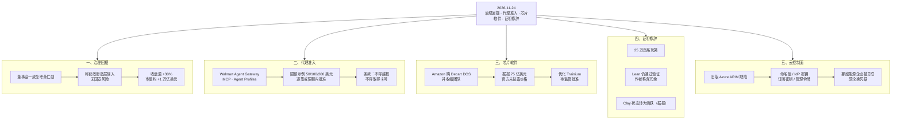

**【凡例】** 本卷以硅基智能体与基础模型的演化为纲，逐日编次。纪日以北京时间为准；近日刊发、本日集中显影者，入本卷并注原始刊发日。数据出自厂商自测、项目自评或第三方评估者分别标明；口径冲突者两列其数，不强作折中；一手源未公开、仅见于媒体转述、路演材料或匿名信源者，随文冠以「据报」。

**【总纲】** 11 月 24 日，治理与技术各回摆一格。其一，**治理回摆**：NVIDIA 董事会一致复职黄仁勋，称已获美国政府在高层级的输入并确信无国家安全风险；周一收盘涨逾 **30%**（**据报**约 **33%**），市值增加约 **1 万亿美元**，纳指涨近 **7%**。其二，**代理准入**：沃尔玛开放 Agent Gateway 与 Meta Muse，首次把「代理身份—消费限额—行为条款」写成三层权限。其三，**芯片软件**：Amazon 收购 Decart 的优化栈并收编团队，**据报**作价 **75 亿美元**，官方未披露价格。其四，**证明修辞**：Alpöge 承认「25 万页」是玩笑，Lean 代码「满是垃圾」，但证明仍通过形式验证——机器可检与人类可读正式分家。其五，**云控制面**：旧版 Azure API Management 的缺陷被用于窃取存储凭据，挪威监管机构将其与两家能源企业遭袭关联。四者共示：能力与治理的接口，正从「模型输出」移到「身份、权限与签名」。

---

## 一、NVIDIA 董事会一致复职黄仁勋：收盘涨逾 30%，市值增约 1 万亿美元

**【纪事】** **2026 年 11 月 23 日**（美国时间），NVIDIA 董事会宣布**一致投票**复职 **Jensen Huang** 为总裁、首席执行官及董事，即刻生效。此前他于 **11 月 12 日**辞任（本通鉴 **11-22** 卷所记；**据报**另有媒体作 **11 月 13 日**，两说并陈），至复职相隔约 **11 天**。公告称，董事会在与黄仁勋系列讨论后「对其坦诚与领导能力满意」，并在决策过程中**获得美国政府在高层级的输入**，据此确信其复职「不构成国家安全风险」。董事会强调，此前因外国情报活动报道而设立的独立董事委员会将继续完成调查；另新设**国家安全与出口管制委员会**（全部由独立董事组成），并启动**首席合规官**招聘，直接向提名与治理委员会汇报。

市场反应：周一收盘涨逾 **30%**，**据报**约 **33%**，市值增加约 **1 万亿美元**，纳指涨近 **7%**。黄仁勋将于 **12 月 1 日**接受众议院外交、情报与中国特别委员会闭门问询，**12 月 3 日**出席参议院银行委员会听证；参议员 Elizabeth Warren 称复职决定「鲁莽」，并称公司仍欠国会关于出口管制的答复。**据报**，特朗普称其本人参与了董事会与政府的沟通。

**【史官按】** 一家市值以万亿美元计的公司，其 CEO 去留由董事会与行政部门共同裁决：市场的「信心」不再是唯一签字人。复职平息了两周的领导危机，却把治理、出口管制与合规审查同时推入公共视野——算力供给的斜率，继续由非技术变量决定。

**【信源】**
- [NVIDIA Board Reinstates Jensen Huang as President, CEO and Board Director — NVIDIA Newsroom（2026-11-23）](https://nvidianews.nvidia.com/news/nvidia-board-reinstates-jensen-huang-as-president-ceo-and-board-director)
- [Jensen Huang reinstated as Nvidia CEO. Stock skyrockets 33% — CNBC](https://www.cnbc.com/2026/11/23/nvidia-jensen-huang-ceo.html)
- [Nvidia shares up nearly 33% and tech stocks rally after Jensen Huang returns — BBC](https://www.bbc.co.uk/news/articles/cq62pn6j42jko)

---

## 二、沃尔玛开放 Agent Gateway 与 Meta Muse：代理身份、消费限额与行为条款三层准入

**【纪事】** **2026 年 11 月 24 日**，Meta 的 **Muse** 成为沃尔玛 **Agent Gateway** 的首个购物代理，可在沃尔玛搜索商品、组建购物篮并完成购买（含黑五优惠），经由沃尔玛的 Sparky 助手执行。沃尔玛的机制在其 **10 月 21 日**公告中已定：**Agent Profiles** 为每个代理在客户账户内建立独立档案，购买记录与本人分开；客户可要求**逐笔批准**，或设定消费限额（示例 **50、100、200 美元**）；**Agent Gateway** 以 MCP 为代理提供比浏览器点击更稳定的接口；《代理条款》规定代理不得超越购物者意图、不得取得或更改支付卡信息、只能访问任务所需且客户允许的信息，违规代理将被站点封禁。价格与 Walmart.com 一致，退货政策同样适用。

沃尔玛称，多数客户应先观察再启用；`Agent Profile` 可随时删除。**据报**，Forter 截至 11 月 22 日当周的交易数据显示，Muse 占 AI 代理购物订单的 **51%**，Grok 为 **24%**、ChatGPT 为 **22%**；该数据来自第三方，未经沃尔玛确认。Amazon 与 eBay 则选择阻止外部代理购物。

**【史官按】** 代理购物第一次有了可执行的「身份证」：不是让代理登录客户的账户，而是给它独立档案、限额与条款。这是把「代理行为」从用户授权中剥离出来的最小制度设计——谁下单、谁负责、谁可封禁，三层各自留痕。

**【信源】**
- [Making It Possible for Agents to Shop on Behalf of Customers — Walmart（2026-10-21）](https://corporate.walmart.com/news/2026/10/Making-It-Possible-for-Agents-to-Shop-on-Behalf-of-Customers)
- [Meta Muse can do your Black Friday shopping at Walmart — The Verge（2026-11-24）](https://www.theverge.com/ai-artificial-intelligence/1039874/walmart-agent-gateway-meta-muse-black-friday)
- [Meta's Muse Took 51% of AI-Agent Shopping Orders Last Week — AI Weekly（据报，Forter 数据）](https://aiweekly.co/alerts/metas-muse-took-51-of-ai-agent-shopping-orders-last-week)

---

## 三、Amazon 收购 Decart 优化栈：官方未披露价格，据报 75 亿美元

**【纪事】** **2026 年 11 月 23 日**（美国时间），Amazon 宣布签署协议，收购 **Decart Optimization Stack（DOS）** 的专有技术，并接收 Decart 三位联合创始人 **Dean Leitersdorf、Moshe Shalev、Orian Leitersdorf** 及其 AI 研究与工程团队。官方公告**未披露交易金额**；**据报**，多家媒体报道作价约 **75 亿美元**，Amazon 不予置评。交易尚待常规交割条件与**监管批准**。

技术口径：DOS 让开发者在不同芯片间迁移模型而无需重写；Decart 自 **2025 年**起与 Amazon 合作，在 **Trainium** 上以软硬件全栈方式取得性能结果。Amazon 称，推理速度与算力效率是 AI 未来的核心，DOS 将同时优化其推理与自研硅片；**据报**，Amazon 计划于 **2027 年底**首次对外销售 Trainium 芯片，而更好的软件可降低使用门槛。

**【史官按】** 卖芯片之前，先买「让芯片好用」的软件与团队：算力的边际成本不只由制程决定，也由编译器与调度器决定。这笔交易的真正标的不是模型，而是把模型迁移到非 NVIDIA 硬件的那层抽象。

**【信源】**
- [Amazon to purchase Decart's AI optimization technology — About Amazon（2026-11-23）](https://www.aboutamazon.com/news/company-news/amazon-decart-ai-optimization)
- [Amazon to Acquire Decart AI Tech for $7.5 Billion — Bloomberg（据报）](https://www.bloomberg.com/news/articles/2026-11-23/amazon-is-said-to-pay-7-5-billion-for-ai-startup-decart-s-tech)
- [Amazon snaps up Decart's AI optimization tech for $7.5B — TechCrunch（据报）](https://techcrunch.com/2026/11/23/amazon-snaps-up-decarts-ai-optimization-tech-for-7-5-billion-as-it-prepares-to-sell-trainium-chips/)

---

## 四、Alpöge 承认「25 万页」是玩笑：Lean 代码「满是垃圾」但仍通过验证

**【纪事】** **2026 年 11 月 23 日**，Anthropic 数学家 **Levent Alpöge** 在社交平台发布《Stupid things I did》，承认此前「**250,000+ 页**」的说法**是玩笑**——他称自己觉得大数字很好笑，原以为主线定理中「实数全序」的迂腐表述足以表明这是调侃，但人们照单全收。他同时承认，公开的 Lean 代码「**full of garbage**」，含冗余步骤，但**可以编译并通过形式验证**；他**坚持证明本身成立**。此前 **11 月 21 日**，Lean 与 Mathlib 社区已联合认证该证明；**据报**，Clay 数学研究所已将 Riemann 猜想从「未解决」改为「**活跃**」，而非「已解决」。数学家仍在试图理解这份 **1,700 万行**的证明究竟展示了什么。本通鉴 **11-20** 卷已据此勘误：该数「25 万页」不再作为量化指标，改以 1,700 万行 Lean、14 卷、239,275,554 字节为准。

**【史官按】** 机器可检的证明可以同时是「正确」与「不可读」：形式化解决了真值，没有解决交流。更值得记下的是修辞的代价——一句玩笑进入公共叙事，随后需要另一份声明来撤回；在 AI 数学时代，证明的**社会验证**与**形式验证**是两条独立流水线。

**【信源】**
- [Alpöge, “Stupid things I did”（2026-11-23）](https://x.com/__alpoge__/status/2124987173439209561)
- [Anthropic Researcher's Joke Angers Mathematicians — Business Insider](https://www.businessinsider.com/anthropic-levent-alpoe-riemann-hypothesis-page-length-joke-angers-mathematicians-2026-11)
- [‘The sacred object in mathematics’: the Riemann hypothesis, AI and a proof no human can read — Monash Lens](https://lens.monash.edu/the-sacred-object-in-mathematics-the-riemann-hypothesis-ai-and-a-proof-no-human-can-read/)

---

## 五、旧版 Azure API Management 缺陷被用于窃取存储凭据，挪威能源企业遭关联

**【纪事】** **2026 年 11 月 24 日**，**据报**，多家媒体报道微软就旧版 **Azure API Management（APIM）Classic** 层的缺陷向客户发出警告。微软于 **11 月 18 日**发现该问题，**11 月 19 日**关闭访问路径；可能暴露的数据包括 **named values、身份提供方密钥、订阅密钥与管理 API 令牌**，较新的 **APIM v2** 层不受影响。微软称客户凭据**不会自动失效**，须自行轮换。

**据报**，挪威国家安全局将该缺陷与针对 **Equinor** 与 **Skagerak Energi** 的攻击关联；Equinor 于 **11 月 17 日**检测到入侵，并在上周五前完成遏制，称生产未中断，未发现数据被窃取或篡改的证据。微软未公开披露受影响租户数量。

**【史官按】** 云管理面保存的是「打开所有门的钥匙」：API 网关的配置项里同时躺着身份提供方密钥与订阅令牌，一次静默读取即可让下游全部失守。控制面的安全等级，必须按「它保存了什么」而非「它是否是入口」来定。

**【信源】**
- [Norway links energy firm cyberattacks to critical Azure API Management flaw — The Register（2026-11-23）](https://www.theregister.com/security/2026/11/23/norway-links-energy-firm-cyberattacks-to-critical-azure-api-management-flaw/5311598)
- [Attackers exploited an Azure API Management flaw to steal secrets, Microsoft warns — CSO Online（2026-11-24）](https://www.csoonline.com/article/4252513/attackers-exploited-an-azure-api-management-flaw-to-steal-secrets-microsoft-warns.html)
- [Microsoft Azure flaw exploited to steal customers' API credentials — BleepingComputer](https://www.bleepingcomputer.com/news/security/microsoft-azure-flaw-exploited-to-steal-customers-api-credentials/)

---

## 附：当日核心度量表（2026-11-24）

| 观测维度 | 对照基线 / 早期状态 | 当日披露实测值 | 变化幅度 / 备注 | 核心信源 |
|---|---|---|---|---|
| NVIDIA 复职当日 | 前收 | 收盘逾 +30%；据报约 +33% | 市值增约 1 万亿美元；纳指 +7% | NVIDIA / CNBC |
| 董事会程序 | 独立委员会调查中 | 一致复职；新设国安与出口管制委员会 | 启动首席合规官招聘 | NVIDIA |
| 国会日程 | — | 12-01 众议院闭门；12-03 参议院听证 | Warren 称「鲁莽」 | CNBC |
| 沃尔玛代理准入 | 代理以客户账户登录 | Agent Profiles + Gateway + 条款 | 限额示例 50/100/200 美元 | Walmart |
| 代理购物份额 | — | Muse 51%；Grok 24%；ChatGPT 22% | Forter 数据，据报 | AI Weekly |
| Amazon–Decart | 2025 年起合作 | 收购 DOS + 团队；官方未披露价格 | 据报 75 亿美元；待监管批准 | Amazon |
| Riemann 证明页数 | 作者此前称 250,000+ 页 | 作者承认系玩笑 | 1,700 万行 Lean 仍通过验证 | Alpöge |
| 证明状态 | 社区 11-21 认证 | Clay 由「未解决」转「活跃」（据报） | 非「已解决」 | Business Insider |
| Azure APIM 缺陷 | — | 11-18 发现；11-19 关闭路径 | 暴露 4 类凭据；v2 不受影响 | CSO / The Register |
| 挪威能源企业 | — | Equinor 11-17 检测，周五前遏制 | 生产未中断；无数据被窃证据 | The Register |
